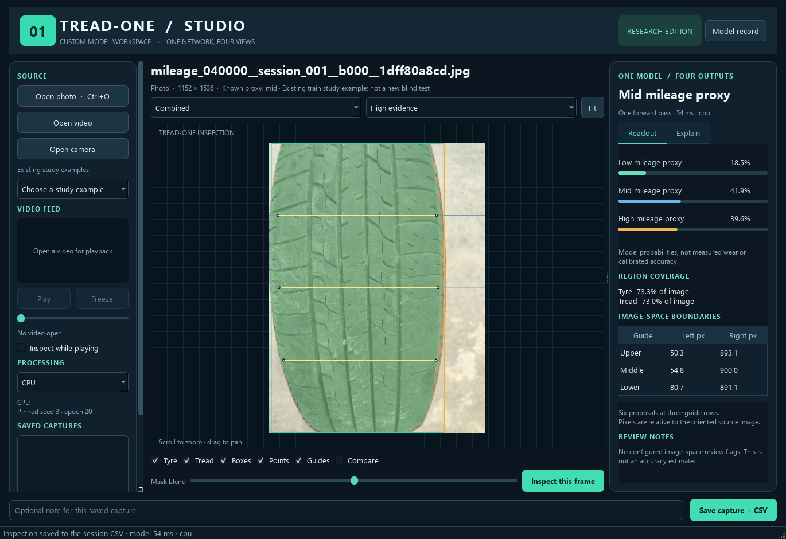
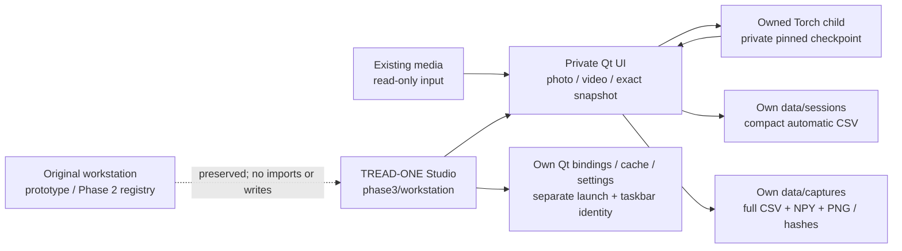

# TREAD-ONE Studio — independent workstation delivery

## Current workstation

TREAD-ONE is now one tab of the unified Phase 3 workstation. The other tab
hosts the original model bench, with shared frame handoff and separate
evidence formats. The implementation record below describes the initial
TREAD-ONE delivery.
[Current launcher and guide](workstation/README.md).

**29 October 2026. User scope: existing data only; no more tyre photos will be
collected.** This supersedes the earlier assumed acquisition campaign. The
current deliverable is an independent native desktop window for the already
trained custom model. Its known scientific limits remain documented.

## Open and use

The application is in **[workstation/](workstation/README.md)**. Double-click
**[Launch TREAD-ONE Studio.cmd](workstation/Launch%20TREAD-ONE%20Studio.cmd)**.
It activates `cv_conda`, opens the separate window and inspects a labelled
existing training example. Then use any existing photo or recorded video.
No additional NB07 run or new training is needed.

The new window has a dark/teal visual identity, its own icon and a separate
Windows taskbar application ID. The original workstation can remain open.
No original source, launcher, selected-model registry or model switch was edited.

## What is implemented

| Capability | Actual behavior |
|---|---|
| Source input | Existing photos, drag/drop, seven available historical split/class examples, recorded videos; optional explicit camera button |
| Single-model inference | One pinned TREAD-ONE forward produces class probabilities, masks, points, signed evidence, concepts and gate |
| Classification | Low/mid/high **mileage proxy** probabilities; actual argmax preserved |
| Segmentation | Overlapping tyre/tread masks, visibility toggles and blend control |
| Localisation | Enclosing thresholded mask boxes; no separate detector substituted |
| Boundary geometry | Six ordered proposals at three fixed rows, with native-pixel readout |
| Explanation | Signed class-logit heatmaps, separate bias/positive/negative accounting, 12 latent texture views and tread attention |
| Image inspection | Original, combined, masks, boundaries, signed evidence, gate and latent channel; zoom/pan/fit and interactive comparison wipe |
| Video | Decode, play/pause, seek, freeze and bounded live snapshot inference; preview separate from analysed frame |
| Frame identity | Request ID, model-input SHA and source generation prevent stale overlays |
| Automatic retention | Per-prediction, class, point, region, latent-summary and event CSVs in an independent session folder |
| Full saved capture | Ten CSV tables / **245,784 rows**, ten native arrays, five PNGs, schema, metadata and hash manifest |
| Restore | All hashes checked; stored pixels/outputs/notes restored without another model forward |
| Device / ownership | Auto GPU/CPU, explicit CPU/GPU choice, private supervised Torch process; shutdown stops only owned work |

The original workstation's multi-model and calibrated-target alignment tools
remain in their original application. This separate window presents actual
TREAD-ONE outputs and image-space geometry; it does not invent physical angles.

## Which checkpoint is installed

| Field | Fixed selection |
|---|---|
| Model | TREAD-ONE r1, 1,372,159 parameters |
| Seed / epoch | **3 / 20** |
| Why | Previously declared original joint-validation winner |
| Weights SHA-256 | `a5b872ed2e4cbfb3b9782b0df563e2606631744cd0274fee2da42a832f985f65` |
| Source revision | `a0296f18e02b12d28f7e51377783d68538032209` |
| Model architecture | Exact copied frozen source, verified against the original source contract |
| Desktop precision | FP32, no autocast, TF32 disabled |
| Selection changes | None; the NB05 projected candidate was not substituted |

This is a separate experimental application, not a declaration that TREAD-ONE
outperforms the existing installed models. The historical selected export has
50% balanced accuracy, 98.419% mean Dice and 1.196% image-width human-point error
on the small existing low/high holdout. Every selected r1 model missed the low
test tyre; held-out mid support is absent. The model record in the UI retains
these limitations. Desktop FP32 outputs need not be bit-identical to earlier
Kaggle mixed-precision outputs.

The existing 570-image / 12-tyre study remains the dataset. No independent
subjects or human truth were manufactured. The NB07 prospective-readiness
result remains historically false; it is not a gate preventing this authorized
desktop inference application.

## Isolation and data flow

| Folder | Ownership |
|---|---|
| `workstation/*.py` | New UI, engine, transport, renderer and direct evidence sources |
| `workstation/models/` | Private exact model implementation, model record and 5.27 MiB weights |
| `workstation/.vendor/` | Approximately 185.8 MiB of already installed Qt bindings copied locally; no package upgrade |
| `workstation/.cache/` | This application's errors/worker logs |
| `workstation/data/` | This application's sessions, settings and explicit captures |
| `workstation_validation/` | Preparation/source-isolation baseline, real model/UI checks, screenshots and engineering-only fixtures |

The app does not import `prototype/bootstrap.py` or change `phase2/workstation/ACTIVE`.
Application-managed paths stay under its own folder. Torch remains the existing
cv_conda 2.5.1+cu121 installation. Dataset examples are read from their original
source package; they are not relabelled or added to a new training manifest.

## Direct CSV retention

| Family | Rows per full capture |
|---|---:|
| Prediction / classes / points / regions / latent mass | 1 / 3 / 6 / 2 / 12 |
| Mask probabilities / segmentation logits | 24,576 / 24,576 |
| Signed class evidence | 36,864 |
| Twelve latent texture maps | 147,456 |
| Tread gate | 12,288 |
| **Total** | **245,784** |

Every dense value is present in CSV and native no-pickle NPY. Source and
model-input PNGs preserve preprocessing inputs. `CSV_SCHEMA.json` records
grains/columns/units, while `CAPTURE.json` records coordinate rules, full source
identity, app-source hashes, software/device/precision and missing-reference
scope. `MANIFEST.json` binds the files with byte counts and SHA-256.

Each completed inference also appends 24 compact scalar/geometry/channel rows
to its session CSV families, plus events as appropriate. Full maps are saved
on explicit **Save capture + CSV**, rather than for every video snapshot.
Ground-truth accuracy, Dice and point error remain blank for workstation inputs;
no confidence score is relabelled as accuracy. The native-coordinate tables are
predictions, not independently measured physical wear/alignment.

Captures remain **local**, with directly browsable files suitable for a later
authorized publication. The desktop app has no token lookup or automatic media
upload. Earlier completed training/audit evidence stays on HF. No new training
or Kaggle deliverable was introduced by the workstation implementation.

## Validation

| Check | Result / evidence |
|---|---|
| Pinned real model + capture retention | [ENGINE_VALIDATION.json](workstation_validation/ENGINE_VALIDATION.json): 12 checks pass |
| Frozen-reference fidelity | All ten CPU output arrays have **maximum difference 0.0** on the existing real-image fixture |
| GPU/CPU comparison | Max probability difference 0, point difference 1.49e-8, mask difference 4.77e-7 on that fixture; FP32 comparison, not a latency/accuracy study |
| Full CSV fidelity | All **245,760 dense CSV values** reconstruct their native arrays exactly; schema/count/unknown-metric and corruption checks pass |
| Native-widget workflow | [UI_VALIDATION.json](workstation_validation/UI_VALIDATION.json): 14 integration checks pass using the actual owned worker |
| UI / video cases | Source-change stale-result rejection; all render modes; no reinference on display controls; save/restore; decode/seek/freeze/live snapshots; clean owned shutdown |
| Visual inspection | Actual widget screenshots inspected; a Windows offscreen missing-font issue was fixed by per-process system-font registration |
| Display scaling | Compact-desktop check keeps button text readable; source/capture sidebar scrolls instead of compressing controls |
| Actual Windows launch | [Native readiness](workstation_validation/TREAD_ONE_Studio_Native_Final.json) and [actual native preview](workstation_validation/TREAD_ONE_Studio_Native_Final.png); final launcher opens the separate Qt Windows window and runs GPU inference |
| Original workstation preservation | [ORIGINAL_BASELINE.json](workstation_validation/ORIGINAL_BASELINE.json): all 47 recorded source/launcher/registry files remain byte-identical |
| Original study records | Original Markdown, frozen training source and executed notebooks are checked again in the final delivery audit |

The test video is explicitly an **engineering fixture derived from an existing
image**, not new tyre data. Camera hardware was not tested. Checks show software
fidelity and workflow correctness; they do not establish improved classification
or independent real-world performance.

## Current next action

Use the separate TREAD-ONE Studio window with existing media and save the
captures you want to retain. The original workstation remains available.
No additional photos, NB07 rerun or model training is required for this step.

[User guide](workstation/README.md) · [Technical architecture](workstation/ARCHITECTURE.md) ·
[Full evidence definitions](workstation/EVIDENCE_SCHEMA.md).

Final delivery checks: [DELIVERY.json](workstation_validation/DELIVERY.json).
The recorded capture contains 28 files / 11,676,919 bytes (about 11.1 MiB).
All 47 original workstation/registry files, 103 original Markdown files,
27 frozen experiment files, nine r1 runtime files and earlier executed notebooks
remain preserved. The final launcher was exercised with the real Windows Qt
platform and actual GPU inference; no additional data collection is planned.
