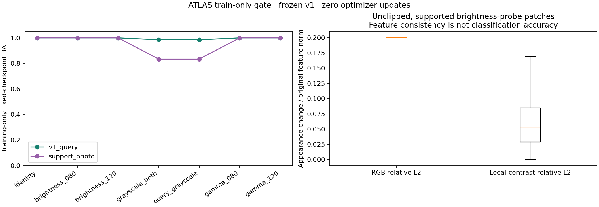
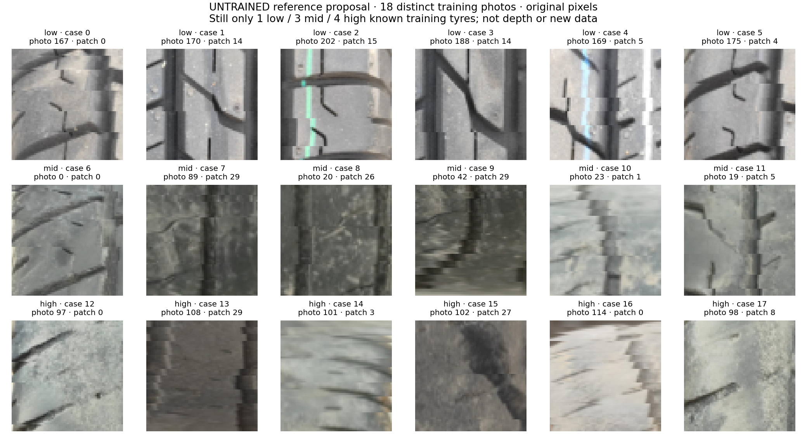
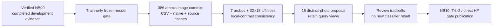

# TREAD-TWO — training-only appearance/reference gate

<!-- NB10_LC_UPDATE_20261030 -->
## Latest status — NB10 closed; NB11 ready, 30 October2026

NB10 is completed and independently HF-verified:495 direct files,1,918,052 scientific rows,386native training records,T4×2,zero fitting/held-out forwards and released ownership. No NB10 rerun is needed. [Completion proof](phase3NB10Completion.md).

The older local results below remain a dated local record. Actual Kaggle results and environment-specific values are in [NB10 completion](phase3NB10Completion.md). The next step is the separate LC model,not repeating this gate or installing its bank into v1.

Next is [NB11 / ATLAS-LC r2](notebooks/phase3_NB11_TREAD_TWO_ATLAS_LC_Resumable_Pilot.ipynb): one separately versioned seed,paired LC views,18-photo source-SHA exclusions,all386queries and sqrt-size group sampling. Local batch8 recovery/package checks pass; actual Kaggle/live-HF preflight and measured accuracy remain pending. Use T4×2,Internet,the existing expanded Kaggle dataset and HF_TOKEN. [Architecture](phase3TreadTwoLCArchitecture.md), [protocol](phase3TreadTwoLCProtocol.md).

<!-- END_NB10_LC_UPDATE -->
**30 October 2026.** Following the [verified NB09 publication](phase3NB09Completion.md),
the next gate is implemented and fully executed **locally** on all existing
training images. The selected v1 classifier and dense anchor remain frozen.
No validation/test image was forwarded, no model was fitted, and no workstation
was changed. Actual dual-T4/HF gate execution is the next user-run NB10 step.

## Completed local work

| Item | Actual local result |
|---|---|
| Source images | **386 train-role images**: 378 original v1 queries plus eight original support photos |
| Frozen checkpoint | Original v1 seed1 / selected epoch18; native hash in the new contract |
| Probes | Seven fixed post-atlas appearance variants; **2,702 predictions** |
| Raw scientific retention | Eight direct CSV families / **1,918,052 rows** |
| Native retention | All 386 original atlas RGB/valid/grid, frozen masks/points, descriptors, source hashes and probe records |
| Reference proposal | **18 cases from 18 distinct training photos**; structural check passes |
| Known original training tyres | Still **1 low / 3 mid / 4 high**; no new independent tyre |
| Remaining query coverage | Every known training tyre retains at least one original photo; proposed query pool 368 images |
| Snapshot | 489 manifest objects, **1,909,948,028 bytes**, about 1.91 GB; no ZIP/NPZ/database |
| New fitting / held-out forwards | **0 optimizer updates / 0 validation or test forwards** |
| Local environment | cv_conda, Torch 2.5.1+cu121, GTX1650; both branches share the one local GPU |
| Kaggle delivery | [Self-contained NB10](notebooks/phase3_NB10_TREAD_TWO_Train_Only_Appearance_And_Reference_Gate.ipynb), four code cells / 36 embedded files |

[Full local verification](tread_two/gate_validation/FULL_VALIDATION.json),
[recovery/role acceptance](tread_two/gate_validation/VALIDATION.json),
[exact rules](tread_two/appearance_gate/RULES.json),
[schema and counts](tread_two/appearance_gate/SCHEMA.md).
The row count is independently checked; it is derived evidence, not new
independent training subjects or additional fitting steps.

## What the training-only probes show

| Frozen selected v1 · 378 query images | Accuracy | Balanced accuracy |
|---|---:|---:|
| Identity | 100.000% | 100.000% |
| Query brightness ×0.8 | 100.000% | 100.000% |
| Query brightness ×1.2 | 100.000% | 100.000% |
| Query gamma exponent0.8 | 100.000% | 100.000% |
| Query gamma exponent1.2 | 100.000% | 100.000% |
| Grayscale query + bank | 99.206% ·375/378 | 98.485% |
| Query-only grayscale | 99.206% ·375/378 | 98.485% |

Support photos are kept separate: identity/brightness/gamma accuracy is 8/8;
both grayscale conditions are 6/8, with BA 83.333%. These support inputs are not
independent validation examples. The new forward path uses fixed selected
weights and per-image head batches, not the original online augmented sampled
training observations; its metrics must not be substituted for the old logs.

The training views remain easy for v1, while the previously inspected low/high
endpoint failed under the saved appearance probes. **A train-only probe pass
does not prove unseen-tyre transfer.** No new endpoint result was generated to
choose these rules or references.

## Local contrast improves a narrow, measurable property

The proposed four channels are masked local normalized luminance, Sobel x/y
and gradient magnitude. A 9×9 window, std floor 0.02 and clipping ±3/3 are fixed
in advance. This is a deterministic texture representation, not a trained
classifier, depth estimate or physical groove measurement.

| Unclipped, ≥95%-supported patches | Patch count | Median RGB relative L2 | Median local-contrast relative L2 |
|---|---:|---:|---:|
| Low, brightness ×0.8 | 2,144 | 0.2000 | **0.0443** |
| Mid, brightness ×0.8 | 7,873 | 0.2000 | **0.0698** |
| High, brightness ×0.8 | 2,240 | 0.2000 | **0.0543** |
| Low, brightness ×1.2 | **337** | 0.2000 | **0.0230** |
| Mid, brightness ×1.2 | 6,327 | 0.2000 | **0.0516** |
| High, brightness ×1.2 | 1,630 | 0.2000 | **0.0199** |

These dimensionless relative feature distances use each representation's own
original norm. They demonstrate reduced feature response under this particular
brightness perturbation, not improved class accuracy. Brightening leaves only
337 of 2,144 low-class patches in the reported unclipped supported subset; this
selection matters. All patches, clipping values and other variants remain in
the raw CSVs. The std floor, flat regions, valid masks, clipping and gamma
nonlinearity limit exact equivariance.

## Reference diversity improves, but query scarcity remains

The proposal chooses six cases per proxy class, one per distinct original
training photo. It balances available known tyre counts before maximizing
fixed local-contrast descriptor diversity with coverage/glare terms. It never
uses held-out images or model scores to choose cases. Low texture is retained
and flagged, rather than treated as an annotation of bad wear.

| Known training tyre | Original photos | Proposed support photos | Original query photos remaining |
|---|---:|---:|---:|
| Low session001 | 67 | 6 | 61 |
| Mid40k session001 | 20 | 2 | 18 |
| Mid70k session001 | 20 | 2 | 18 |
| Mid90k session001 | 57 | 2 | 55 |
| High session001 | 3 | 2 | **1** |
| High session002 | 2 | 1 | **1** |
| High session003 | 5 | 1 | 4 |
| High session004 | 60 | 2 | 58 |

The 18 proposed support photos leave 368 possible queries, including the same
152 unresolved-parent video frames. Two high groups now have one original
query photo left. Reusing the old uniform group sampler would give each such
photo about 32.67 expected draws per 392-draw epoch, or 1,960 over 60 epochs.
This is an analytic consequence of the old sampler, **not an executed v2
training schedule**. The bank does not solve the repetition tradeoff by itself.

Visual inspection also finds visible green/blue marker lines in low cases 2/4,
and blur/stretch/glare or weak detail in several mid/high cases. The structural
pass is not an artifact-free certificate. Local luminance normalization can
retain paint as an intensity/edge pattern. The proposed bank must not be
silently installed against v1 coefficients, or advertised as shortcut-free.

## Data, recovery and verification

The independent local audit checks every manifest hash, recounts all eight
families, verifies every source role/hash, reconstructs all 8,106 logits from
saved affinities/pooling/coefficients/bias, and checks the notebook's exact
embedded sources and fresh worker. The separate recovery acceptance compares
uninterrupted and pause/native/fake-HF/fresh-process paths on real images;
scientific CSV and native values agree. Timing/allocator values are retained
but intentionally excluded from numerical equivalence claims.

Source/environment/weight drift is rejected. An image is the atomic unit; an
incomplete image is replayed. Normal publication is every 30 minutes plus
major completion and catchable Stop/error, respecting server backoff and a
protected writer lease. Forced process death cannot flush unsent work. A
different actual Kaggle environment gets its own explicit gate identity;
this local one-GPU result is not claimed as dual-T4/live-HF gate validation.

The complete native and raw CSV snapshot remains under
`tread_two/gate_validation/local_full_v1/`. The
[interactive local report](tread_two/appearance_gate_results/Training_Gate_Explorer.html)
covers all 386 training images with cohort/class/variant/search controls and
the original-pixel/local-feature proposal gallery. It shows base atlases with
the named probe scores. HTML payload/JavaScript checks are separate from a
browser-render claim. Both scientific figures were visually inspected.

## Next step

Run [NB10](notebooks/phase3_NB10_TREAD_TWO_Train_Only_Appearance_And_Reference_Gate.ipynb)
with **T4×2**, the existing expanded Kaggle dataset, Internet and **HF_TOKEN**,
then **Run All**. [Full guide](tread_two/appearance_gate/README.md).
The gate publishes raw native/CSV evidence in a new namespace and resumes from
the next committed image. No NB08/NB09 rerun or new tyre photography is needed.

After actual gate verification, freeze any new classifier's representation,
support/query ownership and repetition policy together before its one measured
fit. The results motivate a local-contrast model candidate and greater view
diversity; they do not establish better classification, calibrated scores,
physical wear/depth/alignment/safety or unseen-mid/independent-tyre validity.
