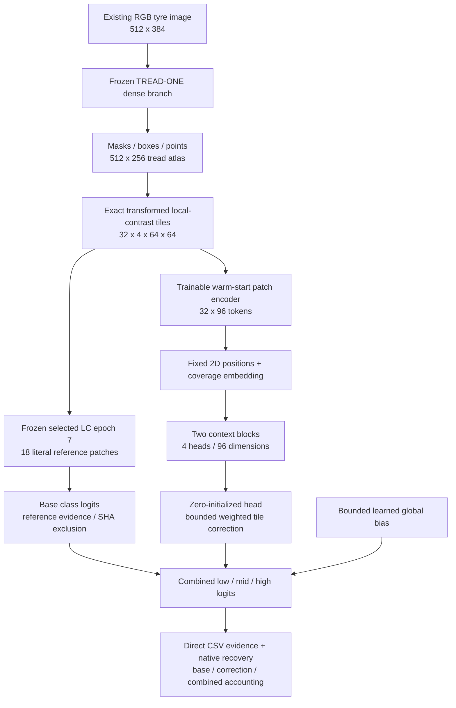

# TREAD-TWO / ATLAS-CONTEXT r3 — spatial correction with an auditable prior

<!-- NB14_COMPLETED_20261101 -->
## Completed context review — 1 November 2026

The NB13 fit and NB14 review are complete and HF-verified. All 80 review files / 52 CSVs match, and the original fit is preserved. [NB14 completion](phase3NB14Completion.md). The classifier remains unpromoted. Next is the implemented [NB15 existing-data readiness / evidence passport](phase3TreadTwoReadiness.md), not another full fit. Earlier pending-NB14 statements below describe the prior delivery. The original architecture/protocol/schema are unchanged.
<!-- END_NB14_COMPLETED_20261101 -->

<!-- NB13_COMPLETED_20261101 -->
## Superseding measured outcome — 1 November 2026

**NB13A completed and independently HF-verified:** actual recovery restored update **2,486** and reached **60 epochs / 2,940 updates** under the original protocol. All 1,503 direct files / 58,176,066 raw CSV rows, native/CSV history and all 60 unchanged frozen-prior epoch states verified; writer released. [Completion, figures and findings](phase3NB13Completion.md).

Do not rerun NB13/NB13A. Context did not repair low recall and worsened NLL; candidate remains unpromoted. Next is [NB14 CPU saved-data review](notebooks/phase3_NB14_TREAD_TWO_CONTEXT_Completed_Review.ipynb), [run guide](tread_two/context_review/README.md). Actual NB14 execution/publication pending. Earlier partial positions and pending gates in this document are dated history, preserved to explain the experiment and repair.
<!-- END_NB13_COMPLETED_20261101 -->


> Current, 31 October 2026: actual dual-T4/live-HF preflight passed; NB13 is partially trained and stopped. HF update 1,294 is verified; notebook output reaches local update 2,467. Preserve the existing session and use [the NB13A recovery instructions](phase3NB13FreezeAndRecovery.md). Earlier implementation/pending-execution statements below record the original delivery.

**Implemented for NB13; measured accuracy is pending Kaggle execution.** This is one new candidate on the existing cohort. It preserves the selected LC model and changes the hypothesis that spatial layout is available to classification. The [NB12 findings](phase3NB12Completion.md) motivate it; improved recognition is not established.

## Why this architecture follows the evidence

| Observation | Design consequence | What remains uncertain |
|---|---|---|
| LC is stable to saved appearance probes but still misses every endpoint low image | Keep its representation/prior; add capacity for information it discards | Texture layout may still be insufficient or confounded |
| Local encoder + equal-band sum discards band order | Explicit 2D token positions and attention across all 32 tiles | Architecture sensitivity does not imply learned useful layout |
| Small cohort and prior overfitting | Freeze the entire selected LC branch; bounded residual with zero initial head and magnitude penalty | Additional 231,555 parameters can still overfit identity/artifacts |
| Reference evidence alone no longer explains the full prediction | Retain base logits, per-patch correction, global bias correction, combined signed evidence and attention separately | Attention is not a causal physical explanation |
| User wants one practical, deeply logged run | Same seed/budget, sampler, recovery and Kaggle workflow | Actual T4×2/live-HF proof is still an automatic gate |

The layout check used eight existing training-photo packets and no held-out forward, new dense inference or optimizer update. [CSV](tread_two/context_validation/layout_invariance.csv), [receipt](tread_two/context_validation/LAYOUT_PROOF.json).



## Frozen prior and trainable components

The prior is the exact LC validation-selected epoch 7 from protocol `ae918ce787775192ce38031936cbfd8285b51b72fbbedb1da570c9271018eb28`, original fit revision `3d5ae39602c3b25caa6af65c1e8d45f53a08e1c8`. Its native checkpoint is 7,040,141 bytes with SHA-256 `f6156aa560aeb880317c6acd745ec1b287aa615fd76656411059033b6a5959fd`. [Pinned input](tread_two/context_pilot/BASE_INPUT.json).

Every base parameter and buffer remains frozen in evaluation mode, including the dense anchor, reference encoder, weights, temperature and bias. The worker checks the full base state after each committed unit and requires no base gradients. The context encoder starts from a separate exact copy of the LC patch encoder; it can learn without changing that prior. No test-picked epoch or alternative bank is loaded.

| Component | Definition |
|---|---|
| Atlas | Eight bands × four columns; each tile 64×64; frozen geometry |
| Four LC channels | Masked 9×9 local luminance standardization, std floor 0.02, clip ±3 then divide by 3; Sobel x/y/magnitude |
| Context patch encoder | Warm-start LC encoder; 96D token per tile |
| Position | Fixed 96D row/column Fourier features at 0.1 scale; 24 frequencies per sine/cosine pair, frequencies `2**linspace(0,3,24)` |
| Coverage | Learned 2→96 linear map of valid fraction and pooling mass |
| Each of two blocks | LN96 → QKV96→288 → four 24D heads → projection96→96 and residual; LN96 → FF96→192→96 with GELU and residual |
| Attention | Explicit FP32 QK/softmax/value multiplication; invalid keys masked at −10,000; all-empty support uses a dummy valid key |
| Correction head | LN96 then bias-free Linear96→3, zero-initialized; `2*tanh(head(token))*pooling_mass` |
| Global correction | Three trainable zero-initialized parameters through `0.5*tanh` |
| Trainable / total | **231,555 / 1,684,988**; frozen base 1,453,433 |
| Execution | FP32 throughout, no dropout/BatchNorm in context attention, no SDPA/flash path, no DDP |

## Exact prediction accounting

Let `alpha_p` be the equal-valid-band patch mass, `a_pr` the frozen reference affinity, `m_r` the full-SHA permission, `s_r=6/n_allowed(class_r)` and `w_cr` the frozen signed weight. Then:

```text
base_evidence[p,c] = alpha[p] * sum_r(a[p,r] * w[c,r] * m[r] * s[r])
delta[p,c]         = alpha[p] * 2 * tanh(head(context_token[p])[c])
bias_delta[c]      = 0.5 * tanh(global_parameter[c])
logit[c]           = base_bias[c] + bias_delta[c]
                     + sum_p(base_evidence[p,c] + delta[p,c])
```

The context branch can use all valid tokens to compute a tile's correction, so the combined tile value accounts for logit mass rather than proving the tile independently caused the decision. On a supported atlas, each class's summed spatial correction is bounded by ±2 and global correction by ±0.5. With no support, tile correction is zero; the finite global correction remains. Initial head/global parameters are zero, so initial logits and patch evidence are bit-identical to selected LC.

The native spatial projection deterministically scatters combined signed evidence through the frozen atlas grid and conserves class-logit mass with bias/unsupported mass handled separately. Original-image projections are retained for identity selected/final endpoints. Structural permutations retain source-patch mapping; they are not projected as if they were natural new photographs.

## Paired objective

```text
L = mean_draws[0.5*(CE_A + CE_B)
               + 0.1*JS(P_A,P_B)
               + 0.05*sum_p(alpha_p*(1-cos(context_A[p],context_B[p])))
               + 0.02*0.5*(mean_class(total_correction_A²)
                           + mean_class(total_correction_B²))]
```

Both query-only views use deterministic seed-addressed brightness/contrast/gamma factors independently uniform in [0.8,1.2]. The frozen dense result is shared; both branches consume the same transformed LC tiles. Reference patches are not independently appearance-augmented. Both CE terms, JS, contextual cosine distance, correction penalty and total are retained per pair and update. Patch distances and mass support independent reconstruction. No extra test loss, label-conditioned bank or teacher label enters this objective.

## Diagnostics and interpretation

The six inherited diagnostics are grayscale-both, brightness 0.8/1.2, gamma 0.8/1.2 and top signed-patch occlusion. Two structural probes reverse eight-band order or reverse four columns within every band, moving local features/support/reference evidence together while fixed position codes remain in place. They preserve the frozen pooled prior. Their deltas test learned positional dependence, not realistic acquisition robustness. The old image thumbnail is only an identity reference for these rearrangements.

Reference cards describe the frozen LC case branch. They cannot explain the learned context term by themselves. The explorer explicitly shows base logits and total correction; CSVs retain the tile decomposition. Attention summaries/matrices are internal behavior diagnostics and must not be called physical-wear ground truth or causal explanations.

[Protocol](phase3TreadTwoContextProtocol.md) · [Evidence dictionary](phase3TreadTwoContextEvidenceSchema.md) · [Engineering proof](phase3TreadTwoContextValidation.md) · [Run guide](tread_two/context_pilot/README.md).
