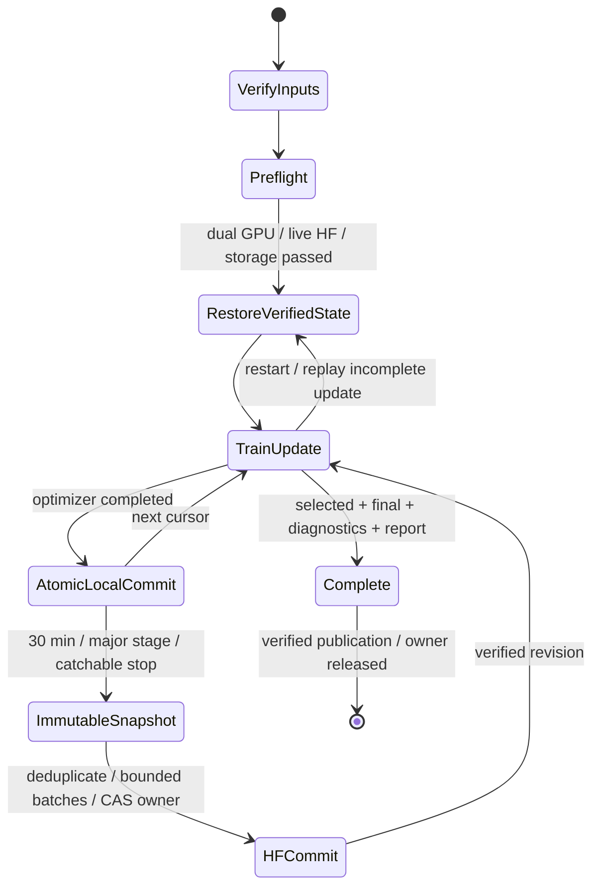

# ATLAS-CONTEXT r3 — frozen one-seed protocol

<!-- NB14_COMPLETED_20261101 -->
## Completed context review — 1 November 2026

The NB13 fit and NB14 review are complete and HF-verified. All 80 review files / 52 CSVs match, and the original fit is preserved. [NB14 completion](phase3NB14Completion.md). The classifier remains unpromoted. Next is the implemented [NB15 existing-data readiness / evidence passport](phase3TreadTwoReadiness.md), not another full fit. Earlier pending-NB14 statements below describe the prior delivery. The original architecture/protocol/schema are unchanged.
<!-- END_NB14_COMPLETED_20261101 -->

<!-- NB13_COMPLETED_20261101 -->
## Superseding measured outcome — 1 November 2026

**NB13A completed and independently HF-verified:** actual recovery restored update **2,486** and reached **60 epochs / 2,940 updates** under the original protocol. All 1,503 direct files / 58,176,066 raw CSV rows, native/CSV history and all 60 unchanged frozen-prior epoch states verified; writer released. [Completion, figures and findings](phase3NB13Completion.md).

Do not rerun NB13/NB13A. Context did not repair low recall and worsened NLL; candidate remains unpromoted. Next is [NB14 CPU saved-data review](notebooks/phase3_NB14_TREAD_TWO_CONTEXT_Completed_Review.ipynb), [run guide](tread_two/context_review/README.md). Actual NB14 execution/publication pending. Earlier partial positions and pending gates in this document are dated history, preserved to explain the experiment and repair.
<!-- END_NB13_COMPLETED_20261101 -->

> Superseding recovery update, 31 October 2026: revision 1 failed because local working files were unavailable. [NB13A revision 2](phase3NB13ARepair.md) is now self-contained, prefers retained/attached saved state and otherwise restores the verified HF checkpoint. Use the updated notebook with Run All. Earlier existing-session-only instructions below are historical.

> Current, 31 October 2026: actual dual-T4/live-HF preflight passed; NB13 is partially trained and stopped. HF update 1,294 is verified; notebook output reaches local update 2,467. Preserve the existing session and use [the NB13A recovery instructions](phase3NB13FreezeAndRecovery.md). Earlier implementation/pending-execution statements below record the original delivery.

**State: implemented and locally checked; actual NB13 T4×2/live-HF preflight, 60-epoch fit and accuracy pending.** The local engineering contract is not the Kaggle measured-fit contract. Actual environment and device identities are included in each contract. [Recipe](tread_two/context_pilot/RECIPE.json), [32-file frozen inventory](tread_two/context_pilot/FILES.json).

## Cohort and boundaries

| Item | Fixed policy |
|---|---|
| Inputs | Existing expanded Kaggle `shanmuk4622/tire-dataset-prepared-phase2`, read-only |
| Images | 570 total: 386 train, 81 validation, 103 historical test |
| Known original training tyres by class | Low/mid/high: 1/3/4; lab source groups have separate identity limitations |
| Labels | Low/mid/high mileage proxies, not measured wear, depth, alignment or safety |
| Bank | Same NB10 18 distinct training-photo patches, six/class; no new reference selection |
| Query eligibility | All 386 train images; query's full original source SHA blocks its own reference before augmentation |
| Reference normalization | Multiply each permitted reference by `6/n_allowed` for its reference class; never use query target to choose references |
| Sampling | Uniform class then domain; within domain group weight ∝√n, then image uniform; replacement explicit |
| New acquisition | None; additional observations are correlated draws/views, not additional independent tyres |
| Held-out status | Validation and historical test have no mid targets; prior test inspections make this a development study |

No workstation or completed experiment is changed. The r1 dense branch and entire validation-selected LC prior remain frozen. The new context encoder/attention/residual is the only measured optimization target. Source, objective, bank or recipe changes after starting require compatibility review and a new experiment identity, never a silent resume under an altered implementation.

## Fit and selection

| Setting | Value |
|---|---|
| Candidate budget | One seed, seed 1; 60 epochs; 49 batch-8 updates/epoch = 2,940 updates |
| Draw/view budget | 392 replacement draws/epoch; 23,520 draws and 47,040 paired-view observations |
| Trainable/total parameters | 231,555 / 1,684,988 |
| Optimizer | AdamW lr 0.001, weight decay 0.0001, betas (0.9,0.999), eps 1e-8; foreach/fused disabled |
| Schedule | Cosine over 2,940 completed updates; no warmup |
| Gradients | Global norm clip 1.0; finite checks and every trainable tensor's gradient summary |
| Precision | FP32, disabled scaler still serialized; dense microbatch 1 |
| Two GPUs | GPU0 training; GPU1 immutable-copy evaluation at barriers; one measured model, no extra seed/DDP |
| Validation | Every epoch; observed-ground-truth-class BA, NLL, group/class metrics and complete per-image evidence |
| Selection | Maximum validation observed-class BA, then minimum three-class NLL, then earliest epoch |
| Weights | Keep all 60 epoch weights plus complete completed-update recovery states; no early stopping |
| Endpoints | Validation-selected and final, with all 103 historical endpoint images each |
| Diagnostics | Eight variants at both endpoints; never used to select a checkpoint |

The eight variants are listed in the recipe. Grayscale is representation-invariant. Reverse-band/column variants are deliberate token-layout interventions and preserve the frozen prior; no synthetic photograph or new physical sample is claimed. The frozen initial baseline is already known, so no additional measured baseline fit is needed.

## Recovery, publication and ownership

Native recovery includes model, optimizer, scheduler, disabled scaler, Python/NumPy/CPU/CUDA RNG, deterministic epoch orders, next draw cursor, scientific CSV row cursors, partial metrics, artifact registry, configuration and environment/source/data hashes. Atomic CSV/native cursor checks roll back uncommitted suffixes; an incomplete update is replayed, not credited as complete. Rerunning unchanged restores verified progress and skips completed work.

HF target is dataset repository `Shanmuk4622/tyre-wear-study` under **`phase3/tread-two/atlas-context-r3/fit/<contract>`**. Engineering preflight has a separate namespace. The selected LC checkpoint is fetched from its original pinned native object and hash/size/protocol/epoch verified. Kaggle `HF_TOKEN` Secret is the only write credential source. No local credential probing or `.env` fallback.

Local commits occur every completed optimizer update. Normal remote snapshots occur every 30 minutes, after major stages, and on catchable Stop/error/SIGINT/SIGTERM. Stop triggers a flush attempt subject to server Retry-After/reset backoff. Forced kernel death cannot run cleanup or publish unsent updates. Remote recovery can only guarantee the last verified publication; preserve local files while a flush is pending.

The inherited transport has five-minute request buckets, a separate hourly commit guard, shared local accounting, authenticated/cached reads, unchanged-object deduplication, bounded 80-object commits, CAS revisions, owner fencing and ambiguous-success reconciliation. These address the user's historical approximately 128/hour concern without presenting it as a universal HF quota. Server limits still govern. No live HF success is claimed from offline fixtures.

## Storage planning and retention

Local real-model fixture extrapolation projects **14,372,641,128 bytes (14.37 GB)** conservative peak against a **16,000,000,000-byte** logical guard within the assumed 20 GB output area. This includes projected direct CSV/native artifacts, two-copy snapshot allowance and a 2 GB staging reserve. The runtime separately requires 2 GiB of free space. Native epoch weights, image maps and dense caches are scaled separately; an epoch checkpoint is not multiplied by the endpoint image count. Full selected/final attention is budgeted as 1,687,552 direct CSV values/rows.

This is a planning estimate, not guaranteed capacity. Actual Kaggle preflight remeasures fixture bytes/free disk and must pass before fitting. Live capacity guards remain active; extra 1 TB scratch is not assumed. Dataset inputs are read directly from the attached Kaggle mount. Do not solve capacity pressure by dropping promised scientific evidence or ZIP compression. Save a catchable failure and pending publication details for review.

## Acceptance after actual execution

1. Preserve executed NB13 and compare all 33 embedded files against delivery.
2. Pin final HF revision/contract; verify all direct object bytes/SHA, 27 schemas/counts and native recovery/owner state.
3. Confirm all 60 epochs / 2,940 updates, all 386 exposed queries, reference self exclusion and no frozen-base drift.
4. Reconstruct paired objective including context penalty, base+correction logits, attention summaries and selected/final mass conservation.
5. Review validation selection, low recall, NLL/Brier/ECE, group failures, context magnitudes, appearance/layout probes and identity/artifact shortcuts. Report failures and unavailable mid recall explicitly.
6. Decide another saved-data review or closure from evidence. No automatic workstation promotion, extra seed, test-picked checkpoint or external acquisition.

[Kaggle instructions](tread_two/context_pilot/README.md) · [Schema](phase3TreadTwoContextEvidenceSchema.md) · [Local proof and limits](phase3TreadTwoContextValidation.md).
