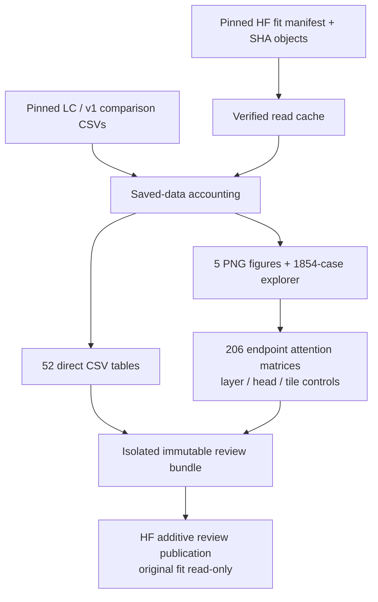

# ATLAS-CONTEXT completed review — NB14

<!-- NB14_COMPLETED_20261101 -->
## Later measured status — 1 November 2026

**NB14 is completed and independently HF-verified**, not pending: all80directfiles,52CSVs/585,825rows, released owner and unchanged original fit. [Completion](phase3NB14Completion.md). Do not regenerate or rerun its executed notebook. Next is [NB15 existing-data readiness](phase3TreadTwoReadiness.md), [run guide](tread_two/readiness_gate/README.md); actual NB15 publication remains pending. Older pending-NB14 wording below records the prior delivery.
<!-- END_NB14_COMPLETED_20261101 -->

**1 November 2026. Implemented and locally checked; actual Kaggle/HF review publication pending.** The measured fit is complete; see [NB13 completion](phase3NB13Completion.md). This separate CPU review contains no model fitting or model forwards.

## Evidence flow and ownership

| Source module | Responsibility |
|---|---|
| [review_context.py](tread_two/context_review/review_context.py) | Pinned inputs, size/SHA cache, bounded downloads, probabilities/cohort/dense metrics, orchestration and table inventory |
| [paired_context.py](tread_two/context_review/paired_context.py) | Draw probabilities, self-exclusion, seeded appearance, paired CE/JS/texture and residual penalty, gradients/exposure, historical comparisons |
| [context_checks.py](tread_two/context_review/context_checks.py) | All correction bounds/logit/patch accounting, frozen LC matching, full endpoint attention, layout response and report notes |
| [render_context.py](tread_two/context_review/render_context.py) | Five scientific figures, interactive base/context/combined tiles, source mapping and attention controls |
| [publish_context_review.py](tread_two/context_review/publish_context_review.py) | Additive direct-file contract/publication through unchanged r3 transport; owner release and identical-rerun skipping |
| `assets/` | Pinned v1/LC cohort CSVs, 103 selected LC identity logits and version/hash metadata |

The frozen `context_pilot/FILES.json` still contains the original 32 entries. Review code lives outside it; neither its source nor the measured training protocol is replaced. All 44 notebook payload files, including frozen transport/source, pinned fit manifest and audit receipt, are individually hashed.

## CSV and viewer contract

The [52-table inventory](tread_two/context_analysis_report/CSV_INDEX.md) and [632-column dictionary](tread_two/context_analysis_report/table_dictionary.csv) cover 585,825 derived rows. Important additions to the prior saved-data review:

| Table | Rows | Meaning |
|---|---:|---|
| `context_observations` | 53,754 | Frozen logits, corrections, changes in NLL/predictions and accounting residuals |
| `context_epochs` | 124 | Stage/epoch aggregates; online observations remain distinct from fixed evaluation |
| `context_by_variant` | 44 | Class-conditioned context magnitude and loss by endpoint/probe |
| `endpoint_context_evidence` | 59,328 | 32 signed correction tiles for each of 1,854 endpoint/probe cases |
| `frozen_LC_prior_metrics` | 198 | Metrics recomputed from unchanged saved prior logits |
| `base_context_pairs` | 1,854 | Matched frozen/context accounting for every explorer case |
| `layout_prior_context_delta` | 412 | Separate prior invariance, correction response and probability response for token-order probes |
| `attention_head_audit` | 1,648 | 206 cases × 2 layers × 4 heads, with entropy/mask/probability checks |
| `attention_by_endpoint` | 16 | Endpoint/layer/head summaries |
| `frozen_prior_peer_check` | 206 | Identity-logit equality against selected LC epoch 7 |
| `LC_context_comparison` | 18 | Pinned descriptive endpoint/probe comparisons; missing LC layout probes remain missing |
| `endpoint_patch_accounting` | 1,854 | Frozen-reference plus context contribution conservation |

Viewer filters: endpoint, all eight probes, target class, wrong/flip status, text search and paging. Choose explained class and frozen/context/combined evidence. Select attention layer/head and hover query/key cells. Seven-decimal copies support interaction; original raw CSV precision remains on HF. Full attention is unavailable for training/probes and displayed as unavailable. All thumbnails are original images; layout interventions move saved tokens, not photographs.

## Resources, restart and publication

| Item | Bound / behavior |
|---|---|
| Kaggle | CPU/None; Internet; authorized HF_TOKEN Secret for publication; no dataset attachment |
| Disk/RAM | At least 4 GiB free output; about 8 GB RAM; source evidence subset approximately 637 MB |
| Original fit archive | 5.646 GB verified locally; the CPU review does not download/load all native weights |
| Dependencies | Existing NumPy/pandas/Matplotlib/Pillow/filelock/requests; only HF SDK pinned to 0.36.2 if needed. No Torch/CUDA replacement. |
| Downloads | SHA/size cache; larger inputs assembled in bounded 1 MiB ranges with four reader threads, unique temporary files and full final SHA. Ignored/invalid ranges rejected. |
| Stopped analysis | Cache survives in existing/saved working files; rerun rebuilds finite derived tables atomically. No optimizer or training continuation exists here. |
| HF write policy | Separate `phase3/tread-two/atlas-context-r3/review/<contract>`; direct CSV/JSON/PNG/HTML/source; no ZIP/NPZ. One major completed-review publication using inherited budgets, 80-object batches, server backoff and ownership. |
| Stop / rerun | Catchable stop allows current completed-report publication to finish. Forced termination cannot upload unsent files. Same completed manifest is verified/skipped on rerun; no concurrent writers. |

This finite review publishes when its major analysis cell has completed. It does not claim NB13's 30-minute/complete-update training recovery for partially derived reports. No project `.env` or alternate credentials are read. Server-directed waits remain possible; preserve working files and logs.

## Local acceptance and remaining check

[Package validation](tread_two/context_review_validation/PACKAGE_VALIDATION.json), [setup execution check](tread_two/context_review_validation/SETUP_VALIDATION.json), [notebook identity](tread_two/context_review_validation/NOTEBOOK.json), [viewer checks](tread_two/context_review_validation/VIEWER.json), [analysis receipt](tread_two/context_analysis_report/ANALYSIS.json).

| Check actually performed | Result / limit |
|---|---|
| Derived scientific tables | Every row/column inventory and SHA checked; logit, patch, pair and attention residuals pass |
| Cache behavior | Reuse and corruption replacement; exact range reassembly; ignored-range response rejected before body read |
| Actual explorer JavaScript | Filters/paging/class/components/layer/head/1,024 matrix cells/missingness checked in a synthetic DOM |
| Offline HF service | Additive namespace, lost successful-commit response reconciliation, released owner, identical rerun skipped without another commit |
| Self-contained notebook | All 44 extracted payload hashes match; fresh extracted analysis reproduces every scientific CSV byte-for-byte |
| Actual setup cell | Executed in an empty fixture directory with only Kaggle paths/SDK metadata stubbed; exact extraction, unchanged rerun and changed-source rejection pass |
| Scope | Zero local model forwards/training/remote writes. Synthetic DOM is functional testing, not a claim of browser screenshot QA. |
| Still pending | Actual Kaggle NB14 and independent audit of its future HF review publication |

Review results are development evidence. No new independent tyres, checkpoint reselection, physical wear labels or workstation installation. [Kaggle run guide](tread_two/context_review/README.md).
