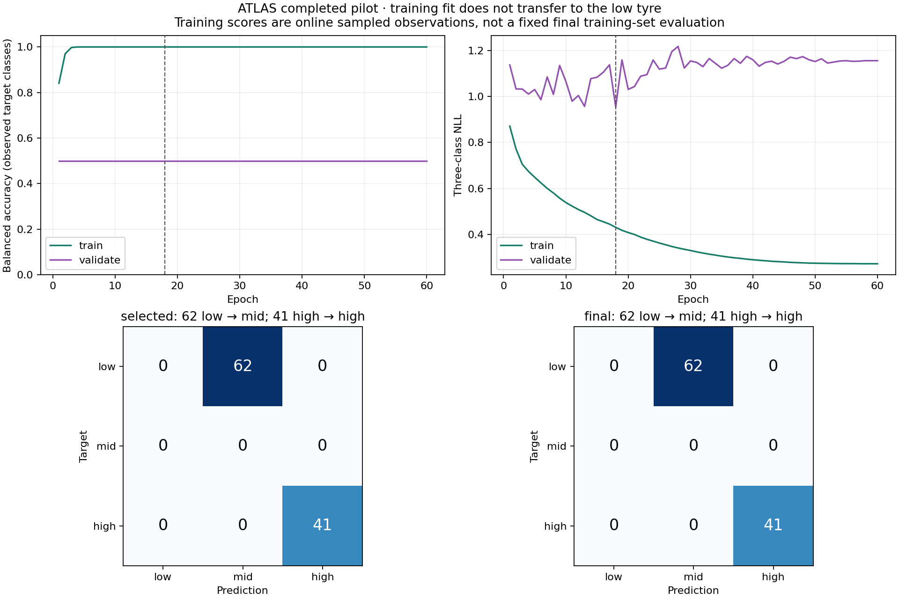
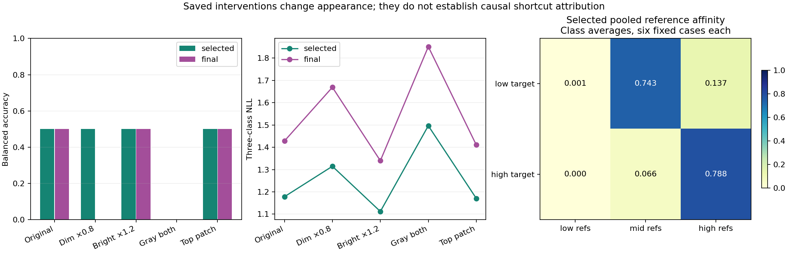
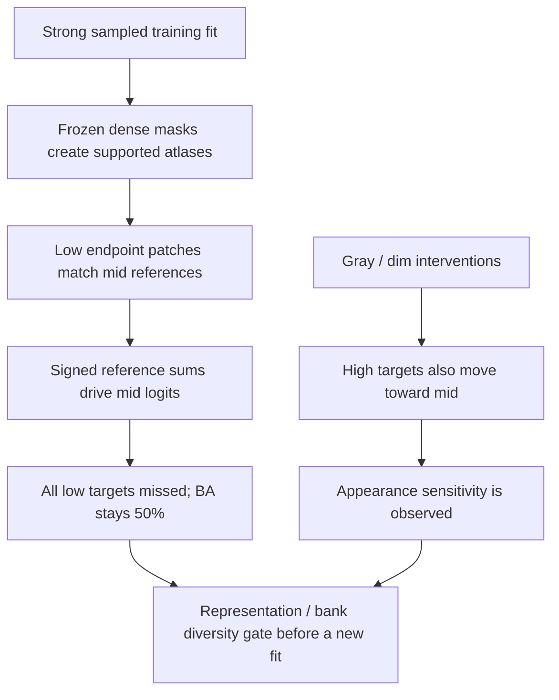
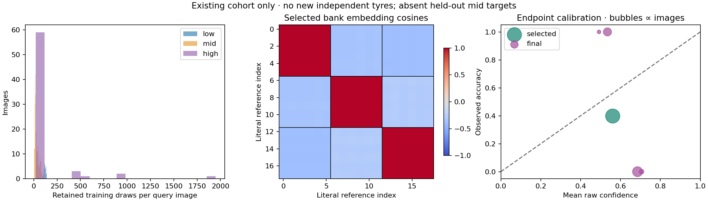

# TREAD-TWO / ATLAS — completed pilot findings and next gate

<!-- NB11_COMPLETE_UPDATE_20261030 -->
## Current — NB11 complete; NB12 review ready

**30 October 2026. NB11 is complete and independently HF-verified:** 60 epochs / 2,940 updates, 1,351 direct files and 54,336,368 raw scientific rows. The actual T4×2/live-HF preflight passed; ownership is released. No NB11 rerun is needed. [Full completion and findings](phase3NB11Completion.md).

Validation selected epoch 7 at BA 56.25%. Selected/final historical endpoint BA remains 50%: 62 low→mid and 41 high→high. NLL and appearance stability improve over v1; low recognition does not, and selected raw-score ECE worsens. Keep the candidate as research evidence; no workstation promotion.

Next: [NB12 saved-evidence review](notebooks/phase3_NB12_TREAD_TWO_ATLAS_LC_Completed_Review.ipynb), **CPU / Internet / HF_TOKEN / no dataset attachment**, then Run All. It adds 40 derived CSVs / 380,595 rows, four figures and a 1,442-case explorer with zero fitting or model forwards. Local recovery/cache/publication/package checks pass; actual NB12/HF review publication is pending. [Run guide](tread_two/lc_review/README.md).

<!-- END_NB11_COMPLETE_UPDATE -->
<!-- NB10_LC_UPDATE_20261030 -->
## Latest status — NB10 closed; NB11 ready, 30 October2026

NB10 is completed and independently HF-verified:495 direct files,1,918,052 scientific rows,386native training records,T4×2,zero fitting/held-out forwards and released ownership. No NB10 rerun is needed. [Completion proof](phase3NB10Completion.md).

The preserved v1 selected/final endpoint remains BA50%,62low→mid/41high→high. A positive train-only gate does not change that result. Next is [NB11 / ATLAS-LC r2](notebooks/phase3_NB11_TREAD_TWO_ATLAS_LC_Resumable_Pilot.ipynb): one separately versioned seed,paired LC views,18-photo source-SHA exclusions,all386queries and sqrt-size group sampling. Local batch8 recovery/package checks pass; actual Kaggle/live-HF preflight and measured accuracy remain pending. Use T4×2,Internet,the existing expanded Kaggle dataset and HF_TOKEN. [Architecture](phase3TreadTwoLCArchitecture.md), [protocol](phase3TreadTwoLCProtocol.md).

<!-- END_NB10_LC_UPDATE -->
<!-- NB09_GATE_UPDATE_20261030 -->
**Completion / next gate, 30 October:** [NB09 is HF-verified](phase3NB09Completion.md).
The proposed training-only gate is now [implemented and locally complete](phase3TreadTwoAppearanceGate.md).
Next: NB10 for actual dual-T4/HF gate retention; it does not fit or promote a
new classifier. Earlier pending-NB09 wording is historical.

**30 October 2026 · post-hoc analysis of the completed NB08 fit.**

The new classifier fits the sampled training data but fails to recognize the
held-out low tyre. Its reference-evidence arithmetic is correct; that does
not make the learned representation transferable. The dense TREAD-ONE branch
remains useful. **Do not promote this classifier or repeat the same fit.**
The next executable deliverable is the CPU-only
[NB09 review/publication notebook](notebooks/phase3_NB09_TREAD_TWO_ATLAS_Completed_Review.ipynb).

## What was checked

| Evidence | Analysis scope |
|---|---|
| Original experiment | Seed 1, 60 epochs, 2,940 updates; selected epoch 18, final epoch 60 |
| Immutable source | HF revision `82e7e1c5774f54c786571cdef7b3b60c1e96630f` |
| Predictions | All **29,410** observations: 23,520 train, 4,860 validation, 206 original endpoint, 824 fixed probes |
| Sampling | Every retained draw and all 378 query images; bank photos remain support, never queries |
| Optimization | All 2,940 update records and 64,680 parameter-gradient rows |
| Selection | All 60 validation selections, original BA/NLL/earliest rule |
| Explanation audit | All **1,030 ×3 logits** reconstructed from saved affinities, pooling, coefficients and bias; all 32 patch sums checked |
| Inputs | 522 hash-verified files / 147,182,968 bytes, about 147 MB; no source model inference |
| Outputs | 30 direct derived CSV tables, field dictionary, three scientific figures, complete interactive image/probe review |
| Limits | Not all 35.5 million source rows were rescanned; no additional subjects, checkpoint search or causal attribution |

[Analysis receipt](tread_two/analysis_report/ANALYSIS.json),
[derived table inventory](tread_two/analysis_report/CSV_INDEX.md),
[methods and denominators](tread_two/analysis_report/METHODS.md).

## 1. The error pattern is low → mid

**Correction to the preceding completion note:** the earlier prose statement
that all 103 endpoint images were predicted high was wrong. The full raw-row
review shows **62 low → mid, 41 high → high**, at both checkpoints. The saved
predictions and the reported 50% balanced accuracy have not changed.

| Original 103-image endpoint | Selected, epoch 18 | Final, epoch 60 |
|---|---:|---:|
| Low targets predicted low / mid / high | **0 / 62 / 0** | **0 / 62 / 0** |
| High targets predicted low / mid / high | **0 / 0 / 41** | **0 / 0 / 41** |
| Target classes present | Low, high | Low, high |
| Accuracy | 39.806% | 39.806% |
| Balanced accuracy over present classes | 50.000% | 50.000% |
| Three-class NLL | **1.17830** | **1.42830** |
| Mean maximum raw probability | 0.56026 | 0.62455 |

The final model is more confident on average while NLL is worse. Identical
argmax accuracy conceals this deterioration. Mid-class recall is unavailable
because there are no held-out mid targets; it is not a measured zero.

**Control nuance:** the saved original-frame frozen anchor makes the same
low→mid / high→high choices, with NLL **1.38694**. The selected candidate's
1.17830 is a probability-score improvement over that control; final 1.42830
is worse. This does not improve low-class recognition or establish calibration.
Both fixed-control context rows are retained in `cohort_metrics.csv`; they are
not new model runs, and the anchor remains seed 3 / epoch 20 in both contexts.

Training **online draw accuracy** reaches 100% from epoch four onward. This
mixes pre-update model states, repeated draws and augmentation; it is not a
new fixed final training-set evaluation. Validation BA remains **50% in every
one of the 60 epochs**, missing all 40 low validation images. More epochs did
not improve the declared classification endpoint. Epoch 18 wins the original
validation-NLL tie-break; no test-based substitution is made.

## 2. The predeclared probes expose appearance sensitivity

| Saved intervention | Selected BA | Final BA | Prediction changes, selected / final |
|---|---:|---:|---:|
| Identity | 50% | 50% | Reference condition |
| Query brightness ×0.8 | 50% | **0%** | 0 / **41** |
| Query brightness ×1.2 | 50% | 50% | 0 / 0 |
| Query and bank grayscale | **0%** | **0%** | **41 / 41** |
| Replace top signed patch | 50% | 50% | 0 / 0 |

Grayscale makes every endpoint prediction mid. Dimming does the same at the
final checkpoint: the previously correct high images change to mid. Every
comparison uses the same image, checkpoint and unchanged target. Probe deltas,
raw probabilities, selected patch and replacement RGB are retained directly.

These are broad appearance interventions. Grayscale modifies both queries
and references; brightness modifies query only. They do **not** identify paint,
illumination, tyre identity or capture hardware as a unique cause. Applying
grayscale at inference is not a demonstrated fix; it worsens this model.

## 3. The reference mechanism explains the wrong score faithfully

For each saved observation, the independent reconstruction uses:

\[
q_j=\sum_{p=1}^{32}\alpha_p\,
\exp\left((\operatorname{cosine}_{pj}-1)/\tau\right),\qquad
z_c=b_c+\sum_{j=1}^{18}w_{cj}q_j.
\]

Here `alpha` is the saved geometric band-pooling mass, `tau` the saved learned
temperature, and `w` the saved signed class/reference coefficient. This is
recalculation from retained numbers, not a new model forward pass.

| Mean pooled affinity, identity images | Low references | Mid references | High references |
|---|---:|---:|---:|
| Selected: low target images | **0.000579** | **0.743410** | 0.137215 |
| Selected: high target images | 0.000271 | 0.065648 | **0.787879** |
| Final: low target images | **0.000100** | **0.845037** | 0.093637 |
| Final: high target images | 0.000087 | 0.210712 | **0.560283** |

The held-out low tyre is embedded near the mid reference cases and far from
the low cases. This gives a concrete mechanism for low → mid. At the selected
checkpoint the bias alone slightly favors low; the wrong mid choice is driven
by the reference terms. This is not simply an unsupported atlas or a constant
mid output: the high targets still match high references in the identity case.

Every endpoint/probe has all 32 supported patches and no empty-support case.
All 3,090 reconstructed logits and all patch-sum checks agree within 2e-6.
The identity reference aggregates also agree with the originally published
`REFERENCE_CASES.csv`. Original-image projection checks were independently
verified in the preceding completion audit; no new spatial splat is run here.
No single-patch prediction flip is observed under the declared occlusion.
That does not prove invariance to broader occlusion or validate causal saliency.

## 4. Sampling worked as specified, but repetition is substantial

| Exposure | Saved count / interpretation |
|---|---|
| Low-class draws | 7,905, from 66 query images of **one training tyre** |
| Mid-class draws | 7,875, original photos plus the three existing clips |
| High-class draws | 7,740, 66 query images from four original training tyres |
| Query coverage | All **378 / 378** images used at least once |
| Fixed bank support | 18 patches from eight source photos; independent class support **1 / 3 / 4 tyres** |
| High query images per known tyre | **2 / 1 / 4 / 59**, after support-photo exclusion |
| Single-image high group | That one remaining query image is drawn **1,948 times** |

The hierarchical sampler balances class/domain/group; it does not create new
examples when a group has one remaining query image. This behavior matches
the recipe, so it is not a sampler implementation failure. It gives a specific
reason to review within-group diversity and repeated-source dependence in a
future recipe. Unresolved clip parents stay unresolved; clips are not counted
as independently verified new tyres.

All update and parameter-gradient finite flags pass. The dense anchor has
zero gradient counts across all 2,940 updates. There is no recorded nonfinite
optimizer failure to explain the classification result. Timing columns cover
their declared compute/record regions; they are not a total wall-clock profile.

## 5. Dense quality and classification quality remain separate

| Frozen dense output on endpoint | Value | Denominator |
|---|---:|---|
| Mean tyre/tread Dice | **98.418%** | 206 image-region rows, 103 images ×2 |
| Mean tyre/tread box IoU | **97.118%** | Same 206 image-region rows |
| Human point MAE | **1.196% of image width** | 150 comparable point targets on 25 images |
| Weak polygon point MAE | Unavailable here | The retained weak targets have incompatible guide rows |

Selected/final dense values agree because the dense branch is frozen. This
supports retaining that branch; it does not validate physical depth, alignment,
safety, calibrated class probabilities or the new appearance classifier.

## 6. What is implemented now

| Deliverable | Purpose / actual state |
|---|---|
| [Interactive failure/probe explorer](tread_two/analysis_report/ATLAS_Failure_Explorer.html) | All **1,030** original/probe records; endpoint, intervention, target, failure, flip, class and search controls; paginated images, base atlases, 32 signed tiles and literal references |
| [30-table CSV inventory](tread_two/analysis_report/CSV_INDEX.md) | Predictions, class/cohort/tyre errors, probe pairs, exposures, gradients, reference affinities/contributions, exact reconstructions, calibration and risk views |
| [Analysis code and guide](tread_two/review/README.md) | Input verification, audit, figures/explorer, separate publication and provenance |
| [NB09](notebooks/phase3_NB09_TREAD_TWO_ATLAS_Completed_Review.ipynb) | Self-contained **CPU** Kaggle analysis/publication, four code cells; no dataset attachment or new inference required |
| [Local validation receipt](tread_two/review_validation/VALIDATION.json) | Scientific regression, complete extracted-notebook reproduction and offline publication checks; actual Kaggle NB09 execution remains separate |
| [Prepared publication](tread_two/review_validation/REVIEW_DELIVERY.json) | New review namespace, direct files; **not yet uploaded from this local session** |

The browser tool could not reach the local Windows loopback server, so no new
browser rendering success is claimed. PNG layout was visually inspected;
actual explorer JavaScript is checked with a synthetic DOM, including its
filters and pagination. Base atlas thumbnails are explicitly labeled when
the numerical evidence comes from a probe; transformed image pixels are not
fabricated or passed off as captured native output.

## 7. The next model gate, using existing data only

The present classifier is a completed negative transfer result. Keep its full
evidence and the selected/final distinction. No more tyre photos are required
by the user, and neither workstation changes as part of this review.

| Before another measured fit | Proposed action / why |
|---|---|
| Train-only appearance gate | Examine existing training views and literal cases under declared colour/luminance changes; freeze acceptance before any new fit |
| Reference diversity | Sample coverage/texture-quality cases across existing training views, with explicit paint/glare/blur tags; avoid six low cases from one support photo |
| Representation candidate | Consider learning normalized-luminance/gradient texture features with appearance consistency from the start; a post-hoc grayscale switch is demonstrably insufficient |
| Repetition control | Make single-image group reuse explicit; predeclare how group balance and view diversity trade off |
| Preserve strengths | Keep the verified frozen dense anchor and exact signed evidence accounting |
| New protocol | Any bank, input, sampler, objective or model change gets a new source/recipe/namespace; never rewrite NB08 |
| Selection and claims | Freeze validation rules in advance; no test-based replacement, no unseen-mid or new-independent-tyre claim |

These are motivated design directions, **not an already tested v2 model**.
Low-class training still has one physical tyre, so train-only view checks
cannot prove unseen-tyre low-class generalization. The immediate next action
is now to run **NB10 on T4×2** for the implemented training-only gate. NB09
is complete and HF-verified; no new fitting or NB08 rerun is needed.
