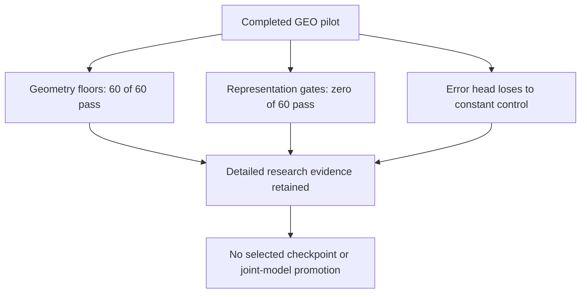

# GEO lessons — what the saved evidence supports

<!-- NB20_VERIFIED_GEO_CLOSED_20261102 -->
## Current — NB20 HF-verified; GEO research cycle complete

**2 November 2026:** NB20 completed both NB18 review and NB19 passport stages.
All 19 payloads match; three cells complete without saved errors. Actual HF
revisions **610bdb22… / abfec8d6…** contain **121 logical files, 51 CSVs /
183,812 rows**. All 119 objects, released owners, 48 reference-comparable tables,
exact vector arrays and actual passport provenance check out. Earlier NB13–NB17
selecting manifests are unchanged. **No NB18/NB19/NB20 rerun needed.**
[Completion and numerical/evidence notes](phase3NB20Completion.md).

The current GEO cycle is closed as **unselected, unpromoted research**. Geometry
passes 60/60 epochs; representation eligibility passes 0/60. The original
27,514,418 CSV rows and native/epoch evidence remain on HF.
[Compact research handoff](phase3TreadTwoGEOResearchClosure.md).

**Recommended next direction:** separately design a texture revision with fixed
local targets and batch-compatible diversity, reusing saved geometry and existing
photos. [Design brief](phase3TreadTwoGEONextResearch.md). This is proposed,
not implemented or trained. No new notebook/fit is required to finish this cycle.
Both workstation implementations remain deferred and preserved.
<!-- END_NB20_VERIFIED_GEO_CLOSED_20261102 -->

**2 November 2026.** A postmortem of completed NB17, not a revised recipe.
The original protocol, source, checkpoint rule and weights remain frozen.
[Completion](phase3NB17Completion.md) · [Run All batch](phase3TreadTwoGEOPostrunBatch.md).

## Scale, diversity and geometry are different findings

Task isolation protected segmentation while texture learning failed its gate.
Human validation point MAE is about 5.23% lower than G0, a retrospective finding
on 25 annotated validation images. It is not an independent deployment result.

G0 projector rank is 11.03, but its median standard deviation is only 0.00382;
it fails the scale floor. Final rank is 1.03866 with median standard deviation
0.44111; it fails the diversity floor. Neither satisfies both conditions. The
random G0 texture head must not be described as a previously validated solution.

## Most held-out variation separates two source groups

The following exact decomposition uses saved final view-0 vectors. It partitions
total squared centered variation into between-component and within-component
scatter. The implementation checks that both terms sum to total scatter.

| Role | Conservative components | Projector: between / total | Pooled encoder: between / total |
|---|---:|---:|---:|
| Train: 386 photos | 6 | 49.7350% | 50.9830% |
| Validation: 81 photos | 2 | 99.0481% | 99.3859% |
| Test: 103 photos | 2 | 98.6761% | 96.5116% |
| All: 570 photos | 10 | 63.6567% | 61.5592% |

[Direct decomposition](tread_two/nb17_report/component_variance_decomposition.csv).
The identity is `z_i - mean(z) = (z_i - mean(z_group)) +
(mean(z_group) - mean(z))`. This is descriptive arithmetic, not a fitted model.

The two held-out groups explain most variation in their respective cohorts.
This does not establish a physical wear axis, prove identity memorisation, or
identify the visual cue responsible. Conservative grouping includes unresolved
relationships; it is not equivalent to confirmed independent physical identity.
Component centering is not a correction installed into the model.

## Low diversity is already visible before pooling

The audit uses native 32 × 96 tokens, before and after axial context, without a
new forward. Only supported tiles enter token statistics. Flattening mixes image
and spatial-position variation. Per-position centering removes each position's
mean before flattening; it adds no new subjects.

| Role | Layer | Flattened rank | Position-centered rank | Median per-position rank | Pooled rank |
|---|---|---:|---:|---:|---:|
| Validation | Local encoder | 1.92994 | 2.04427 | 1.34407 | 1.06457 |
| Validation | After axial context | 3.01947 | 1.45307 | 1.14836 | 1.02099 |
| Test | Local encoder | 1.65088 | 1.69229 | 1.47990 | 1.08671 |
| Test | After axial context | 3.21584 | 1.34052 | 1.25176 | 1.02942 |

[Token spaces](tread_two/nb17_report/endpoint_token_spaces.csv) ·
[256 position records](tread_two/nb17_report/endpoint_patch_latent.csv).
The evidence rules out attributing *all* observed degeneracy only to the final
64D projector. It does not prove every tile/channel is constant. Position metadata
and photometric plans remain part of these measurements.

## The original covariance objective has a small-batch constraint

NB17 uses eight images per update and a 64D projector. A centered eight-row sample
covariance has rank at most seven. One batch therefore cannot contain 64 mutually
uncorrelated nonzero-variance directions, even if corpus-level features were good.

For positive semidefinite sample covariance `C` with rank at most seven,
`||C||_F² >= trace(C)² / 7`. If all 64 diagonal variances equal one, the
implemented per-view off-diagonal penalty obeys
`sum(i != j, C_ij²) / 64 >= 64/7 - 1 = 8.142857…`.
Thus variance and covariance penalties cannot both attain their ideal zero on
one eight-image batch. This derivation assumes exact unit diagonal variance;
the implementation adds 1e-4 inside the variance square root.

This does not prove the cause of the measured failure. Validation rank ≥ 4 on
81 images is still feasible. It explains why feature scale, paired consistency
or one total-loss curve alone cannot establish a healthy representation.

## Questions for a separately justified future experiment

These are options, not runnable new fits or promises of improved accuracy.

| Observed issue | Design question | Evidence required |
|---|---|---|
| Local encoder already low-rank | Could a fixed, independently defined local target prevent self-collapse? | Train-only target; hidden-pixel leakage checks; per-position rank and masked controls |
| Eight-image / 64D covariance mismatch | Smaller representation or explicitly defined cross-batch estimator? | Exact math; stale-state policy; complete queue/RNG/cursor retention if used |
| Held-out variation mainly between two groups | Preserve within-group variation instead of only separating groups? | Original-role within/between diagnostics; no held-out fitting |
| Error head loses to a constant | Is a learned error predictor justified? | Same-cohort MAE/RMSE/calibration and human-only point availability |
| Geometry preserved | Study geometry independently? | New declared selection rule; preserve original selected=None; no test-based optimisation |

Training has six conservative components (low/mid/high = 1/1/4), and no middle
class exists in the held-out roles. More telemetry cannot add independent tyres
or turn mileage proxies into physical depth/safety truth. Existing photos only;
the user will not collect new tyre photographs.

NB20 has now completed and published NB18 review and NB19 passport. The user
authorised the separately documented [TRACE design and prototype](phase3TreadTwoTRACEDesign.md).
Its measured fit still requires a new frozen protocol and the full engineering
gates; the completed GEO source and workstations remain preserved.
