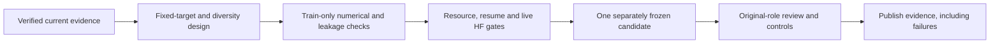

# Next research direction — repair texture learning with existing data

<!-- NB24_VERIFIED_20261102 -->
## Current — NB24 TRACE completed and HF-verified

**2 November 2026:** NB24 completed preparation, actual T4×2/HF continuation,
one seed /60 epochs /2,940 updates, and the saved-evidence review/passport.
All 33 payloads match. **No NB21/NB22/NB23/NB24 rerun needed.**
[Completion and verification scope](phase3NB24Completion.md).

Final validation masked reconstruction beats the strongest declared control by
**21.63%**; local reconstruction improves **36.44%**. Utility passes60/60, but
projector/encoder diversity passes0/60: ranks **1.0225 /1.2296 /1.2489**.
**Selected=None; research-only, unpromoted.**
[Illustrated findings and next research](phase3TreadTwoTRACEFindings.md).

The fit retains **3,553 direct CSVs /47,263,346 rows /6,725 NPY /64 PT /13.507 GB**;
570 existing photos only. Counts include inherited cache rows; no new photos.
Independent audit reconstructs all 2,940 objectives and60 validation gates; the
published full dense audit and the bounded local audit have explicit scopes.
All five owners are released; earlier publications remain unchanged.

Next use saved local texture/component evidence to justify any future revision;
no new fit or NB25 is required to complete this cycle. Preserve executed
notebook/runtime/protocol. Both workstations remain deferred.
<!-- END_NB24_VERIFIED_20261102 -->

<!-- TRACE_BATCH_20261102 -->
## Historical — TRACE batch delivery before NB24 execution

**2 November 2026:** all four self-contained TRACE notebooks are implemented.
**[NB24 Run All master](notebooks/phase3_NB24_TREAD_TWO_TRACE_All_In_One_Batch.ipynb)**
automatically sequences fixed-target preparation, actual dual-T4/HF continuation
and storage gates, one seed / 60 epochs / 2,940 updates, then the saved-evidence
review and interactive passport. Individual NB21/NB22/NB23 files are supplied too.

Use a dedicated Kaggle **T4×2**, Internet ON, the existing expanded
`shanmuk4622/tire-dataset-prepared-phase2` input and **HF_TOKEN**. Start cold with
at least 19 GB free; actual capacity must also preserve the 2 GB reserve. Run one
master, not competing writers. [Full setup/recovery guide](phase3TreadTwoTRACEBatch.md).

Local real-model lifecycle/restart/fault/review and fresh payload tests pass.
All 570 existing photos and 60 source schedules were exercised. The executable
schema has 48 CSV families / 671 fields with native predictions/tokens, all epoch
weights and complete-update recovery. [Acceptance and boundaries](phase3TreadTwoTRACEValidation.md).

**Actual Kaggle/live HF and measured training remain pending user execution.**
The notebooks enforce those live gates automatically. No local token/HF write,
new photo or workstation change. Original GEO remains closed/unselected; no old
completed notebook needs a rerun. Preserve this new source/notebook/protocol
once execution starts.
<!-- END_TRACE_BATCH_20261102 -->

<!-- TRACE_DESIGN_20261102 -->
## Earlier design checkpoint — TRACE prototype checked

**2 November 2026:** the user authorised work on the next design. **TREAD-TWO /
TRACE** now has four prototype modules, 71,022 new trainable parameters, fixed
spatial descriptors and explicit position-sensitive pooling. All 386 train photos
were audited: 197,632 target cells / 1,185,792 values retained. CPU leakage, loss,
gradient, state-restore and frozen-geometry equivalence checks pass.

[Design, findings and interactive examples](phase3TreadTwoTRACEDesign.md) ·
[Detailed rollout](tread_two/trace_design/DELIVERY_PLAN.md).

This is **local design/engineering**, not a measured model, live HF publication,
48 implemented telemetry writers or runnable Kaggle batch. Next build the full
data/transaction/evidence runtime and prove storage/dual-T4/HF continuation, then
deliver all justified notebooks with a sequential master. Existing photos only;
both workstations and every completed experiment remain preserved. NB20/GEO stays
closed and unselected; no old notebook rerun is needed.
<!-- END_TRACE_DESIGN_20261102 -->

## Original proposal before TRACE implementation

**Historical brief, 2 November 2026.** This proposal preceded the authorised
TRACE design/prototype above; it delivered no runtime, training notebook or
measured model at that point. NB20 closes the current
GEO cycle. [Completion](phase3NB20Completion.md) · [postmortem](phase3TreadTwoGEOLessons.md).

## Recommendation and motivation

Design one separately versioned **TREAD-TWO GEO texture revision**, keeping useful
saved geometry as an explicitly declared research input. The existing 570 photos
are the photo scope. Only 386 training photos may supply fitted statistics/targets;
held-out roles remain previously inspected development cohorts.

| Observed evidence | Consequence for the proposed revision |
|---|---|
| Local encoder and pooled vectors already have low rank | A larger final projector or transformer alone does not address the measured failure location |
| About 99% of validation variation lies between two components | Track within-component variation and role-specific spectra; pooled rank cannot establish generalisation |
| Eight images / 64 projector dimensions | Centered batch covariance has rank at most seven; use compatible dimensionality or a separately defined estimator |
| Very strong pair consistency with low diversity | Pair consistency needs independent reconstruction and diversity controls |
| Masked gain only 4.03% vs train mean | Preserve this control and investigate targets independent of student updates |
| Geometry passes all epoch floors | Reuse retained geometry with its actual selection provenance |
| Error heads lose to median controls | Keep confidence claims conditional on a demonstrated control advantage |

## Changes to investigate before freezing a protocol

1. **Fixed local targets.** Define deterministic multiscale texture targets or
   descriptors from existing train-role patches. The student cannot collapse
   these targets by changing its encoder. Any fitted normalisation, whitening
   or target transform must use training data only. These remain image-derived
   targets, not measured wear/damage labels.
2. **Batch-compatible diversity.** Investigate a small projection dimension
   (for example six with batch eight), while requiring meaningful rank in both
   projection and pooled features. This removes the specific 64D/rank≤7 conflict;
   it does not guarantee useful learning. A cross-batch queue is an alternative
   needing its own estimator, staleness policy and complete recovery-state proof.
3. **Declared geometry input.** The selected original TREAD-ONE anchor and
   unselected final GEO adapters have different provenance. State which is used
   and why; preserve the original selected=None outcome.
4. **One bounded measured candidate after engineering gates.** Freeze the target
   math, weights, architecture, source, schema, original roles and eligibility
   before fitting. Keep the familiar Kaggle/HF workflow. Objective weights and
   duration need numerical/resource measurements before they become a contract.

## Gates and retention before a long fit

| Gate | Required evidence |
|---|---|
| Targets and leakage | Train-only provenance; hidden-pixel changes cannot leak into visible student inputs through preprocessing |
| Objective arithmetic | Independent reduction from direct CSV/native sufficient statistics; explicit missingness |
| Task separation | Gradient checks and unchanged declared geometry behavior |
| Representation | Per-role/component spectra, within/between scatter, local-token and pooled diagnostics |
| Storage | Actual 20 GB working-area budget; optional 1 TB scratch never assumed |
| Recovery | Exact completed-update optimizer/RNG/queue/cursor restore; actual HF continuation before long fitting |
| Publication | Direct CSV/native records; 30-minute/major/stop attempts; server backoff and single-owner writes |
| Fuller evidence | Complete target-map construction once, true memory peak counters, populated staging measurements and explicit final-event coverage |
| Delivery | All justified notebooks together with an automatic sequential master |

Training still has six conservative components (low/mid/high = 1/1/4), and each
held-out role has two components with no middle class. A new objective cannot
manufacture independent tyres or physical-depth/safety truth. Any improved
development result must retain those limitations.

This recommendation launches no fit, requests no new photos and leaves deferred
workstation work unchanged. Preserve every completed source/weight/publication,
and distinguish proposed, engineered, locally checked, Kaggle-completed and
independently verified states in any later implementation.
