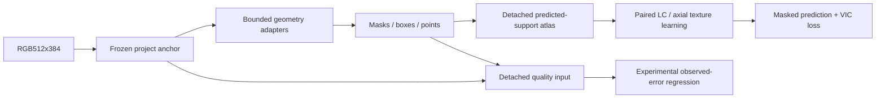

# TREAD-TWO / GEO — implemented measured protocol

<!-- NB20_VERIFIED_GEO_CLOSED_20261102 -->
## Current — NB20 HF-verified; GEO research cycle complete

**2 November 2026:** NB20 completed both NB18 review and NB19 passport stages.
All 19 payloads match; three cells complete without saved errors. Actual HF
revisions **610bdb22… / abfec8d6…** contain **121 logical files, 51 CSVs /
183,812 rows**. All 119 objects, released owners, 48 reference-comparable tables,
exact vector arrays and actual passport provenance check out. Earlier NB13–NB17
selecting manifests are unchanged. **No NB18/NB19/NB20 rerun needed.**
[Completion and numerical/evidence notes](phase3NB20Completion.md).

The current GEO cycle is closed as **unselected, unpromoted research**. Geometry
passes 60/60 epochs; representation eligibility passes 0/60. The original
27,514,418 CSV rows and native/epoch evidence remain on HF.
[Compact research handoff](phase3TreadTwoGEOResearchClosure.md).

**Recommended next direction:** separately design a texture revision with fixed
local targets and batch-compatible diversity, reusing saved geometry and existing
photos. [Design brief](phase3TreadTwoGEONextResearch.md). This is proposed,
not implemented or trained. No new notebook/fit is required to finish this cycle.
Both workstation implementations remain deferred and preserved.
<!-- END_NB20_VERIFIED_GEO_CLOSED_20261102 -->

<!-- NB17_COMPLETE_POSTRUN_BATCH_20261102 -->
## Historical — NB17 verification and batch delivery before NB20 execution

**2 November 2026:** the attachment is completed NB17 (message says NB16).
HF revision `1113bf8a…`: **11,637 logical files / 3,080 direct CSVs /
27,514,418 rows / 8,457 native arrays / 10.31 GB**. One seed,
60 epochs and 2,940 updates; all selected bytes, schemas, native evidence and original masks
independently checked. Owner released; earlier four publication manifests unchanged.
**Do not rerun NB16/NB17 training.** [Completion and illustrated insights](phase3NB17Completion.md).

The geometry floor passes 60/60; human point MAE improves 5.23% retrospectively.
Representation eligibility passes 0/60: final validation projector rank 1.038659,
pooled 96D rank 1.020990; masked gain 4.0337% is below 5%. **Selected unavailable;
final remains research-only, unpromoted.** No new classification/depth/safety claim.

**Next: [NB20 Run All master](notebooks/phase3_NB20_TREAD_TWO_GEO_All_In_One_Postrun.ipynb)**.
It automatically runs/publishes NB18 full review then NB19 evidence passport.
All three notebooks are delivered now; individual stage files are optional.
CPU / None, Internet ON, existing expanded Kaggle input, HF_TOKEN, at least 13 GB free
on a fresh start. One shared verified cache, complete-stage recovery, publication
every 30 minutes and at major/stop boundaries. [Full batch/run guide](phase3TreadTwoGEOPostrunBatch.md).
Local actual-data audit and offline source/handoff/restore checks pass; new
NB18/NB19 Kaggle/HF publication remains pending. Existing photos only, no extra
fit or workstation change. User preference: supply all justified next notebooks
together with an automatic sequential master; preserve scientific gates.
<!-- END_NB17_COMPLETE_POSTRUN_BATCH_20261102 -->

**1 November 2026. NB16 completed; NB17 ready, unexecuted.**
This is the separately frozen implementation of the approved geometry-first
objective. [NB16 verification](phase3NB16Completion.md) precedes
[NB17](notebooks/phase3_NB17_TREAD_TWO_GEO_Resumable_Pilot.ipynb).
The completed ATLAS classifier experiments and both workstations remain intact.

## Model and learning paths

| Component | Implemented behavior |
|---|---|
| Anchor | Exact selected TREAD-ONE seed 3/epoch 20,1,372,159 parameters, frozen eval; weights a5b872ed… |
| Geometry |27,068 parameters; zero-init mask-logit delta±1 and raw-point delta±.25; original ordered6-point decoder |
| Texture |326,632 parameters; predicted-support512×256atlas, 32local64×64tiles, 4 LC channels, 96D encoder, 2axial blocks, 64D VIC projector and masked4×16×16 target decoder |
| Error estimates |2,179 parameters; detached48 frozen features +16geometry scalars; three annotation-error estimates, human-only point-error targets |
| Separation |No shared trainable task parameters; atlas/quality boundaries detached; independent group norm1 clipping |
| Classification |No mileage CE/ordinal objective or new trained classifier |

Geometry loss is masked BCE + soft Dice, 2×weighted point SmoothL1(beta.02),
.1containment, .1eligible row alignment and.1anchor drift. Quality contributes
.25×SmoothL1(beta.02). Texture contributes a min(1,epoch/5) ramp times
25invariance +25(sum of view variance penalties) +sum of covariance penalties
+.5masked Huber(beta.1). Exact mask/point drift denominators are separate CSV
fields; no component is hidden inside a scalar total only.

The hidden-RGB check is conditional on a fixed predicted support/warp. Tile
photometric contrast and LC are local, and hidden tokens are replaced before
context. The frozen geometry anchor still sees the full source image; this is
not a claim that geometry carries no information about hidden regions.

## Data, schedule and optimization

| Item | Frozen choice |
|---|---|
| Input | Existing expanded shanmuk4622/tire-dataset-prepared-phase2; checksum06c6c9d0… /overlay f81a80d2… |
| Roles |386train /81validation /103historical development test; no reassignment |
| Conservative components |Training sizes2/3/5/60/67/249; low/mid/high 1/1/4, not8 independent batch tyres |
| Point provenance |70 human /152 weak /164 absent train images; weak loss weight.25 |
| Schedule |Every386 primary IDs once/epoch +6 marked padding draws; 49×8; within-batch unique IDs and≥2 components |
| Optimizer |AdamW FP32, group LRs1e-4/1e-3/3e-4,wd1e-4,betas(.9,.999), eps1e-8,foreach/fused false |
| LR convention |Cosine at the previous completed global update; no LR warmup |
| Texture skip |Need≥4eligible distinct images/≥2 components; otherwise every texture gradNone, no moment/decay-only step |
| Devices |GPU1 frozen inference/evaluation; GPU0 trainable modules; one candidate, no DDP |

Training covers23,520 draws, including360padding draws; more telemetry is not more
independent photographs. Existing tyre identity/support limits remain relevant.

## Controls, validation and selection

Before optimization, compute the deterministic identity training-atlas mean
predictor from386 images, valid counts, and training-only quality-target medians.
Unsupported mean coordinates predict0 with their count retained; zero is not
observed truth. Compute original G0 geometry on the81validation images once.

Every epoch uses the same seed-addressed pair of validation photometric views.
Mask RNG seeds stay fixed; tile eligibility follows current predicted support,
so selected tile identity can change when geometry support changes. Every actual
mask/weight/target is saved. Candidate and mean predictor are compared under the
same current targets and masks.

| Selection gate | Required |
|---|---|
| Mean two-mask validation Dice |≥G0−.002 |
| Human-point width MAE |≤G0+.001 |
| Invalid atlas fraction |≤G0+.01 |
| Median projector std |≥.1 |
| Covariance effective rank |≥4, one fixed view per eligible validation image |
| Mean predictor loss |Available and≥1e-6 |

Among eligible epochs minimize masked_Huber/mean_Huber +.1 paired cosine distance,
earliest tie. The historical test never selects a checkpoint. If none qualify,
selected is unavailable; final/all epoch weights and rejection reasons remain.
Predeclared usefulness uses **the selected epoch's original validation metrics**
(≥5%masked-loss gain, paired distance≤.05) plus≥90%training draw loss coverage.
It does not pool training/test endpoint scores to claim a validation success.

Selected/final identity evaluation covers all 570 images with original cohort
roles; human/weak/missing targets remain distinct. Experimental error estimates
are compared with training medians using MAE/MSE/RMSE and fixed bins. Retrieval
uses eligible training references and excludes the same full source SHA and
entire conservative component; similarity is descriptive, not wear calibration.

Ten historical-cohort diagnostics are brightness.8/1.2,gamma.8/1.2,grayscale,
known5×5blur, explicit GT-background neutralization, reverse bands, reverse columns,
and top valid observable masked-residual tile removal. Structural mappings and
unavailable probes are recorded. These are not new photos or damage labels.

## Retention and capacity

All40 families /468 executable fields are documented in
[schema/retention](tread_two/geo_pilot/EVIDENCE_SCHEMA.md). Every train/validation/
endpoint mask logit, point, quality output, row parameter, token and masked
prediction/target/weight is retained; vectors, boxes, losses, gradients, exposure
and diagnostics stay CSV. All60epoch weights, selected/final native exports and
complete rolling optimizer/RNG states are saved. No ZIP/NPZ/database envelope.

The final local fixture's adjusted measured forecast is
**14.380 GB**, with typed planning
upper estimate12.983 GB and projected peak
14.614 GB. The actual Kaggle gate must establish
same-filesystem hardlinks and pass15 GBlogical/18 GBpeak/2 GBreserve limits within
the20 GBassumption. Local Windows copy tests do not prove Kaggle hardlinks.
Runtime guards stop safely rather than discard telemetry.

The measured model/result remains untested until the user executes NB17. Local
fixtures are engineering evidence only. No physical wear/depth/safety, three-class
unseen-tyre transfer or production promotion is established by this protocol.
