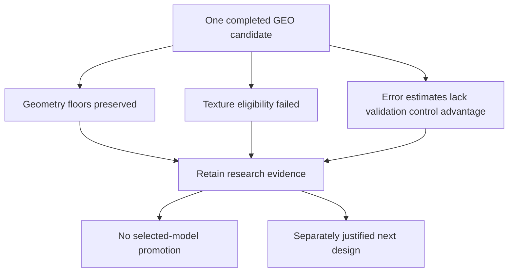

# GEO research handoff — current cycle complete

**2 November 2026.** NB16 preparation, NB17 fit and NB20's NB18/NB19 review/passport
stages are complete and independently HF-verified. No rerun or extra notebook
is required to close this cycle. [Completion proof](phase3NB20Completion.md).

| Item | Durable pointer | Status |
|---|---|---|
| Measured fit | [Pinned fit](https://huggingface.co/datasets/Shanmuk4622/tyre-wear-study/tree/1113bf8a9dd69687b23570fe985ed3a979a5f0e1/phase3/tread-two/geo-r1/fit/7d1bc8554813ae16ba3d73d5d4af2d8c05c977e9282d1bf324ff9dbef6e89bdb) | 60 epochs / 2,940 updates; frozen |
| Completed review | [Pinned review](https://huggingface.co/datasets/Shanmuk4622/tyre-wear-study/tree/610bdb223ca1212bbca9d42463ae427db98e5d6f/phase3/tread-two/geo-r1/review/a756786db07c44005c1f8f8174a8bdd71e697aded10608bfe7b759638f223b6d) | Seven completed audit stages |
| Capability passport | [Pinned passport](https://huggingface.co/datasets/Shanmuk4622/tyre-wear-study/tree/abfec8d65fe0066e415df47407370e0159255223/phase3/tread-two/geo-r1/passport/a756786db07c44005c1f8f8174a8bdd71e697aded10608bfe7b759638f223b6d) | Actual review provenance retained |
| Final native model | [Pinned final artifact](https://huggingface.co/datasets/Shanmuk4622/tyre-wear-study/resolve/1113bf8a9dd69687b23570fe985ed3a979a5f0e1/phase3/tread-two/geo-r1/fit/7d1bc8554813ae16ba3d73d5d4af2d8c05c977e9282d1bf324ff9dbef6e89bdb/evidence/exports/final-8358e0595d46caee1160.pt) | Unselected research artifact |
| Selected joint model | Unavailable | Original rule rejected all 60 epochs |
| Small local index | [Publications](tread_two/geo_research_release/publications.csv) / [artifacts](tread_two/geo_research_release/artifacts.csv) | Exact revisions, paths, hashes and counts |
| Model card | [Exact published card](tread_two/geo_research_release/MODEL_CARD.md) | Capability limits preserved |
| Earlier ATLAS series | [Historical hub](tread_two/research_release/Evidence_Hub.html) | Separate objectives and frozen evidence |

This index points to already-published evidence; it is local metadata, not a new
HF experiment. [RELEASE.json](tread_two/geo_research_release/RELEASE.json) binds
its source receipt and index hashes. The earlier ATLAS hub is preserved as a
dated separate release and is not regenerated.

The broader application is not declared complete. Both workstations and their
selected checkpoints remain preserved; their UI work is deferred. Existing
photos only. Classification/depth/safety limits remain unchanged.

The [recommended next research](phase3TreadTwoGEONextResearch.md) is a targeted
texture revision. Repeating the same geometry fit after removing texture is not
a justified new accuracy experiment: the completed runtime already isolated
the trainable task paths. Use retained weights/observations for geometry analysis.
