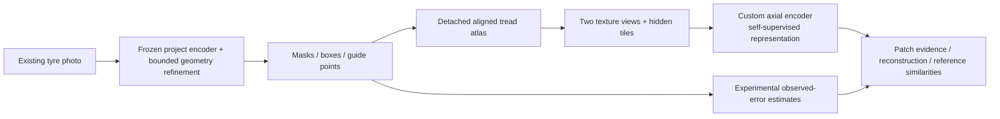

# TREAD-TWO / GEO — complete geometry-first development plan

<!-- NB16_DONE_STATUS -->
**Current update,1November2026:** [NB16 is complete and HF-verified](phase3NB16Completion.md); no rerun. NB17 is delivered in the isolated geo_pilot branch. Earlier pending/preparation statements below are dated history.
<!-- END_NB16_DONE_STATUS -->

<!-- NB16_STATUS -->
**Implementation update, 1 November 2026:** [NB16 preparation is delivered](phase3NB16Preparation.md). Local model/recovery checks pass; actual Kaggle/HF and full measured-fit integration remain pending. The design below is the original planning snapshot.
<!-- END_NB16_STATUS -->

**1 November 2026. Full design plan prepared; implementation and measured training pending.** This is a new TREAD-TWO objective built around segmentation, guide geometry, aligned texture learning and traceable evidence. The completed ATLAS v1/LC/context classifier experiments remain preserved as research evidence. Only existing photos are used; workstation changes remain deferred.

## What we will build

One custom packaged model accepts a 512×384 tyre photograph and returns tyre/tread masks, mask-derived localization boxes, six guide points, a 512×256 visible-tread atlas, local/global texture embeddings, masked-texture prediction diagnostics and three experimental annotation-error estimates. The first pilot has **no mileage-classification loss**. Later classification probing is a separately declared question, so another confidence increase is not presented as useful tyre recognition.

The creative component is a geometry-guided masked texture learner: use the existing visible geometry to establish 32 comparable local tiles, predict hidden texture from its neighbors, and learn stable but noncollapsed paired representations. Small geometry-refinement heads train with the masks/points already available. Disjoint gradients prevent texture/error objectives altering the dense branch. This combines useful existing supervision with a genuinely different learning objective; improvement is not yet measured.

## Why this follows our results

| Observed fact | Consequence in the new plan |
|---|---|
|All three ATLAS candidates retain low recall 0/62 |Do not launch another mileage-CE capacity revision as the main experiment |
|Context mainly lowers loss on already-correct sampled training views |Test masked-target prediction/representation utility with explicit collapse and mean-baseline checks |
|Existing geometry is useful; shared-gradient revision worsened point error |Keep the exact selected anchor frozen, train small supervised residuals, isolate task gradients and clip groups separately |
|Only 1/1/4 conservative training components across low/mid/high |Keep claims at existing-cohort development scope; preserve identity constraints and require no new photography |
|User wants one practical, highly retained run |One seed/60 epochs; same Kaggle/HF workflow with more raw outputs and direct CSV |

Evidence and limitations: [NB05](phase3NB05Completion.md), [NB15](phase3NB15Completion.md), [completed research handoff](phase3TreadTwoResearchClosure.md). Geometry labels can support class-agnostic learning even though a complete independent three-class component holdout is unsupported. This does not eliminate identity confounding or turn the historical endpoint into a blind test.

## Chosen experiment

| Item | Decision |
|---|---|
|Data |Existing 570 images; 386 train /81 validation /103 historical test; exact checksums/grouping retained |
|Point supervision |Train 70 human /152 weak /164 none; weak point weight 0.25; error targets human-only |
|Anchor |TREAD-ONE r1 seed 3/epoch 20, original validation selection, SHA`a5b872ed…`; 1,372,159 frozen parameters |
|New trainable parts |Bounded mask/point adapters,96D texture encoder and 2 axial blocks,64D projector,masked 4×16×16 decoder,3 error outputs |
|Capacity target |≤1M new trainable /≤3M total parameters; exact counts pending implementation |
|Fit budget |One seed 1,60 epochs,49×8 draws/epoch; 2,940 updates; every 386 train source each epoch plus 6 logged padding draws |
|Precision / learning |FP32; AdamW separate groups/clips; masked prediction +invariance/variance/covariance; supervised geometry/error losses |
|Checkpoint selection |Geometry preservation/collapse eligibility, then lowest masked-loss ratio+.1 paired distance; earliest tie; no test selection |
|Retention |40 draft CSV families plus full train logits/tokens/masked predictions/targets; all 60 epoch weights and complete rolling recovery |
|Kaggle / HF |Two T4s, existing expanded Kaggle input, HF_TOKEN, direct immutable files,30 min/major/catchable-stop pushes |
|Space |15 GB logical /18 GB projected peak /2 GB reserve within 20 GB assumption; actual fixture projection is mandatory |
|Application |Both workstations unchanged; this phase creates research code/evidence and a later export contract |

## Deliverables and dependency order

| Stage | Concrete deliverable | Completion evidence |
|---|---|---|
|A: data and source contract |Typed schema, full-coverage schedule, pinned anchor/data, exact annotation availability |Hash/identity/packing and warm-start tests |
|B: local model and persistence |Geometry/texture/error branches, losses, raw native chunks, atomic store, replay tests |Shapes/gradients/accounting/disk tests; no measured accuracy claim |
|C: planned NB16 |Self-contained Kaggle preparation/contract gate |Actual dual T4 math/memory/storage/live HF resume; disposable engineering namespace only |
|D: planned NB17 |One resumable measured GEO pilot |All 60 epochs or honest failed/incomplete state; direct telemetry/native checkpoints |
|E: planned NB18 |Completed-run audit, interactive atlas, model card and capability export |Pinned public verification, independent scientific reconstruction and declared result |

The immediate engineering milestone is **implement stages A/B and build NB16**. These notebook files are planned; none is runnable yet. Existing NB08–NB15 are not regenerated or repeated. An engineering gate is an automatic validity check, not a new permission request. No arbitrary extra full seed/sweep starts if the hypothesis fails.

## What success will mean

Preserve validation dense geometry within declared limits; beat the frozen train-only mean masked-target predictor by at least 5%on validation; retain finite noncollapsed features and mean paired cosine distance≤.05; obtain validSSLloss for≥90%trainingdraws; report the experimental error head against a simple fixed baseline. Evaluate selected/final historical outputs only after original selection and retain every failure/group/availability count.

These thresholds are frozen engineering criteria for this development study, not guarantees of deployment or physical tyre condition. If no checkpoint passes, the candidate fails and its complete evidence is retained. There is no automatic fallback to an attractive historical-test checkpoint. Classification, crack/damage detection, physical depth and safety remain unestablished.

## Full technical documents

| Document | Detail |
|---|---|
| [Architecture](tread_two/geometry_first/plan/ARCHITECTURE.md) |Exact tensor shapes, bounded refinement, masking, error outputs, loss formulas and gradient isolation |
| [Experiment](tread_two/geometry_first/plan/EXPERIMENT.md) |Data/schedule/augmentation, baseline controls, optimizer, selection, endpoints and diagnostics |
| [Retention](tread_two/geometry_first/plan/RETENTION.md) |Every requiredCSVfield/cadence, native arrays, raw capacity math, recovery versus permanent history and declared gaps |
| [Operations](tread_two/geometry_first/plan/OPERATIONS.md) |Two-GPU ownership, Kaggle cells, crash boundaries, HF cadence/budgets, fresh restore and troubleshooting |
| [Implementation](tread_two/geometry_first/plan/IMPLEMENTATION.md) |Module ownership, dependency order, local/live acceptance matrix, source freeze and next notebooks |
| [Risks and decisions](tread_two/geometry_first/plan/RISKS_AND_DECISIONS.md) |Observation-to-design mapping, failure actions and pending measured engineering facts |
| [Machine plan](tread_two/geometry_first/plan/PLAN.json), [schema](tread_two/geometry_first/plan/SCHEMAS.json), [sources](tread_two/geometry_first/plan/SOURCES.json) |Exact chosen values, draft field/type proposal and pinned evidence/primary references |

The self-supervised objective adapts [VICReg](https://arxiv.org/abs/2105.04906); this small-cohort design has no measured improvement yet. The new detached sampling boundary follows the project's previous deterministic-operation failures and [PyTorch's CUDA backward caveat](https://docs.pytorch.org/docs/2.11/generated/torch.nn.functional.grid_sample.html). [HF bucket/action guidance](https://huggingface.co/docs/hub/en/rate-limits) informs visible server-aware backoff; all user cadence, stop and direct-record requirements remain in force.

[Planning validation](tread_two/geometry_first/validation/PLAN_VALIDATION.json) records 480 schedule feasibility cases, raw CSV precision examples, dense-count reconstruction, metadata consistency and preserved sources. This is design validation, not a tested model or passed Kaggle gate.
