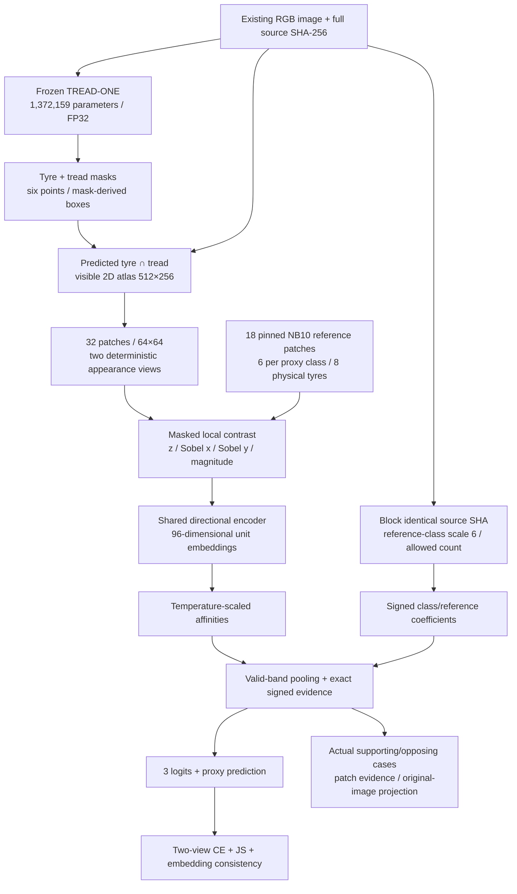
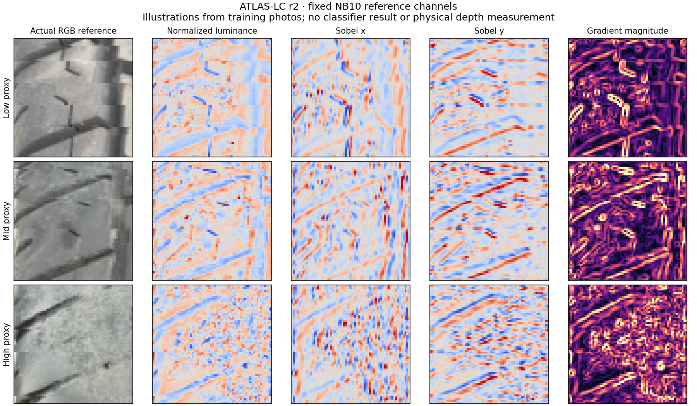
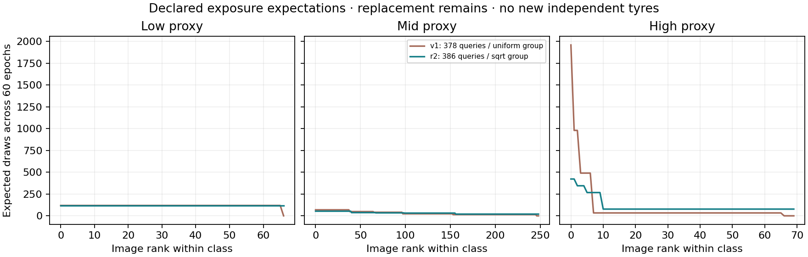

# ATLAS-LC r2 — an appearance-consistent case-evidence model

> Current status, 30 October 2026: NB11 and NB12 are complete/HF-verified. This document records the preserved LC r2 study. The new separately frozen candidate is [ATLAS-CONTEXT r3](phase3TreadTwoContextArchitecture.md); [NB12 completion](phase3NB12Completion.md) records actual publication and interpretation.

<!-- NB11_COMPLETE_UPDATE_20261030 -->
## Current — NB11 complete; NB12 review ready

**30 October 2026. NB11 is complete and independently HF-verified:** 60 epochs / 2,940 updates, 1,351 direct files and 54,336,368 raw scientific rows. The actual T4×2/live-HF preflight passed; ownership is released. No NB11 rerun is needed. [Full completion and findings](phase3NB11Completion.md).

Validation selected epoch 7 at BA 56.25%. Selected/final historical endpoint BA remains 50%: 62 low→mid and 41 high→high. NLL and appearance stability improve over v1; low recognition does not, and selected raw-score ECE worsens. Keep the candidate as research evidence; no workstation promotion.

Next: [NB12 saved-evidence review](notebooks/phase3_NB12_TREAD_TWO_ATLAS_LC_Completed_Review.ipynb), **CPU / Internet / HF_TOKEN / no dataset attachment**, then Run All. It adds 40 derived CSVs / 380,595 rows, four figures and a 1,442-case explorer with zero fitting or model forwards. Local recovery/cache/publication/package checks pass; actual NB12/HF review publication is pending. [Run guide](tread_two/lc_review/README.md).

<!-- END_NB11_COMPLETE_UPDATE -->
**30 October 2026 · implemented and locally checked; measured accuracy pending NB11.**
This is the next TREAD-TWO experiment. NB08's completed ATLAS v1, NB09's review,
NB10's frozen-model gate and both workstations keep their original identities.
Only the existing tyre data are used. No new photo collection is required.

## Why this model follows the evidence

| Observed evidence | r2 design response | What remains unproven |
|---|---|---|
| Dense tasks are strong; changing shared gradients regressed the earlier classifier | Freeze the declared TREAD-ONE dense anchor; optimize only a separate classifier | Frozen dense outputs can still fail on an unfamiliar capture |
| v1 learned training queries but missed every low endpoint; grayscale/dimming changed predictions | Replace RGB classifier input with four local-contrast texture channels and paired appearance training | Texture can encode identity, paint, blur and capture artifacts |
| v1's six references per class came from only 1/3/4 photos; all low cases matched mid references strongly | Use NB10's 18 distinct original training-photo patches | Distinct photos are not distinct physical tyres |
| Excluding NB10's 18 photos would create two singleton high query groups | Keep all386 queries; block identical source-SHA references per query | Other photographs of that same tyre can still be similar |
| Uniform-group replacement oversampled tiny high groups | Draw groups with probability proportional to sqrt(group size) | Repetition remains; expectation is not a hard exposure cap |
| Correct signed evidence did not imply transfer | Keep exact accounting and interventions, report classification failures openly | Explanations are model arithmetic, not physical causal proof |

The changes form a **bundled hypothesis**, not a single-factor ablation. One
seed is fitted. A better historical score would motivate further review; it
would not establish independent generalization or physical-wear validity.

## Actual computation

The atlas is a visible image coordinate system. It is not a cylindrical 3D tyre
reconstruction, millimetre measurement or physical alignment estimator.

## Representation and trainable layers

For valid mask `v`, luminance is the arithmetic RGB mean. A masked9×9 average
estimates local mean `μ` and variance; `s=max(sqrt(variance),0.02)`.
`z=clip((gray−μ)/s,−3,3)/3 · v`. The four channels are
`[z, Sobel_x(z)·v, Sobel_y(z)·v, sqrt(dx²+dy²+1e−12)·v]`.
Padding and pooling match [lc_features.py](tread_two/lc_pilot/lc_features.py).
Low-texture regions are not discarded as supposed wear truth.

The examples illustrate the representation before fitting. Bright lines, blur
and local contrast can still be capture artifacts. No channel measures depth.

| Stage | Exact structure |
|---|---|
| Stem | Conv4→24,3×3,stride2; GroupNorm8; SiLU |
| Directional block1 | Parallel depthwise7×3/3×7, concatenate; pointwise24×2→32; GroupNorm8; SiLU |
| Downsample2 | Conv32→48,3×3,stride2; GroupNorm8; SiLU |
| Directional block2 | Depthwise7×3/3×7; pointwise48×2→64; GroupNorm8; SiLU |
| Downsample3 | Conv64→96,3×3,stride2; GroupNorm8; SiLU |
| Embedding | Adaptive mean pool; L2 normalize with epsilon1e−6 |
| Case head | 54 constrained signed weights,3 biases,1 bounded temperature parameter |
| Parameters | **81,274 trainable; 1,453,433 total**, including frozen anchor |

There is no BatchNorm, dropout, AMP or stochastic layer. The reference encoder
is shared and trainable; the literal reference RGB, mask, label and source SHA
buffers remain fixed. Bank labels assign support/opposition signs; the query
label enters the loss only.

## Source exclusion and exact explanation

Let `a_br=1` when query source SHA differs from reference source SHA, otherwise0.
For reference class `g`, `n_bg=sum_{r:class(r)=g} a_br`. There are six cases per
class and all18 sources are unique, so an ordinary query retains6/6/6; a bank
photo retains5 for its own reference class and6 for the others. This is computed
from all32 SHA bytes before augmentation, independent of the query label.

Base coefficient `w_cr=sign(c=class(r)) · 2 sigmoid(u_cr)/6`, where the sign is
+1 for support and−1 for opposition. Effective coefficient:

`w_bcr = w_cr · a_br · 6/n_b,class(r)`.

For cosine similarity `s_bpr`, temperature `τ=.05+.95 sigmoid(t)`, reference
affinity is `exp((clip(s,−1,1)−1)/τ)`. Valid bands carry equal pooling mass;
within a band, patch mass `α_bp` follows valid coverage. Empty support has zero
mass. The class logit is exactly

`logit_bc = bias_c + Σ_p Σ_r α_bp affinity_bpr w_bcr`.

The blocked case contributes zero. CSV `case_rules`, affinities, patch support
and saved base coefficients reconstruct all contributions, including reference
class normalization. Selected/final native captures retain effective coefficients,
all reference embeddings and3×18 aggregate evidence. Bilinear CPU projection
conserves signed mass back to the512×384 image; residual guard is2e−6 logit units.
Bias remains separate from spatial evidence.

## Appearance objective and sampler

Each draw supplies two query-only brightness/contrast/gamma views, six
independent factors uniform[.8,1.2], determined by its saved augmentation seed.
Brightness precedes valid-pixel global contrast; clamp to[0,1], then gamma;
invalid pixels remain zero. Dense geometry is computed once on original RGB.

`L = mean[.5(CE_A+CE_B) + .1 JS(P_A,P_B) + .05 Σ_p α_p(1−cos(q_Ap,q_Bp))]`.

The bank is identical for both views. There are no pseudo labels, teacher
targets or held-out loss inputs. LC removes colour by construction; grayscale
agreement is an implementation property, not learned robustness evidence.
Brightness/gamma clipping, flat-region floors and shadows still change texture.

Sampling is uniform class → uniform available domain → group with weight
`sqrt(n_group)` → uniform image. It uses replacement and logs exact probabilities.
All386 training images are eligible, including the18 reference photos with
self-reference suppression. The largest per-image expectation is **422.27**
draws over60 epochs, compared with about1,960 for a singleton under the disjoint
18-photo proposal and old uniform-group sampler. This is an expectation, not a cap.

The figure compares the actual v1 query pool with r2's all386 policy. Curves are
sorted independently within each class; zero v1 entries are excluded bank photos.
The [underlying comparison CSV](tread_two/lc_validation/sampling_comparison.csv)
retains image/source identities, so the plot does not hide who receives repetitions.

## Claim and deployment boundary

- Training low/mid/high known physical-tyre support remains **1/3/4**. Video
  frames remain correlated and their original parents unresolved.
- The old103-image endpoint has62low/41high, no mid. It was already inspected.
  Validation chooses a checkpoint; test/probe scores cannot change that choice.
- Dense metrics, boxes and points come from the frozen anchor. Classifier
  training cannot be credited with improving those tasks.
- This is mileage-proxy research, not depth, alignment, roadworthiness or safety
  diagnosis. No workstation installs this unmeasured r2.

See [training/recovery protocol](phase3TreadTwoLCProtocol.md),
[CSV schema](tread_two/lc_pilot/SCHEMA.md), [run guide](tread_two/lc_pilot/README.md)
and [actual local validation](tread_two/lc_validation/LOCAL_VALIDATION.json).
