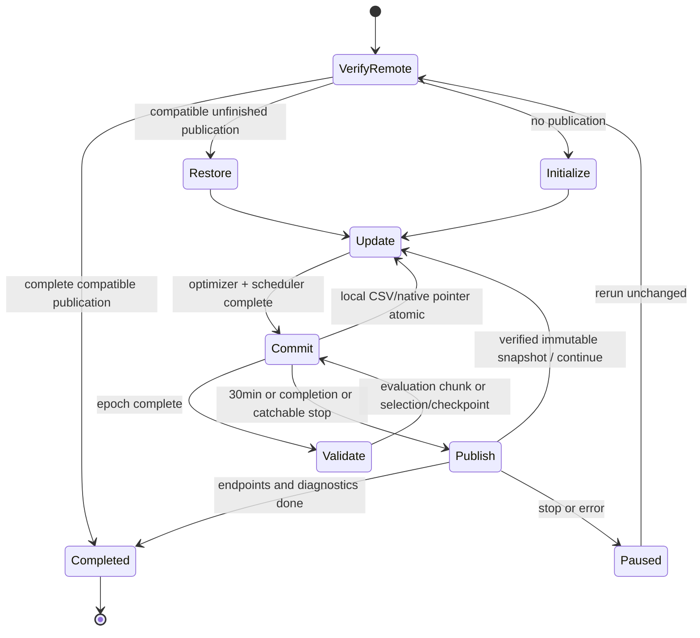

# NB11 — frozen ATLAS-LC r2 training and recovery protocol

<!-- NB11_COMPLETE_UPDATE_20261030 -->
## Current — NB11 complete; NB12 review ready

**30 October 2026. NB11 is complete and independently HF-verified:** 60 epochs / 2,940 updates, 1,351 direct files and 54,336,368 raw scientific rows. The actual T4×2/live-HF preflight passed; ownership is released. No NB11 rerun is needed. [Full completion and findings](phase3NB11Completion.md).

Validation selected epoch 7 at BA 56.25%. Selected/final historical endpoint BA remains 50%: 62 low→mid and 41 high→high. NLL and appearance stability improve over v1; low recognition does not, and selected raw-score ECE worsens. Keep the candidate as research evidence; no workstation promotion.

Next: [NB12 saved-evidence review](notebooks/phase3_NB12_TREAD_TWO_ATLAS_LC_Completed_Review.ipynb), **CPU / Internet / HF_TOKEN / no dataset attachment**, then Run All. It adds 40 derived CSVs / 380,595 rows, four figures and a 1,442-case explorer with zero fitting or model forwards. Local recovery/cache/publication/package checks pass; actual NB12/HF review publication is pending. [Run guide](tread_two/lc_review/README.md).

<!-- END_NB11_COMPLETE_UPDATE -->
**30 October 2026. Implemented; local engineering acceptance passed.** Actual
dual-T4 execution, live HF restore and measured r2 outcomes remain Kaggle work.
The next action is to run [NB11](notebooks/phase3_NB11_TREAD_TWO_ATLAS_LC_Resumable_Pilot.ipynb),
then independently audit its saved execution and pinned HF publication.

## Frozen study choices

| Item | Value |
|---|---|
| Candidate fits | One architecture, seed1,60 epochs,49 updates/epoch,batch8;2,940 updates |
| Data | Existing prepared phase2 release; historical386train/81validation/103test |
| Query/reference policy | All386 train queries;18 distinct train-photo reference patches; full-SHA self block |
| Sampling | Class/domain uniform; group probability ∝sqrt(n); uniform image; replacement |
| Appearance | Two views per draw, brightness/contrast/gamma uniform[.8,1.2] |
| Objective | Mean paired CE +0.1 probability JS +0.05 band-weighted embedding cosine distance |
| Optimizer | AdamW,lr.001,wd.0001,betas(.9,.999),eps1e−8; foreach/fused disabled |
| Schedule | Cosine over2,940 completed updates; no warmup; global norm clip1 |
| Numeric mode | FP32 throughout; disabled scaler still saved; dense microbatch1 |
| GPU ownership | GPU0 optimizer; GPU1 immutable evaluation copy at barriers; no DDP |
| Selection | Validation observed-class BA descending, three-class NLL ascending, earliest epoch |
| Retention | Every completed update state; all60 epoch weights; selected/final outputs and interventions |
| Diagnostics | Grayscale-both,brightness.8/1.2,gamma.8/1.2,top signed patch occlusion; both endpoints |
| HF destination | `Shanmuk4622/tyre-wear-study`, `phase3/tread-two/atlas-lc-r2/fit/<contract>` |
| Secrets | Kaggle `HF_TOKEN` only; worker does not receive it |

The contract hashes source/assets, recipe, dataset/overlay and actual numeric
environment/devices. The local one-GPU engineering contract intentionally differs
from the measured Kaggle contract. The same source/contract must be used to resume
an active fit. An environment change is not silently bypassed.

## Two layers of recovery

| Layer | What is recoverable | Interruption boundary |
|---|---|---|
| Local committed unit | Model,optimizer,scheduler,disabled scaler,Python/NumPy/CPU/CUDA RNG,epoch order,next draw/update,partial epoch/evaluation records,dense-cache identities,CSV row/byte cursors and native hashes | Last completed atomic unit; replay an incomplete update/chunk |
| Pinned HF snapshot | Complete immutable direct CSV/native/source snapshot selected by manifest; object hashes verified before install | Last verified remote snapshot; forced kernel death cannot upload unsent work |

CSV appends are hashed per unit. On recovery, completed prefixes are verified and
only uncommitted generated suffixes are rolled back. The native pointer selects
one consistent model/CSV state. Two recent local state files rotate; all committed
CSV rows, unit/history records, dense artifacts and epoch weights remain retained.
Timing/resource observations may differ between executions; scientific/native
state equality is tested separately from those measurements.

## HF ownership, publication and rate handling

One owner uses a2,700-second lease and900-second heartbeat with compare-and-swap
commits. Never steal an active lease, erase ownership or launch duplicate writers.
Objects are content addressed; batches contain at most80 scientific objects.
The final manifest is selected only after checking all objects; lost successful
responses are reconciled rather than blindly repeating commits.

Normal pushes occur every1,800 seconds, at major notebook-stage completion and
catchable Stop/error. A stop requests a safe update boundary and **immediately
attempts** to publish; server wait/backoff can delay the transfer. The last verified
revision and pending local work are retained. Power loss/forced process death
cannot execute cleanup. Preserve local output whenever possible.

The corrected budget is native r2 code: API96/300sec,resolver400/300sec,transfer
1,000/300sec, plus a separate conservative96 commit attempts/hour. These are
local guards, not claims about an account's actual quota. Server policy,
remaining/reset and Retry-After take priority; long waits do not become invented
network timeouts. Concurrent traffic on other hosts is not locally countable.
[HF's official rate-limit documentation](https://huggingface.co/docs/hub/en/rate-limits)
describes bucketed five-minute HTTP quotas and separate granular action limits;
checked30 October2026. The tested Hub0.36.2 transport is pinned; Torch is preserved.

## Output budget and evidence volume

| Observation family | Planned count |
|---|---:|
| Training draws | 23,520 |
| Training appearance observations | 47,040 |
| Validation observations | 4,860 |
| Selected/final endpoint observations | 206 |
| Six diagnostics ×two endpoints ×103images | 1,236 |
| Total classifier observations | **53,342** |
| Patch/reference affinity rows | **30,724,992** |
| Signed patch/class rows | **5,120,832** |
| Per-observation reference permission rows | **960,156** |
| Paired draw records / patch consistency rows | **23,520 / 752,640** |

The local actual batch8 fixture projects a **15,015,649,644-byte peak**:
working scientific copy + immutable staging +2GB reserve, below the16GB guard
inside the user's20GB output budget. This is an extrapolation, not a quota
guarantee. Kaggle remeasures raw CSV sizes and must pass its own projection before
measured training. Start with12GiB free. Runtime free-space guards remain active;
the larger scratch mount mentioned by the user is never assumed.

Previously verified publication staging is removed before constructing another
snapshot. Paths are resolved inside the owned snapshot directory and carry a
verified-publication marker. Raw scientific data, all epoch weights and recovery
history are never deleted to reduce the budget. A remote-resume transfer directory
is removed only after a verified local install. No ZIP,NPZ or database is uploaded.

## Interpretation and next review

Both online views are saved before the optimizer update and join the preceding
coefficient state. Epoch training metrics mix online states and repeated views;
they are not fixed-checkpoint training-set accuracy. Validation is deterministic
original appearance. All103 selected/final images receive conserved native
projections and the interactive report; all diagnostic predictions remain CSV.

After NB11 completes, audit execution, owner release, every manifest object,
CSV row cursors, paired objective reconstruction, exposure, reference exclusions,
selected/final confusion/NLL/calibration, per-group failures and projection
residuals. Compare against the preserved v1 result with explicit changed protocol.
Do not promote by a test-selected epoch or call this independent confirmation.

No new tyre photos, external acquisition, workstation modification or additional
measured seed is authorized by merely finishing this notebook.
