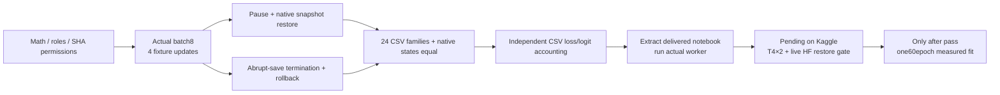

# ATLAS-LC r2 — actual validation and delivery boundaries

> Current status, 30 October 2026: NB11 and NB12 are complete/HF-verified. This document records the preserved LC r2 study. The new separately frozen candidate is [ATLAS-CONTEXT r3](phase3TreadTwoContextArchitecture.md); [NB12 completion](phase3NB12Completion.md) records actual publication and interpretation.

<!-- NB11_COMPLETE_UPDATE_20261030 -->
## Current — NB11 complete; NB12 review ready

**30 October 2026. NB11 is complete and independently HF-verified:** 60 epochs / 2,940 updates, 1,351 direct files and 54,336,368 raw scientific rows. The actual T4×2/live-HF preflight passed; ownership is released. No NB11 rerun is needed. [Full completion and findings](phase3NB11Completion.md).

Validation selected epoch 7 at BA 56.25%. Selected/final historical endpoint BA remains 50%: 62 low→mid and 41 high→high. NLL and appearance stability improve over v1; low recognition does not, and selected raw-score ECE worsens. Keep the candidate as research evidence; no workstation promotion.

Next: [NB12 saved-evidence review](notebooks/phase3_NB12_TREAD_TWO_ATLAS_LC_Completed_Review.ipynb), **CPU / Internet / HF_TOKEN / no dataset attachment**, then Run All. It adds 40 derived CSVs / 380,595 rows, four figures and a 1,442-case explorer with zero fitting or model forwards. Local recovery/cache/publication/package checks pass; actual NB12/HF review publication is pending. [Run guide](tread_two/lc_review/README.md).

<!-- END_NB11_COMPLETE_UPDATE -->
**30 October2026. Local acceptance passed; measured r2 results are pending.**
The checked runtime is frozen under `tread_two/lc_pilot/`. NB11 embeds those exact
files, with no edits to completed v1, the supplied executed notebooks or either
workstation. Local commands ran in `cv_conda`; no package replacement was needed.

## Evidence-backed checks

| Check | Actual result | Receipt |
|---|---|---|
| Model/data invariants |386train roles,18distinct source SHAs,81,274trainable/1,453,433total;source-only self block,6/n scale,additive logits,paired gradients and sampler normalization pass | [Math validation](tread_two/lc_validation/MATH_VALIDATION.json) |
| Full-batch actual worker | Batch8,four updates,two epochs and selected/final/six diagnostic fixture paths complete | [Local validation](tread_two/lc_validation/LOCAL_VALIDATION.json) |
| Pause and restore | Fresh process resumes after update1; all model,optimizer,scheduler,scaler,RNG,orders,cursors and native artifacts equal uninterrupted execution | Same receipt |
| Abrupt interruption | Termination during native save rolls back incomplete CSV/native suffix; resumed scientific state matches uninterrupted | Same receipt |
| All scientific families |24families equal,including both appearance views,reference permissions,pair losses and patch consistency | Same receipt |
| Offline transaction/publication |17checks:four atomic fault sites,two-state rotation,prefix/hash/contract rejection,immutable CSV snapshots,pinned restore,80-object batches,lost-success reconciliation,CAS fencing,owner release and quota/backoff | Same receipt; network requests0 |
| Independent CSV accounting |96observations/288logits reconstructed;max residual1.1533e−8;32paired losses/fourupdate losses;max pair-loss residual1.1949e−7;all SHA masks/scales checked | [CSV-only accounting](tread_two/lc_validation/CSV_ACCOUNTING.json) |
| Delivered notebook |31exact embedded files,five clean code cells;freshly extracted batch8 worker commits16view observations and native/scientific state matches reference | [Package validation](tread_two/lc_validation/PACKAGE_VALIDATION.json) |
| Storage | Projected peak15,015,649,644bytes <16GB guard;actual raw fixture byte sizes drive projection | Local validation storage_projection |
| Figures | Actual pinned reference channels and declared sampler expectations generated and visually inspected | [Channels](tread_two/lc_validation/figures/reference_channels.png), [sampling](tread_two/lc_validation/figures/sampling_expectations.png) |
| Interactive report | Saved-evidence report contains all four fixture endpoint records/18references;payload checked | Package validation; no native-browser-render claim |

The fixture retains96classifier observations,55,296affinity rows,1,728reference
permission rows,32draw pairs,1,024patch-consistency rows and64appearance exposure
rows. It also exercises30deduplicated dense images. Those are engineering records,
not60epoch measured outcomes. No fixture score is a classifier-improvement claim.

## Where the proof stops

| Capability | Local state | Kaggle requirement |
|---|---|---|
| CUDA execution | Existing GTX1650,FP32,train/evaluation oncuda:0 | Actual T4×2 topology verified in prepare/preflight |
| Live authenticated HF publication | Not performed locally;public upstream reads only | Write-capable HF_TOKEN from Kaggle Secrets |
| Remote recovery | Offline immutable Git/LFS service fixture +native install tested | Automatic upload,pinned download,fresh-process restore equivalence before long fit |
| Complete measured model | Not trained;all result fields remain unknown |2,940updates,all60epoch weights,endpoints and diagnostics |
| Model quality | No improvement established | Independent completion audit,including failures and calibration |
| Physical wear/safety | No new truth or claim | Outside these mileage-proxy annotations |
| Workstation integration | Deferred;unchanged | Separate later user direction after result review |

Native equality is required within the same declared environment. Timing,disk,
host RSS and CUDA peak resource fields are deliberately excluded from exact
equivalence comparisons; their actual observations remain saved. Other scientific
fields are not excluded to make a failure disappear. Kaggle includes its actual
environment in its own contract and recomputes the output projection.

## Retention, gaps and preservation

The24-family/285-column schema is documented in [SCHEMA.md](tread_two/lc_pilot/SCHEMA.md).
Every draw keeps both views' logits/probabilities,full patch/reference comparisons,
support/evidence,augmentation factors and source permissions; pair-level objective
terms join per-update loss/gradient summaries. Full native recovery state remains
available at completed atomic boundaries. All60epoch weights are retained in a
measured run. Unsaved continuous energy traces,per-objective gradient vectors and
new physical labels are explicitly not claimed. Source seeds/data/geometry recover
appearance tensors without storing another full RGB copy for every draw.

The final [HANDOFF.json](tread_two/lc_validation/HANDOFF.json) binds actual notebook,
source/asset and documentation hashes; original workstation/source/Markdown
baselines and supplied executed notebooks are checked separately. Historical
clean-delivery hashes are never imposed on user-executed notebook bytes.

Next: follow the [Kaggle run guide](tread_two/lc_pilot/README.md), then return the
executed NB11 for independent HF verification. No NB08/NB09/NB10 rerun is required.
