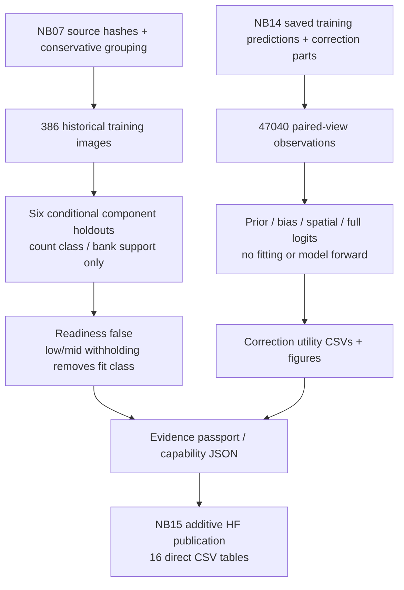
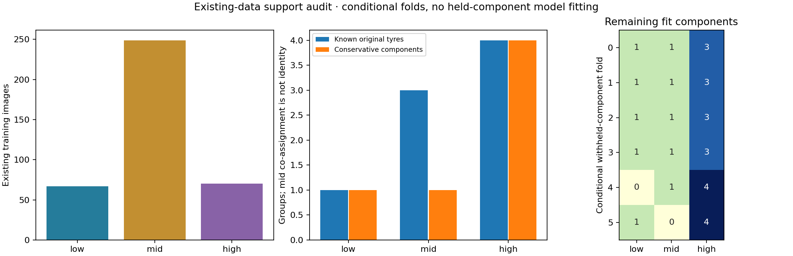
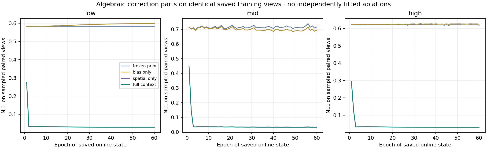
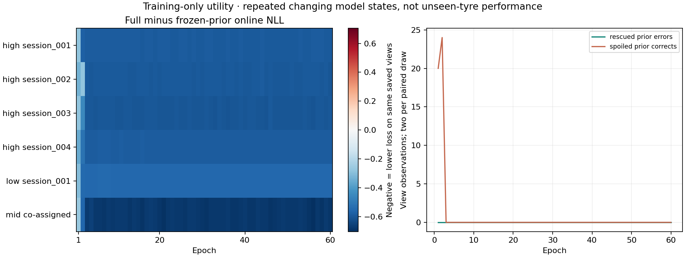

# TREAD-TWO — existing-data readiness and evidence passport

<!-- NB15_CLOSED_20261101 -->
## Superseding measured completion — 1 November 2026

NB15 is now complete and independently HF-verified: all 38 direct files / 16 CSVs / 196,905 rows, three figures and actual passport controls pass; writer released. [Completion](phase3NB15Completion.md). Readiness false is the expected support finding. Do not rerun NB15 to change it. The next consolidation step is now [implemented as the research handoff](phase3TreadTwoResearchClosure.md); no further notebook is needed for the unchanged studies. Earlier pending-Kaggle wording below records the original delivery.
<!-- END_NB15_CLOSED_20261101 -->

**1 November 2026. Implemented and executed locally; actual NB15 Kaggle/HF publication pending.** Analysis integrity passes; scientific readiness for a complete three-class component-held-out comparison is **false**. This is a measured support limit, not a runtime error or proof that all possible models must fail.

## Why this is the next step

The [completed NB14](phase3NB14Completion.md) confirms that added positional capacity amplified training confidence without improving the historical low-class failure. Another full seed/architecture run has no supporting transfer evidence. This gate uses existing pinned registries and training observations to identify what can be checked honestly, without new photographs, checkpoint reselection or workstation changes.

## Existing training support

| Proxy class | Images | Original photos | Existing video frames | Known original tyres | Conservative components |
|---|---:|---:|---:|---:|---:|
| Low | 67 | 67 | 0 | 1 | 1 |
| Mid | 249 | 97 | 152 | 3 | 1 |
| High | 70 | 70 | 0 | 4 | 4 |

The mid component conservatively co-assigns unresolved parent candidates and their clips. **It is not an assertion that three known mid tyres are identical.** Known physical tyres, provisional clip groups and conservative components are counted separately. No historical validation/test image is reassigned to training.

| Conditional withheld group | Remaining low/mid/high fit images | Result |
|---|---|---|
| High session 001 | 67 / 249 / 67 | Three classes remain; no fold model is fitted |
| High session 002 | 67 / 249 / 68 | Three classes remain; no fold model is fitted |
| High session 003 | 67 / 249 / 65 | Three classes remain; no fold model is fitted |
| High session 004 | 67 / 249 / 10 | Three classes remain; no fold model is fitted |
| Only training low tyre | 0 / 249 / 70 | Low fit class disappears |
| Conservative mid component | 67 / 0 / 70 | Mid fit class disappears |

This blocks a complete class-supported leave-component-out comparison across the current training grouping. The four high-only conditional holdouts do not validate low/mid transfer. Counting support does not make the existing globally trained encoder group-held-out.

The frozen 18-reference bank is audited after removing the full held component and identical query source SHA. All **1,158 query/class rows** are retained; unsupported `6/n` normalization remains blank. No replacement bank is trained or scored.

## What the correction parts show

For every saved training observation, reconstruct `b`, `b+g`, `b+s`, and `b+g+s`, where `b` is frozen selected LC, `g` bounded global bias and `s` summed spatial correction. All four variants use the identical saved view and actual pre-update model state. These are algebraic diagnostic parts, not independently trained ablations.

The frozen prior already correctly classifies **all 47,040 sampled training-view observations**. Full context rescues **0** prior errors and transiently spoils **44** prior-correct view observations early in training. It lowers training NLL mainly through the spatial term. This is a confidence/loss finding on trained images and repeated changing states, not evidence of transfer or a fixed final-cohort evaluation.

| Final training epoch, same 784 saved views / 214 distinct images | NLL | Mean max probability | Argmax accuracy |
|---|---:|---:|---:|
| Frozen prior | 0.636877 | 0.530181 | 100% |
| Bias only | 0.636948 | 0.529765 | 100% |
| Spatial only | 0.031380 | 0.969111 | 100% |
| Full context | 0.031365 | 0.969124 | 100% |

## Code, retention and execution

| Module / artifact | Responsibility |
|---|---|
| [public_inputs.py](tread_two/readiness_gate/public_inputs.py) | Six public pinned inputs, hash/size cache, bounded 1 MiB reads, retries/server waits, no credential lookup |
| [INPUTS.json](tread_two/readiness_gate/INPUTS.json) | Exact NB14/NB07 revisions, prefixes, object hashes/sizes and provenance |
| [run_gate.py](tread_two/readiness_gate/run_gate.py) | Filter training rows before numeric analysis; identity/fold/bank support; four logit parts and view/group aggregates |
| [render_gate.py](tread_two/readiness_gate/render_gate.py) | Three PNG figures, interactive epoch/class/variant passport, methods and table index |
| [publish_gate.py](tread_two/readiness_gate/publish_gate.py) | Immutable additive direct files through unchanged r3 transport, ownership and rerun reconciliation |
| [CAPABILITIES.json](tread_two/readiness_report/CAPABILITIES.json) | Research-only classifier; retained frozen geometry; internal evidence scope; depth/safety unavailable |

Six inputs total **70,218,229 bytes**. Outputs: **16 CSV tables / 196,905 rows**, including **188,160** saved-view counterfactual rows, all 2,316 conditional fold assignments and 1,158 bank-support rows, a 166-field dictionary, three figures and interactive passport. [Full CSV inventory](tread_two/readiness_report/CSV_INDEX.md), [methods/denominators/limits](tread_two/readiness_report/METHODS.md), [interactive passport](tread_two/readiness_report/Evidence_Passport.html).

NB15 is self-contained: 40 hashed payload files. CPU/None, Internet, HF_TOKEN for writes, no dataset, 2 GiB free / about 4 GB RAM. Only the HF SDK is added to a private publication folder; global Kaggle libraries and Torch/CUDA are not replaced. Original native model weights are not loaded. Finite report/cache files survive a stopped session when working output survives; unchanged rerun reuses verified inputs and rebuilds derived tables. Complete publication happens after the major analysis cell; it does not claim per-update optimizer recovery or 30-minute snapshots for a partial derived report. Catchable Stop lets the current completed-report upload finish; forced kernel death cannot upload unsent files.

Destination: `phase3/tread-two/readiness-gate/v1/<contract>`, **38 logical direct files** including manifest. Source/protocol and original fit/review namespaces remain read-only. No ZIP/NPZ/database. Large local input cache, acceptance fixtures and row-level counterfactual table stay outside Git; direct HF publication retains them.

## Actual local proof and decision

[Package acceptance](tread_two/readiness_validation/PACKAGE_VALIDATION.json), [public transport/cache checks](tread_two/readiness_validation/TRANSPORT_VALIDATION.json), [notebook identity](tread_two/readiness_validation/NOTEBOOK.json), [viewer checks](tread_two/readiness_validation/VIEWER.json), [analysis receipt](tread_two/readiness_report/ANALYSIS.json).

- Every table size/schema/row/hash and unsupported reference case checked; actual class/component support and algebraic counts confirmed.
- Changing every held-out numeric prediction/correction and held-out registry label leaves **all scientific CSVs byte-identical**. Changing a training source SHA is rejected.
- Actual 40-file setup cell executed locally with Kaggle paths stubbed: extraction/rerun/drift rejection pass. Fresh extracted scientific code reproduces every CSV without network downloads.
- Actual passport JavaScript epoch/class/variant controls and weighted curves pass a synthetic DOM check; no native browser screenshot claim.
- Offline publication handles a lost successful response, releases ownership, skips an identical rerun and writes only its new gate namespace.

Training-only describes the rows analyzed. The frozen LC prior had already been historically selected on validation, so this is not an untouched end-to-end benchmark. No physical depth/safety/wear truth or independent tyres are created.

**Decision:** retain ATLAS v1/LC/context as documented research candidates; do not automatically launch a fourth full classifier fit or install the failed classifier. Run NB15 once for the requested durable HF evidence publication, then verify and close this gate. A later existing-data experiment needs a distinct supported objective/protocol; an identical rerun cannot repair missing support. Workstation changes remain deferred under the user's instruction; no new-photo collection is required for this completed audit.
