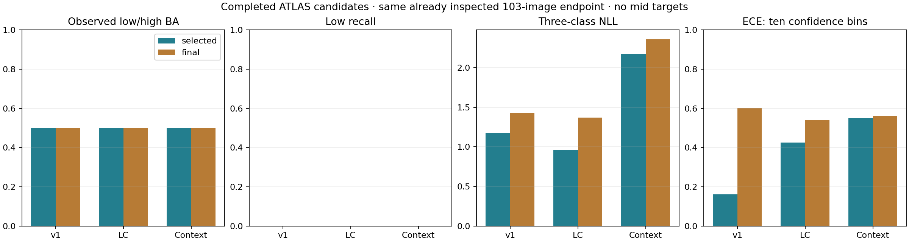
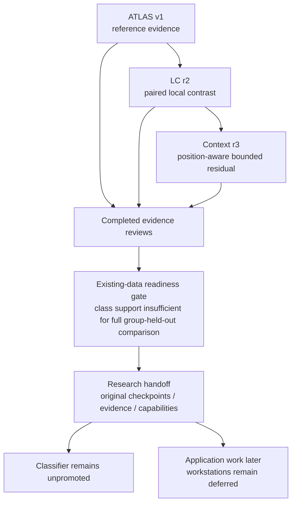

# TREAD-TWO current experiments — research closure and handoff

<!-- GEO_PLAN_20261101 -->
## Later requested direction — geometry-first GEO plan

On 1 November 2026 the user requested a complete new development plan after discussing what remains possible with existing photos. [TREAD-TWO / GEO plan](phase3TreadTwoGeometryPlan.md) defines a different geometry/representation objective; implementation is pending. The closure below still applies to the completed ATLAS classifier series. No old fit, model selection, research index or workstation is modified by the plan.
<!-- END_GEO_PLAN_20261101 -->

**1 November 2026. Three candidate fits, their reviews and the existing-data readiness gate are complete and HF-verified. Classification remains research-only/unpromoted.** This closes the current v1 / LC r2 / context r3 experimental series. It does not declare the broader tyre application finished or establish useful classification on unseen tyres.

## Result and decision

| Candidate | Original selected epoch | Selected / final BA | Low / high recall | Selected NLL | Final NLL |
|---|---:|---:|---|---:|---:|
| ATLAS v1 | 18 | 50% / 50% | 0/62; 41/41 | 1.178296 | 1.428298 |
| ATLAS-LC r2 | 7 | 50% / 50% | 0/62; 41/41 | 0.961273 | 1.369872 |
| ATLAS-CONTEXT r3 | 7 | 50% / 50% | 0/62; 41/41 | 2.174813 | 2.358475 |

All comparisons describe the same already-inspected 103-image low/high historical endpoint. No mid target, independent confirmation cohort, causal single-factor comparison or image-independent confidence interval is invented. Each fit completed one seed / 60 epochs / 2,940 updates; NB13A recovered the existing context experiment. Different architectures are not seed replicates.

LC addresses an observed appearance-stability problem and improves selected probability loss. Context adds learned layout sensitivity and correctly conserved internal evidence. Neither repairs low recognition. Context mainly sharpens training confidence and worsens historical probability loss. The choices followed earlier observations, but the measured results do not establish the hypotheses as successful classifiers.

NB15 independently verifies the class-support limit: known original training tyres low/mid/high = 1/3/4; conservative components = 1/1/4. Two conditional holdouts remove a fit class. The three known mid tyres remain physically distinct; their unresolved clip-parent co-assignment is a leakage safeguard. [NB15 completion and proof](phase3NB15Completion.md), [methods](phase3TreadTwoReadiness.md).

## Handoff contents and code ownership

| Deliverable | Purpose |
|---|---|
| [Evidence hub](tread_two/research_release/Evidence_Hub.html) | Offline model/type filters, selected/final metrics, capability statements and exact evidence links |
| [v1 card](tread_two/research_release/MODEL_CARD_V1.md), [LC card](tread_two/research_release/MODEL_CARD_LC.md), [context card](tread_two/research_release/MODEL_CARD_CONTEXT.md) | Architecture/results/source/selection/limit records; selected/final native SHA and direct URLs |
| [models.csv](tread_two/research_release/models.csv) | Three model identities, original epochs, unchanged inventory hashes and native pointers |
| [endpoint_metrics.csv](tread_two/research_release/endpoint_metrics.csv) | Six saved endpoint rows; BA, recalls, NLL, Brier, ECE and explicit scope |
| [publications.csv](tread_two/research_release/publications.csv) | Nine pinned publications: three fits, three reviews, three gates; counts, audit scope and receipts |
| [artifacts.csv](tread_two/research_release/artifacts.csv) | Fourteen exact SHA/size/HF object descriptors, including six selected/final native checkpoints |
| [capabilities.csv](tread_two/research_release/capabilities.csv) | Research classification, retained frozen geometry, internal explanations and unavailable depth/safety targets |
| [provenance.csv](tread_two/research_release/provenance.csv), [dictionary](tread_two/research_release/table_dictionary.csv) | Consumed source hashes, field definitions, units and missingness |
| [RELEASE.json](tread_two/research_release/RELEASE.json) | Every local source/output hash and the explicit local-only handoff status |
| [Generator](analysis/build_tread_two_research_release.py) | Builds only metadata, cards, figure and research HTML from completed receipts/manifests/CSV |
| [Acceptance](analysis/validate_research_release.py) | Checks source/artifact hashes, manifest/native pointers, row scopes, cards, figure and actual viewer JS |

Seven CSV tables contain 134 metadata rows. These are not new training observations or independent tyres. Native weights are referenced at immutable revisions rather than copied into a new archive. NB08's raw-row count remains a saved cursor declaration with bounded recount scope; later exhaustive audits and derived-table checks retain their separate scope. NB07 structured counts exclude additional raw/control inputs. There is no combined row total presented as new data.

## Actual checks

[Validation receipt](tread_two/research_release_validation/VALIDATION.json): all source/output hashes match; three original selected epochs are 18/7/7; fourteen artifact descriptors match the original manifests by size/SHA/object URL; nine publication records retain released owners and passed receipts. The actual HTML JavaScript filters for three models and three record kinds, model-card links and capability/artifact display pass a synthetic DOM test. The scientific comparison PNG was visually inspected. Native browser rendering is not claimed.

The independent NB15 audit separately checks all 37 published payloads, all 16 CSV schemas/counts/values, three PNGs, actual passport controls, the capability record, and unchanged context fit/review manifests. No model forward, optimizer update, local credential lookup, HF write or application mutation occurs during closure.

## Current next step

The consolidation step is implemented and ready for review. No further notebook is needed for these unchanged completed studies. Use the handoff as the evidence contract when workstation/application work is resumed; those changes remain deferred. Keep the selected models and both workstations unchanged. Existing photos only; the audit and closure do not require acquisition.

A later model experiment can explore a distinct supported target, representation or protocol, but this closure does not automatically start a fourth full classifier fit, choose a post-hoc blend/threshold, or relabel mileage as physical depth/safety. A false support flag cannot be fixed by an identical rerun. The current conclusion is a completed research series with unresolved low-class transfer.

All indexed scientific evidence is already directly retained on HF. The new local research index itself has not been published to HF; its compact sources/cards/CSV/figure are kept Git-visible. [Handoff guide](tread_two/research_release/README.md).
