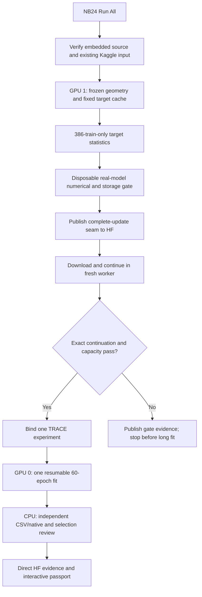
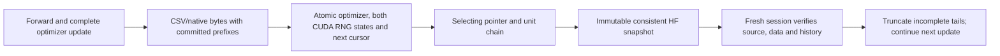

# TRACE notebook batch — run NB24 once

<!-- NB24_ACTUAL_RESULT -->
## Current result — original NB24 complete

The actual Kaggle fit and HF review are complete. **Do not rerun the completed
batch.** [Completion and live gate proof](phase3NB24Completion.md) ·
[Actual findings, figures and next research](phase3TreadTwoTRACEFindings.md).
The delivery/local-test/run instructions below are historical reference; their
pending-live statements describe the pre-execution checkpoint.
<!-- END_NB24_ACTUAL_RESULT -->

**2 November 2026.** The complete preparation, pilot and review batch is
implemented under `tread_two/trace_batch/`. **Run NB24 with Run All** in one
dedicated Kaggle session. It sequences the dependent stages automatically.
The individual notebooks are supplied for separate stage use and recovery.

| Notebook | Purpose | Normal use |
|---|---|---|
| [NB21 preparation](notebooks/phase3_NB21_TREAD_TWO_TRACE_Preparation_And_Contract_Gate.ipynb) | Fixed targets, numerical/storage gates and actual HF checkpoint continuation | Optional individual stage |
| [NB22 pilot](notebooks/phase3_NB22_TREAD_TWO_TRACE_Resumable_Pilot.ipynb) | One seed / 60 epochs / 2,940 updates; automatically satisfies preparation | Optional individual stage |
| [NB23 review](notebooks/phase3_NB23_TREAD_TWO_TRACE_Completed_Review_And_Passport.ipynb) | CPU saved-evidence audit and interactive research passport | Optional after completed fit |
| **[NB24 master](notebooks/phase3_NB24_TREAD_TWO_TRACE_All_In_One_Batch.ipynb)** | **Preparation → live gate → pilot → review** | **Recommended: Run All once** |

Do not launch the individual notebooks concurrently against the same run. They
share one experiment and HF ownership; the master handles their order.

## Kaggle setup

| Setting | Required value |
|---|---|
| Session | Dedicated fresh session for a new run; retain its files for recovery |
| Accelerator | **GPU T4 ×2** for NB24/NB21/NB22 |
| Internet | **ON** |
| Input | Existing expanded **`shanmuk4622/tire-dataset-prepared-phase2`** |
| Secret | Enable **`HF_TOKEN`**, with write access to **`Shanmuk4622/tyre-wear-study`** |
| Working space | Cold start **at least 19 GB free**; actual projection must also leave the 2 GB reserve |
| Run | Upload NB24 → confirm settings → **Run All** |

NB23 alone uses CPU / None and restores the completed fit, including its cached
inputs. It never starts training. No new tyre photos are needed. The 20 GB output
assumption is enforced through measured projections and runtime guards; optional
1 TB scratch is not required or assumed persistent.

The numerical worker receives no token. GPU 1 extracts/cache geometry before
fitting; GPU 0 trains the complete batch of eight. There is no DDP split into
two rank-incompatible batches of four. Actual use of both devices is recorded;
GPU 1 can be idle after its assigned cache phase.

## What is trained and retained

| Contract | Implementation |
|---|---|
| New texture parameters | **71,022**, same checked TRACE design |
| Frozen geometry | Original selected TREAD-ONE anchor + explicitly **unselected GEO final** geometry adapters |
| Data | Existing roles:386 train / 81 validation / 103 test; original SHAs/components preserved |
| Optimisation | Seed 1, AdamW LR 0.001, weight decay 0.0001, clip 1; FP32; no scheduler/scaler |
| Source exposure | All 386 train sources once/epoch + 6 explicit padding draws; 8 distinct source SHAs/update |
| Target | Fixed six-channel local image descriptors; stats fitted on386 train images only |
| Direct CSV | **48 executable families / 671 fields**, including explicit prediction parameter update and original paired cosine |
| Native evidence | Full prediction/token bodies, clean cache/targets once, all epoch weights and two rolling complete recovery states |
| Visual review | Source/role-filtered residual atlas, validation figure and research model card |

The executable schema adds two fields to the historical669-field design:
`parameter_update` prevents a pre-update training prediction being labelled as
post-update; `paired_cosine` retains the original selection arithmetic while its
value is independently checked against native vectors.

Families live at their natural stage: fixed inputs under `inputs/cache/csv/`,
fit records under `csv/`, transport receipts in the final administrative
publication, and independent reductions in the review. Empty error/unavailable
families remain explicit headers; an absence of errors is not fabricated data.
The [runtime schema](tread_two/trace_batch/SCHEMAS.json) declares exact fields.

## Recovery and HF cadence

Local state commits at complete optimizer updates inside an epoch. Save model,
optimizer, Python/NumPy/CPU/both CUDA RNG, deterministic source schedule, partial
epoch aggregates, cursor, counters, schema/source/data/geometry hashes and ledger.
An incomplete update replays from the prior complete state; it does not quietly
restart the epoch. Scheduler/scaler are explicitly unused.

Push consistent snapshots every **30 minutes**, after major stages and immediately
attempt publication on a catchable Stop/error. Epochs remain durable locally;
the loop does not create two HF publications per epoch. Server backoff and the
shared commit/request budget remain authoritative. Normal progress, snapshot
verification, quota waits and last verified revision are visible. A forced
kernel death cannot publish unsent work.

Keep compatible local/session files. Rerun NB24 with the same settings to restore
the newest verified compatible local/HF state and skip completed stages. A stable
HF experiment registry prevents an accidental second fit after source or numerical
environment drift. Do not edit an active notebook/package or clear ownership to
bypass a mismatch.

The final selecting publication has an explicit owner-release acknowledgement.
A separate finite transport receipt preserves pending administrative events
through that scientific publication. Its own upload and later review requests
are outside the declared coverage boundary; there is no recursive upload promise.

## Storage and evidence limits

The new full local cache was exercised on all 570 images and uses about 1.09 GB,
including canonical RGB, masks, geometry, target maps and direct construction
tables. The actual Kaggle gate measures the **fully formatted** disposable
CSV/native lifecycle, extrapolates all fit/validation/potential endpoints/probes,
adds the full cache, all epoch weights, rolling recovery, staging and uncertainty,
and requires ≤15 GB logical /≤18 GB projected peak plus adequate actual free
space. These are gates, not a guarantee that every session has that capacity.

Full contrast-input tensors for every view would exceed98 GB for training alone.
They are explicitly reconstructed from the once-retained clean cache, seeds and
source instead. All computed predictions, loss sufficient statistics, native
features and epoch weights are retained at their declared grains. Historical
optimizer states are rolling, not a permanent snapshot for every old update.

## Validation and scientific interpretation

[Local acceptance](phase3TreadTwoTRACEValidation.md) records actual CPU/single-GPU
engineering, offline parent tests, source/payload identity and preservation.
**Actual Kaggle dual-T4/live-HF proof and the measured model remain pending until
you run the notebooks.** NB24 performs those live gates automatically before the
long fit. No local token lookup or HF write was used to prepare this delivery.

The review checks retained object hashes, every native finite body, exact
prediction/moment CSV↔native values, raw local/masked Huber reductions, all
training objective terms, validation gates and selected epoch. Completed review
receipts skip on rerun. Incomplete analysis replays its last unfinished finite
stage without fitting the model again.

Selected may be unavailable if every epoch fails a gate. Keep final and all epoch
evidence as research. Inherited GEO selected=None remains unchanged. Descriptor
residuals are image-space evidence, not measured tread depth, damage detection,
calibrated confidence or a new mileage-classification result. The already
inspected roles cannot supply a new blind evaluation. Both workstations remain
unchanged.

## Troubleshooting

| Situation | Action |
|---|---|
| Long cache/hash/upload | Watch the 25-second heartbeat and snapshot-file counter; keep all compatible files |
| Rate-limit wait | Honour the displayed server delay; do not start another writer |
| Stop or session reset | Preserve files and rerun NB24; it restores/skips completed work |
| Wrong dataset/source/environment | Keep evidence and stop at the explicit guard; do not substitute a checkpoint or edit hashes |
| Capacity gate fails | Retain the gate report; long training stays blocked and promised telemetry is not silently dropped |
| Native/CSV review mismatch | Preserve `review/WORKER.log`, checkpoint and direct tables; report the traceback |
| Another live owner | Stop the other writer cleanly or wait for its lease; do not remove the owner manually |
| No selected checkpoint | Scientific rejection, not a notebook execution failure |
