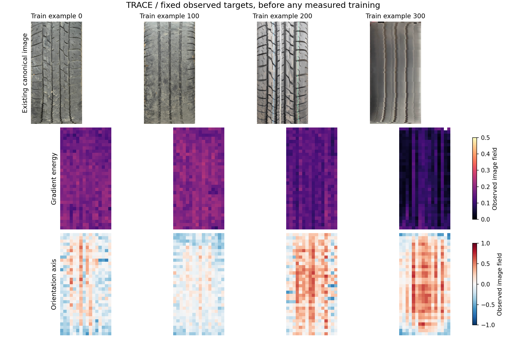

# Next design — TREAD-TWO / TRACE

<!-- NB24_VERIFIED_20261102 -->
## Current — NB24 TRACE completed and HF-verified

**2 November 2026:** NB24 completed preparation, actual T4×2/HF continuation,
one seed /60 epochs /2,940 updates, and the saved-evidence review/passport.
All 33 payloads match. **No NB21/NB22/NB23/NB24 rerun needed.**
[Completion and verification scope](phase3NB24Completion.md).

Final validation masked reconstruction beats the strongest declared control by
**21.63%**; local reconstruction improves **36.44%**. Utility passes60/60, but
projector/encoder diversity passes0/60: ranks **1.0225 /1.2296 /1.2489**.
**Selected=None; research-only, unpromoted.**
[Illustrated findings and next research](phase3TreadTwoTRACEFindings.md).

The fit retains **3,553 direct CSVs /47,263,346 rows /6,725 NPY /64 PT /13.507 GB**;
570 existing photos only. Counts include inherited cache rows; no new photos.
Independent audit reconstructs all 2,940 objectives and60 validation gates; the
published full dense audit and the bounded local audit have explicit scopes.
All five owners are released; earlier publications remain unchanged.

Next use saved local texture/component evidence to justify any future revision;
no new fit or NB25 is required to complete this cycle. Preserve executed
notebook/runtime/protocol. Both workstations remain deferred.
<!-- END_NB24_VERIFIED_20261102 -->

<!-- TRACE_BATCH_20261102 -->
## Historical — TRACE batch delivery before NB24 execution

**2 November 2026:** all four self-contained TRACE notebooks are implemented.
**[NB24 Run All master](notebooks/phase3_NB24_TREAD_TWO_TRACE_All_In_One_Batch.ipynb)**
automatically sequences fixed-target preparation, actual dual-T4/HF continuation
and storage gates, one seed / 60 epochs / 2,940 updates, then the saved-evidence
review and interactive passport. Individual NB21/NB22/NB23 files are supplied too.

Use a dedicated Kaggle **T4×2**, Internet ON, the existing expanded
`shanmuk4622/tire-dataset-prepared-phase2` input and **HF_TOKEN**. Start cold with
at least 19 GB free; actual capacity must also preserve the 2 GB reserve. Run one
master, not competing writers. [Full setup/recovery guide](phase3TreadTwoTRACEBatch.md).

Local real-model lifecycle/restart/fault/review and fresh payload tests pass.
All 570 existing photos and 60 source schedules were exercised. The executable
schema has 48 CSV families / 671 fields with native predictions/tokens, all epoch
weights and complete-update recovery. [Acceptance and boundaries](phase3TreadTwoTRACEValidation.md).

**Actual Kaggle/live HF and measured training remain pending user execution.**
The notebooks enforce those live gates automatically. No local token/HF write,
new photo or workstation change. Original GEO remains closed/unselected; no old
completed notebook needs a rerun. Preserve this new source/notebook/protocol
once execution starts.
<!-- END_TRACE_BATCH_20261102 -->

**2 November 2026: design and local prototype implemented.** TRACE learns fixed
local image descriptors in the frozen GEO canonical atlas. It has **71,022 new
texture parameters**, explicitly preserves row/column arrangement, and uses a
**6D** auxiliary projector with a seven-eligible-row covariance guard.

| Completed now | Evidence |
|---|---|
| Exact target math, architecture, draft experiment and 48-family/669-field retention specification | [Design package](tread_two/trace_design/README.md) |
| All 386 train-photo target construction: 197,632 cells / 1,185,792 values retained | [Findings and audit](tread_two/trace_design/FINDINGS.md) |
| Hidden-pixel leakage, objective/gradient, CPU native resume and frozen-geometry equivalence proofs | [Numeric](tread_two/trace_design/validation/NUMERICAL.json) / [geometry](tread_two/trace_design/validation/GEOMETRY.json) |
| Existing-image interactive descriptor explorer | [Open explorer](tread_two/trace_report/TRACE_Design_Explorer.html) |
| Gated rollout and complete future notebook batch | [Delivery plan](tread_two/trace_design/DELIVERY_PLAN.md) |

The train-only audit found that whole-image target averages remain low-rank;
full spatial maps carry much more variation. TRACE therefore retains local maps
and explicit spatial moments. These findings are design evidence, not a trained
accuracy or generalisation result.

**Next:** implement the new transaction/evidence runtime, prove the full storage
and live recovery paths, then deliver preparation/pilot/review notebooks together
with one Run All master. **No new training notebook is ready to run yet.** No old
completed notebook needs a rerun.

Only existing photos are used. The inherited GEO final geometry remains an
explicitly **unselected research input**; the old selected=None result is
preserved. No new classifier, physical-depth/safety claim or workstation change.
New design records are local; their full direct-CSV/native HF publication is
planned for Kaggle preparation, not claimed complete now.

