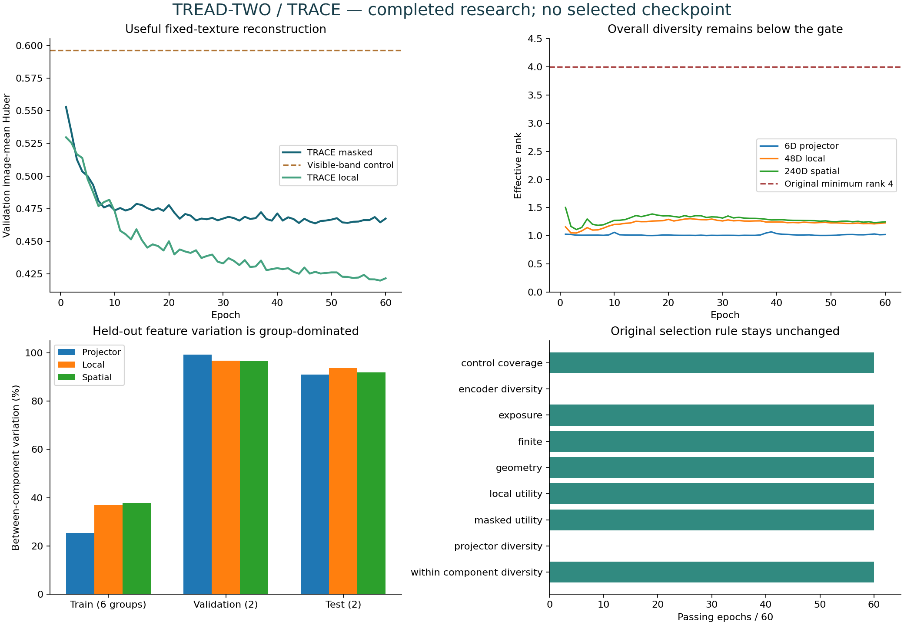
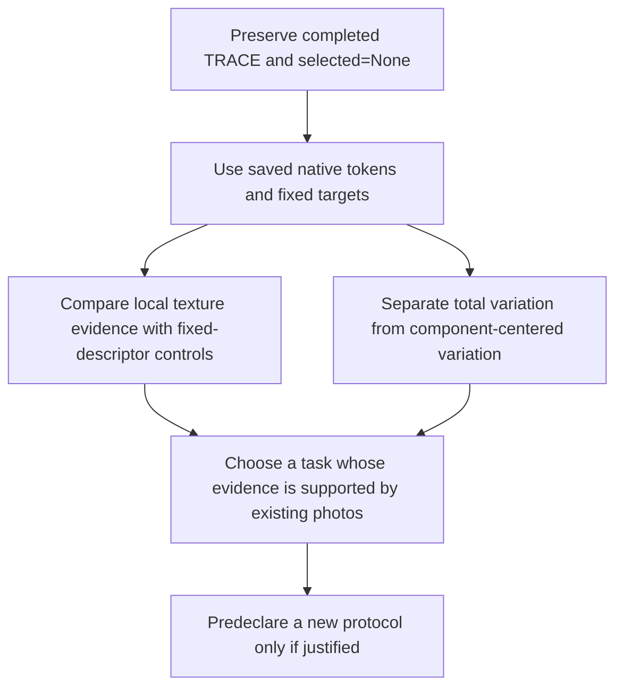

# TRACE findings — useful texture reconstruction, unresolved feature diversity

**2 November 2026. Actual NB24/Kaggle/HF result; one measured seed.**
[Execution, provenance and verification boundaries](phase3NB24Completion.md).

TRACE learns a measurable fixed-texture reconstruction advantage on the original
validation cohort. It still fails the predeclared broad representation gates.
The honest outcome is **completed, unselected, unpromoted research**.

## What improved

Validation uses 81 previously inspected images. Values below are image-mean
SmoothL1/Huber losses on standardized image-derived targets; lower is better.
The three masked comparisons use identical supported hidden-cell intersections,
with 100% common coverage. Controls and normalization were fitted on training only.

| Final epoch 60 quantity | TRACE loss | Control loss | Relative reduction | Original minimum |
|---|---:|---:|---:|---:|
| Masked vs channel mean |0.467383113 |0.691030548 |32.36% |5% |
| Masked vs position mean |0.467383113 |0.662255626 |29.43% |5% |
| Masked vs visible-band mean, strongest control |0.467383113 |0.596403013 |**21.63%** |5% |
| Local vs position mean |0.421631580 |0.663375253 |**36.44%** |10% |

These percentages describe **target reconstruction**, not tyre-wear
classification accuracy, physical tread depth, safety or defect-detection accuracy.
The best masked validation loss is0.463746201 at epoch 47 (22.24% vs the strongest
control), recorded only as a retrospective diagnostic. Epoch 47 fails diversity too;
it is **not selected** and does not replace the original final endpoint.

## Why no checkpoint was selected

| Original gate | Passing epochs |
|---|---:|
| control coverage | 60/60 |
| encoder diversity | 0/60 |
| exposure | 60/60 |
| finite | 60/60 |
| geometry | 60/60 |
| local utility | 60/60 |
| masked utility | 60/60 |
| projector diversity | 0/60 |
| within component diversity | 60/60 |

The geometry entry is an inherited fixed-input/provenance gate. TRACE does not
train geometry and did not newly establish 60 independent geometry measurements.
The other passing gates do not override either failed diversity gate.

| Final validation space | Effective rank | Minimum | Leading variation | Within-component rank |
|---|---:|---:|---:|---:|
|6D projector |1.022507 |4 |99.68% |2.034 |
|48D local pooled features |1.229626 |4 |96.91% |9.782 |
|240D spatial moments |1.248859 |4 |96.75% |11.272 |

Projector median coordinate standard deviation is **0.096143**, above the 0.05
floor. Its rank fails even though its amplitude passes. Within-component local
and spatial ranks comfortably pass the 2.0 floor. The representation is not
literally constant; most total variation is concentrated along one direction.

## Group structure remains the main warning

| Final endpoint role | Images | Projector rank | Local rank | Spatial rank | Local between-group variation | Spatial between-group variation |
|---|---:|---:|---:|---:|---:|---:|
| test | 103 | 1.184118 | 1.313274 | 1.447506 | 93.72% | 91.82% |
| train | 386 | 1.718241 | 2.719162 | 2.842357 | 36.97% | 37.73% |
| validation | 81 | 1.022507 | 1.229626 | 1.248859 | 96.78% | 96.56% |

Validation has only two conservative components. They account for **96.78%** of
local variation and **96.56%** of spatial variation; projector between-component
variation is99.35%. Removing component means exposes smaller, more varied
within-component differences. This is compatible with a dominant group/appearance
axis; it does not identify its physical cause or prove a tyre-identity shortcut.

Training effective ranks are also below 4, so the limitation is not explained
solely by having two held-out groups. The batch-compatible 6D projector fixes
the old 64D/batch8 rank-feasibility conflict; feasibility does not guarantee that
this objective learns broad useful features. Reconstruction and a pair
agreement term can coexist with a narrow representation. That mechanism remains
a hypothesis until a separately justified test establishes it.

## Layout and appearance probes

All four nonidentity probes use the 103 original test-role images, the final
epoch 60 weights and fixed geometry/cache. Targets/support are permuted with the
layout where appropriate. These are descriptive probes, not checkpoint selection.

| Probe | Mean 240D spatial cosine change | Mean 6D projector cosine change | Mean masked loss |
|---|---:|---:|---:|
| Brightness×0.85 |0.000650 |0.000458 |0.471648 |
| Grayscale |approximately 0 |approximately 0 |0.472012 |
| Reverse bands |0.023727 |0.019439 |0.553258 |
| Reverse columns |0.021681 |0.006075 |0.548635 |

Reversal leaves the pooled local encoder invariant to numerical precision while
changing contextual spatial evidence and worsening masked reconstruction. This
confirms order sensitivity in the existing model. Spatial moments/position
metadata already make order matter by design; this does not prove semantic
damage localization. Grayscale invariance is largely expected because input
contrast/gradients are constructed from channel-mean grayscale. Do not describe
that built-in property as a newly learned colour-robustness discovery.

[Full probe table](tread_two/trace_completion_report/INTERVENTION_SUMMARY.csv) ·
[Interactive residual passport](https://huggingface.co/datasets/Shanmuk4622/tyre-wear-study/resolve/7672729fdb1ccd0f55b565c1d60e8a50c6be078e/phase3/tread-two/trace-r1/review/37a7b701e9d9c3ca39b6966a427d306d5e23b3d2fc3f451f91f5d5c892ac069b/evidence/TRACE_Evidence_Passport-f6a9456cd701e252c91f.html).
Residual heatmaps are standardized image-descriptor reconstruction errors,
with unavailable cells shown in white. They are not measured wear, causal
explanations of damage, calibrated confidence or physical-depth maps. The
mask-leakage gate applies after fixed geometry; original geometry has already
seen the full image before a texture tile is hidden.

## Lessons carried forward from previous models

| Previous observation | TRACE response | Actual outcome |
|---|---|---|
| Joint geometry/texture training did not solve latent collapse | Freeze the saved geometry; train only 71,022 texture parameters | Reconstruction utility improves; broad diversity still fails |
|64D small-batch covariance objective was rank-infeasible |6D auxiliary projector; diversity requires at least 7 eligible rows | Feasible and finite; final rank 1.02 is still below 4 |
| Mean pooling discarded layout | Explicit five spatial moments and axial context | Actual reversal sensitivity; no new semantic wear claim |
| Learned quality estimates lost to constant controls | Omit another confidence head; retain raw residuals and fixed controls | Rich interpretable research evidence, no calibrated reliability claim |
| Earlier collection was too sparse/compressed | Direct full-view CSV/native evidence and all epoch weights |47.263 million fit-publication rows with explicit scopes/gaps |

TRACE and GEO have different targets, controls and model roles. Their loss
numbers/ranks are contextual evidence; the 21.63% TRACE advantage is not a
matched paired estimate against GEO's 4.03% value. No new classification head or
evaluation was run; old classification results are not updated by this notebook.

## What to do next with the existing data

1. Close the current fit/review cycle without rerunning it or relaxing its gates.
2. Next, analyse saved tile tokens, fixed descriptor maps and per-component
   residuals to distinguish useful local reconstruction from broad embedding
   quality. Use training-only controls; keep repeatedly inspected roles explicit.
3. A future candidate should answer that diagnosis with a separately frozen
   objective and feasible evaluation. Do not launch a weight sweep, add epochs,
   relabel the same data or claim a fresh blind test from the existing roles.

**This is the next research proposal, not another delivered training notebook.**
No new photos, additional optimizer updates, HF writes or workstation changes
were made during this verification. Both workstations remain deferred.
