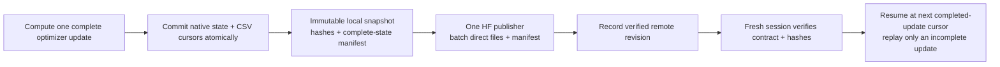

# TREAD-TWO / ATLAS — evidence, resource and recovery contract

**29 October 2026. Requirements now implemented in ATLAS v1.** The
[runtime](PILOT_IMPLEMENTATION.md), [21-family schema/247 definitions](PILOT_EVIDENCE_SCHEMA.md)
and [NB08 run guide](PILOT_RUN_GUIDE.md) are delivered and locally checked.
The original prototype below remains untrained; separate engineering fixtures
exercise the real optimizer, recovery and reporting. **No measured classifier
fit or live HF upload has occurred locally.** Full T4/remote acceptance is gated
in NB08. Required future-run tables are not claimed as completed study results.

## Current prototype evidence

| Direct artifact | Records / meaning |
|---|---|
| [PROOF.json](prototype_report/PROOF.json) | 15 CPU engineering checks, parameter counts, environment, source hashes; no trained accuracy |
| [prototype_bank.csv](prototype_report/prototype_bank.csv) | 18 cases with image/tyre/class/patch/support/anchor provenance |
| [bank_images.csv](prototype_report/bank_images.csv) | 8 actual training-source photos, not 18 independent subjects |
| [bank_pixels.csv](prototype_report/bank_pixels.csv) | 221,184 exact FP32 RGB values, channel/row/column addressed |
| [query_manifest.csv](prototype_report/query_manifest.csv) | 3 training-photo engineering illustrations; no held-out performance |
| [atlas_rows.csv](prototype_report/atlas_rows.csv) | 1,536 row coordinate/support records for those illustrations |
| [untrained_affinities.csv](prototype_report/untrained_affinities.csv) | 1,728 patch/reference cosine and kernel values, explicitly untrained |
| [untrained_patch_evidence.csv](prototype_report/untrained_patch_evidence.csv) | 288 patch/class accounting records, explicitly untrained |
| [head_gradient_check.csv](prototype_report/head_gradient_check.csv) | 22 parameter-gradient checks; backward only, no optimization |
| [bank_rgb.npy](prototype_report/bank_rgb.npy), [bank_labels.npy](prototype_report/bank_labels.npy) | Exact native reference tensors; RGB float32 18×3×64×64 and int64 class labels |
| [CSV_SCHEMA.json](prototype_report/CSV_SCHEMA.json), [MANIFEST.json](prototype_report/MANIFEST.json) | Actual columns, row counts, byte sizes and SHA-256 hashes |
| [WORKSTATION_SNAPSHOT.json](prototype_report/WORKSTATION_SNAPSHOT.json) | Existing independent-app source identities checked before and after proof |
| [Interactive illustration](ATLAS_EXPLORER.html) | Three geometry examples, clickable patch coordinates and 18 real source-case records; no classifier-performance display |
| [DELIVERY.json](DELIVERY.json) | Final hash/schema/pixel/provenance/isolation/link verification; explorer payload/JS checked, browser rendering untested |

There are **8 CSV tables / 224,787 rows**. Most are exact bank pixels, not new
measurements or training observations. PNGs are quantized previews; the NPY/CSV
pixels, rather than PNG decoding, define the exact model bank. Native files
are published directly when publication is implemented; metrics must not be
hidden inside ZIP, NPZ, a checkpoint or an uploaded database.

Prototype index is 0–17; class index 0/1/2 means low/mid/high mileage proxy.
Patch index is row×4+column, with eight rows/four columns; pixels use zero-based
indices. RGB is float32 [0,1]. `valid_fraction` and clipping are fractions,
cosine is dimensionless [-1,1], affinity is dimensionless (0,1], contribution
is in class-logit units, and alpha/`weight` is pooling mass. Atlas mapping
coordinates are in the resized 512×384 input, not original-camera or physical
units. Blank source coordinates denote unsupported rows. Gradient norms use
the engineering loss and are not historical training gradients.

## Planned measured-run tables

Every row needs an immutable contract/run ID and explicit stage. Training rows
also need completed-update ID and occurrence/sample cursor; evaluation rows
need checkpoint SHA and image ID. CSV primary keys and units must be frozen
in a machine-readable dictionary, including nullable/NA reasons and duplicates.

| CSV family | Required contents / frequency |
|---|---|
| Source and split registry | Image hashes/paths, class provenance, known tyre or unresolved clip group, original roles; once per contract |
| Reference bank and review | Exact pixels, source identities, patch coordinates/coverage, clipping, inclusion reason, reviewer/status and fixed bank hash |
| Sample/exposure journal | Every query occurrence, class/domain/group draw route, augmentation parameters/RNG identity and completed update |
| Update metrics | Loss and sufficient statistics, LR, optimizer/scaler state references, gradient/clipping norms, numerical skips/replays, timings and resource samples |
| Query predictions | All three logits/probabilities, label, prediction, correctness, support diagnostics, loss; every training occurrence and evaluation image |
| Atlas/patch support | Per-image row map once per distinct input geometry; per-occurrence patch support, alpha and augmentation identity |
| Patch/reference affinities | All 32×18 raw cosine/kernel values for each measured query occurrence and each validation/evaluation image |
| Patch/class evidence | All 32×3 contributions plus bias and additive residual; no top-k-only retention |
| Evidence coefficients | All 54 signed weights, three biases and temperature at every update state; exact before/after-state identity |
| Reference embeddings | All 18×96 current vectors per immutable epoch/evaluation checkpoint; current shared encoder SHA |
| Class/group/task summaries | Confusion counts, denominators, precision/recall/F1, observed-class BA, NLL/Brier/ECE; image/domain/tyre/source-group scopes |
| Dense outputs and truth | Full native outputs for each unique fixed-input/anchor contract, coordinate/mask CSV and scalar metrics; human versus weak truth explicitly separated |
| Selection ledger | Every epoch endpoint, compared scores, tie-breaks, selected hash and reason; preserve final separately |
| Diagnostics and failures | Every planned perturbation and wrong/unsupported/clipped case, raw scores and changed inputs/interventions, no curated-only gallery |
| Lifecycle/publication | Start/stop/error, completed cursor, snapshot/hash, local pending data, HF attempts/backoff/request counts/revisions and independent verification |

Pair evidence is reconstructible as **alpha × signed weight × affinity**.
Retain these components for every pair and preserve raw patch/class sums;
avoid duplicating the same pair three times solely to inflate row counts.
Encoder activations, every per-parameter tensor gradient and GPU waveforms are
not promised on every update. Bounded diagnostic captures and explicit gaps
must say what was actually collected. More CSV rows do not create more tyres.

## Storage estimate before launch

The [proposed budget](EXPERIMENT_PLAN.md) gives these **planning counts**:

| Family | Calculation | Planned rows |
|---|---|---:|
| Training query occurrences | 60×49×8 | 23,520 |
| Training patch/reference affinities | 23,520×32×18 | 13,547,520 |
| Training patch/class evidence | 23,520×32×3 | 2,257,920 |
| Full validation image predictions | 60×81 | 4,860 |
| Full validation affinities | 4,860×32×18 | 2,799,360 |
| Per-update signed weights | 2,940×3×18 | 158,760 |

Measure actual CSV bytes per row using a representative full update; extrapolate
all families, native states and publication staging before freezing the budget.
Measure GPU memory/time at batch eight with all support patches re-encoded.
Do not assume that the new head's small parameter count makes dense inference
or CSV I/O free. Repeated native dense maps for unchanged inputs should be
deduplicated by input/anchor/grid/precision hash, with an occurrence reference.

Keep Kaggle-attached data read-only. Check actual free space/mounts at startup;
treat the user's 20 GB output area as a hard budget to respect and any larger
scratch as temporary capacity to measure, not a guaranteed 1 TB allocation.
Use immutable direct CSV shards, a verified manifest and bounded staging.
Archive epoch telemetry without deleting scientific evidence; rotate local
recovery states only after their successor and relevant remote snapshot are
verified. Under pressure, flush/pause with a recorded reason rather than
silently stop logging or discard tables.

## Completed-update recovery

The native resume state must include new classifier and fixed bank tensors,
anchor/source/data/bank hashes, optimizer, scheduler, scaler, Python/NumPy/CPU/
CUDA RNG, deterministic sampler order/cursor, augmentation cursor, next update,
partial-epoch metrics, selected/final state identities and all CSV row cursors.
Freeze accumulation policy; a half-completed accumulation is replayed from the
last complete update unless a separately proven finer-grained state is stored.

Before long training, prove interrupted-versus-uninterrupted equivalence on the
**actual new model**, including bank, predictions, optimizer/scaler and CSV
content. Exercise catchable stop, incomplete write, repeated resume, expired
owner, rate limit, ambiguous upload success and fresh-session remote restore.
Earlier NB04/NB05 success is reference infrastructure, not automatic proof for
this new architecture/sampler/evidence path. Never overwrite frozen old sources
to add the candidate; vendor/version the needed training components separately.

The anchor/grid and evidence kernel run FP32 outside outer autocast in the
prototype. Verify the real T4 path and bank/query AMP handling before fitting.
No sampler backward is required. Deterministic encoder math and process restore
must still be tested; a detached grid alone is not a determinism guarantee.

## Dual-T4 and HF ownership

Implemented layout: GPU 0 owns one candidate optimizer; GPU 1 validates an immutable
epoch snapshot and performs bounded engineering checks behind an explicit
barrier. The second GPU must never mutate training weights or independently
publish the same run. This is a barrier layout, not DDP or a claim that both
devices are continuously saturated. Local tests use one GTX 1650; actual
two-T4 memory/timing/recovery acceptance still runs automatically in NB08.

Use account **Shanmuk4622**, the established study dataset repository, a new
TREAD-TWO namespace and **HF_TOKEN from Kaggle Secrets only**. Verify actual
current service limits when implementing. The historical ~128/hour concern
is a conservative budget input, not a universal quota. One publication owner
must coordinate request counts, concurrent-account usage and writer leases.

| Trigger | Required behavior |
|---|---|
| Normal execution | Commit completed-update progress locally; batch changed direct files about every 30 minutes |
| Major cell/epoch-run milestone | Flush a consistent snapshot; deduplicate unchanged blobs |
| Catchable Stop/error/SIGINT/SIGTERM | Save complete local cursor immediately and attempt immediate flush, respecting server backoff |
| HTTP 429/transient failure | Honour server delay headers, bounded jitter/backoff and shared request budget; retain pending work |
| Restart | Verify last remote revision/native manifest before resume/skip; do not merely trust a local success message |
| Forced process/kernel death | Cleanup cannot run; recover last verified remote state and record any unsent gap |

A manifest becomes current only after every referenced object is present and
hash-verified. Do not publish a recovery cursor ahead of its CSV/native state.
Independent post-run verification must fetch the pinned revision and check
all files, schemas, row counts, checkpoint selections, role/provenance rules
and error/stop history. A local file named “passed” is not remote verification.

## Delivery gate

The delivered `.ipynb` embeds its exact versioned source, identifies the direct
Kaggle input, documents Internet/dual-T4/Secrets settings, provides Run All and
restart/resume instructions, prints safe resource checks, and explains storage,
rate-limit and interruption troubleshooting. No token values may appear in
outputs. The long-run cell must stay gated until numerical, storage, lifecycle
and live HF restore checks pass. This contract is the checklist for that
implementation, not a claim that those gates have already passed.
