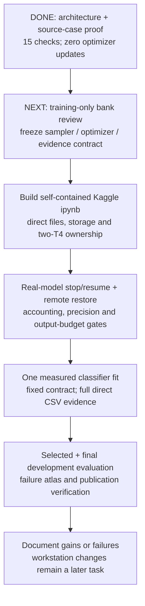

# TREAD-TWO / ATLAS — one-candidate development pilot

**29 October 2026. Status: v1 implemented; local engineering acceptance passes;
measured Kaggle fit pending.** The [NB08 notebook](../notebooks/phase3_NB08_TREAD_TWO_ATLAS_Resumable_Pilot.ipynb)
and [run guide](PILOT_RUN_GUIDE.md) are delivered. The exact implemented
[RECIPE.json](pilot/RECIPE.json) and [module record](PILOT_IMPLEMENTATION.md)
supersede the provisional choices in the design table below. FP32 throughout,
microbatch-one dense inference, augmentation [0.9,1.1], fixed unfiltered bank
and the stated AdamW/cosine recipe are now frozen. Existing data only;
workstation changes remain deferred. No measured accuracy is available.

## The question we will actually test

Can an inspectable local-patch classifier, operating on predicted visible-tread
coordinates, improve the existing mileage-proxy endpoint while retaining the
declared TREAD-ONE dense outputs? We will train **one new classifier**, rather
than repeat an architecture search or the failed shared-gradient mechanism.

| Prior evidence | Implication for this pilot |
|---|---|
| NB03: all six checkpoints correctly classify all 386 nominal training images | More training fit is not the objective; expose transfer failures |
| Oracle tread gates change validation BA by at most 1.25 percentage points | Test a new local representation, not a gate-only change |
| NB05: selected baseline/candidate test BA 50% / 17.073% | Do not assume gradient projection solves the problem |
| Declared r1 export: test Dice 98.419%, point error 1.196% image width | Freeze that dense branch; do not sacrifice it to another class objective |
| All selected r1 exports miss the 62 low test images | Keep low recall and every wrong low prediction visible |
| Only one low training tyre | No architecture can turn repeated views into independent subjects |

Sources: [NB03 findings](../phase3ClassifierDiagnosticResults.md),
[NB05 completion](../phase3NB05Completion.md),
[r1 completion](../phase3CompletionAudit.md),
[source-data audit](../phase3NB07Completion.md).

## Data roles and dependence

| Role | Images | Original physical tyres | Meaning |
|---|---:|---|---|
| Historical training | 386 | 8: low/mid/high = 1/3/4 | 234 original photos plus 152 existing frames |
| Fixed reference bank | 8 source photos / 18 patches | The same 8 training tyres | Support inputs to the new shared encoder |
| Classifier query pool | 378 | The same training cohort | 66 low, 246 mid, 66 high; excludes all 8 bank photos |
| Historical validation | 81 | Low/high only | 40 low + 41 high; no mid target |
| Historical test | 103 | Low/high only | 62 low + 41 high; previously inspected development endpoint |

There are 418 original photos and 152 frame derivatives in the complete
570-image release, representing 12 original tyres. The three clips depict
three distinct existing mid tyres; their exact original-photo parent mapping
remains unresolved. All of them stay in training. They must not be silently
treated as independent new tyres or distributed across held-out roles.

Bank photos still participate as encoder support, so none of the 386 training
images is discarded. Excluding them as queries prevents an identical source
photo from also being a classification query. It does not remove same-tyre
dependence, nor does it erase the frozen anchor's earlier exposure.

**Do not reshuffle existing mid tyres into a purported unseen holdout while
retaining this anchor.** The frozen TREAD-ONE model already learned from those
training images. A future all-three-class grouped study would need newly
initialized whole models inside each new split, originals only while clip
parents are unresolved, and an explicit existing-cohort development label.
That is a separate possible study, not this pilot and not a new-data request.

## Proposed fitting recipe

These are design choices to resolve and freeze in a machine-readable contract
before any measured update. They are not a tested training release.

| Item | Proposed choice / required gate |
|---|---|
| Candidate | ATLAS v0.1: 81,274 trainable parameters; dense anchor frozen |
| Initialization | One new classifier seed, seed 1; exact initial state hash retained |
| Budget | Up to 60 epochs × 49 completed updates × 8 query draws = 23,520 occurrences |
| Epoch definition | 392 draws with replacement, not a pass through the 378-image pool |
| Sampler | Class-uniform draws; within class balance source domains/groups; retain actual exposure per image/group |
| Mid identity handling | Known originals grouped by physical tyre; clip IDs are source groups, not resolved tyre identities |
| Class objective | Three-class cross entropy; avoid adding inverse-class loss weights on top of a class-balanced sampler |
| Starting optimizer proposal | AdamW, learning rate 0.001, weight decay 0.0001; cosine decay; gradient clipping at 1.0 |
| Image path | Original fixed RGB preprocessing → frozen predicted-mask atlas; no target masks in classifier inference |
| Augmentation proposal | Bounded query-only brightness/contrast/saturation; exact transforms/RNG logged; unsupported pixels remain invalid |
| Support path | Fixed exact FP32 reference pixels, re-encoded by the current encoder; no outcome-driven case replacement |
| Precision | FP32 anchor/grid/kernel/evidence; encoder AMP only after real T4 numerical/recovery checks |
| Checkpoints | Validation-selected and final; complete latest-update resume state separate from selection |
| Dense tasks | No new dense optimization; same-input preservation plus re-evaluation of saved outputs |

The precise source-group draw probabilities, augmentation ranges, optimizer
groups and schedule must be frozen together. If a preflight requires a repair,
record it before measured training. Do not quietly tune these against test.
The deterministic prototype bank is **provisional**: its ≥0.75 mask-coverage
rule does not remove paint, glare or blurred patterns. Freeze a training-only
review with inclusion reasons and sensitivity probes before the fit.

This is an **engineering comparison to an existing export**. It changes the
representation, query pool, sampler and trainable budget. It is not a
compute-matched architecture-only ablation, even if the update count matches
an earlier run. One seed does not measure initialization variance.

## Selection and reporting

1. Select the checkpoint by validation balanced accuracy over the **observed
   ground-truth classes (low/high)**. Use three-class NLL as the first tie-break,
   then the earliest epoch. Log every candidate and the selection reason.
2. A mid prediction on a low/high example still counts as wrong. Save all three
   raw logits/probabilities and the full 3×3 confusion counts. Mid held-out
   recall is **unavailable**, not zero or silently omitted from the explanation.
3. Report image accuracy, observed-class BA, per-class precision/recall/F1,
   confusion counts, NLL, Brier score and a declared fixed-bin ECE. Retain
   image/domain/physical-tyre counts and metrics; missing denominators stay NA.
   With so few held-out tyres, image-level confidence intervals cannot be
   presented as independent-subject uncertainty.
4. Preserve mask Dice/IoU, human-point errors, box derivation and exact evidence
   residuals. Keep weak polygon-derived point records separate from human truth.
5. After fitting ends, evaluate selected and final checkpoints once against
   the already inspected historical endpoint. Do not select by test score.
   The baseline seed-3 export already has 100% validation BA: ceiling effects
   and the old split's weakness must remain explicit.

For a **limited engineering improvement**, require test observed-class BA
above the declared export's 50% and low recall above zero, with all high-class
tradeoffs disclosed. Also require dense preservation and valid evidence
accounting. This is an exploratory target on old data, not independent
confirmation, calibrated safety or a deployment claim. If it fails, publish
the complete failure evidence; do not search seeds/checkpoints until it looks good.

## Diagnostics without another fit

| Probe | What it can reveal | What it cannot prove |
|---|---|---|
| Original / atlas / local patch comparison | Whether the expected tread support is actually visible | Correct physical depth or complete 3D geometry |
| Colour/brightness changes, grayscale and marked-patch review | Dependence on colour, paint or lighting | Elimination of every shortcut |
| Missing/clipped support bins | Failure associated with the atlas construction | Calibrated rejection or reliability |
| Rank actual positive and negative cases per image/class | Which literal references drive this prediction | Causal wear reasoning or independent sample count |
| Patch occlusion with exact replacement pixels recorded | Sensitivity to the chosen intervention | An in-distribution or causal counterfactual |
| Recompute selected outputs at fixed precision | Reproducibility and evidence accounting | Historical AMP equality or broad device determinism |

Atlas stretching may remove useful absolute pattern-size information; paint,
tyre identity and lighting may remain predictive. These are recorded failure
modes, not reasons to conceal examples or enlarge the model automatically.

## Execution sequence

The next execution is **NB08 Run All**, whose first live gate must establish
actual T4/remote recovery and resource acceptance before the measured fit.
Existing TREAD-ONE notebooks are complete and must not be rerun as a substitute.
See [local validation and limits](PILOT_VALIDATION.md) and the
[implemented evidence schema](PILOT_EVIDENCE_SCHEMA.md).
