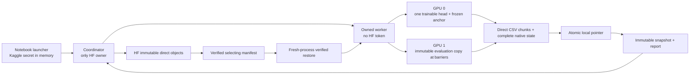
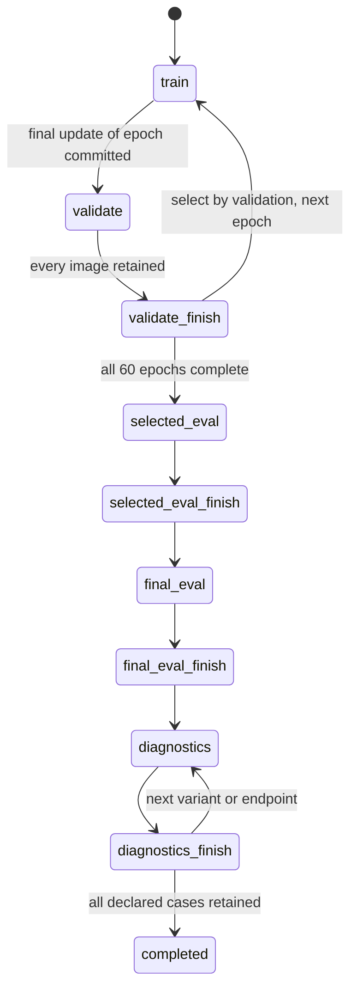

# ATLAS v1 — implemented runtime and ownership

**29 October 2026.** This is the implementation following the
[design](DESIGN.md) and [experiment plan](EXPERIMENT_PLAN.md). A measured fit
has not been run locally. The original prototype and completed studies are
preserved; all new training code is isolated in [pilot/](pilot/RECIPE.json).

## Module map

| Source | Responsibility |
|---|---|
| [model_atlas.py](pilot/model_atlas.py) | Frozen dense branch, directional encoder, appearance transforms, signed case evidence |
| [geometry.py](pilot/geometry.py) | Exact copied prototype visible-atlas map, invalid support and band pooling |
| [frozen_anchor.py](pilot/frozen_anchor.py) | Byte-identical original TREAD-ONE architecture; original hash verified in the source inventory |
| [data_atlas.py](pilot/data_atlas.py), [legacy_data.py](pilot/legacy_data.py) | Frozen safe roles, deterministic query schedule, exact image preprocessing and original truth access |
| [worker.py](pilot/worker.py) | One optimization owner, resumable phase/cursor state machine, immutable validation copy |
| [telemetry.py](pilot/telemetry.py), [schemas.py](pilot/schemas.py) | Raw observations, sufficient statistics, explicit denominators and deterministic evidence splatting |
| [store.py](pilot/store.py) | Direct append CSV, chunk hashes, native state, atomic pointer, rollback and remote installation |
| [coordinator.py](pilot/coordinator.py) | Kaggle stages, single publisher, ownership/stop/30-minute lifecycle |
| [publisher.py](pilot/publisher.py), [evidence_hub.py](pilot/evidence_hub.py), [rate_budget.py](pilot/rate_budget.py) | Immutable direct objects, CAS ownership, pinned restore, actual HTTP transport budgets/backoff |
| [acceptance.py](pilot/acceptance.py) | Fresh-process real-model equivalence and storage extrapolation |
| [report.py](pilot/report.py) | Curves and complete endpoint explorer derived from saved outputs; no model fitting |
| [FILES.json](pilot/FILES.json), [VENDORED.json](pilot/VENDORED.json) | Final source/asset identity and exact original dependency provenance |

No frozen r1/NB04/NB05 source is edited. Needed components were copied/versioned
under the new runtime. The old publisher's immutable-object protocol remains
the basis; the new direct-CSV append store replaces a growing local SQL journal.
The runtime does not read `.env` files, login caches or alternative credentials.

## Model and precision

| Property | Implemented v1 |
|---|---|
| Total / frozen / trainable | 1,453,433 / 1,372,159 / 81,274 |
| Anchor evaluation | FP32, eval, no gradients, fixed microbatch one |
| Query classifier | FP32; scaler explicitly disabled and its empty state retained |
| Local inputs | 512×256 predicted visible-tread atlas, 32 patches of 64×64 |
| Reference inputs | Exact native float32 bank, 18 actual patches; shared current encoder |
| Query augmentation | After frozen geometry, before local encoding; invalid pixels remain zero |
| Dense targets | Used for retained evaluation only; no target-mask input to class inference |
| Class control | Frozen original-frame r1 logits/probabilities retained with every candidate observation |

Fixed dense microbatch one avoids companion-dependent numerical geometry and
allows each unique input's dense output to be retained once. Preservation means
comparison with the frozen anchor at the **same FP32, microbatch-one** contract.
It does not claim bit equality with historical AMP/batch-eight metrics.
Human point errors require matching prediction/annotation guide rows; all raw
points/targets are retained and unavailable comparisons are explicitly flagged.

The bank review keeps the original deterministic cases without appearance-based
replacement. [Review and risks](BANK_REVIEW.md). Query photographs exclude all
eight bank photos, but bank inputs remain in the graph and the same physical
tyres remain dependent. The exact bank is stored in checkpoint buffers and
direct CSV/native source assets; PNGs never define recovery pixels.

## Process and data flow

The evaluation copy is the current candidate at validation, or its declared
selected/final checkpoint at endpoint review. It has no optimizer and never
updates the training model. Global training RNG is restored explicitly before
each next update, including after evaluation-model construction.

## State machine and recovery

State includes model/anchor/bank, optimizer, scheduler, disabled scaler, all
Python/NumPy/CPU/CUDA RNG, deterministic epoch orders, next cursor, partial
training/evaluation records, selected/final artifact references, observation
cursor, dense-cache identities, CSV offsets/counts and immutable artifact hashes.
There is no gradient accumulation in v1: one complete batch is one update.

CSV bytes are fsynced before the native/unit manifest and final pointer.
Recovery verifies every committed chunk hash, then truncates only uncommitted
suffixes in the run's own generated CSV. An interrupted native save cannot
advance the pointer. Latest two local native states rotate; scientific CSV,
unit history and all 60 epoch checkpoints remain. Publication copies mutable
CSV into immutable staging; it never hard-links an append target.

Remote snapshots consolidate unit metadata as JSON, with direct CSV state
versions and direct schema dictionary. Installation checks all object hashes,
source contract and native/CSV cursors before continuation. Compatible remote
history can fast-forward a local prefix; divergence is rejected. Prior-session
logs retain stable content-addressed filenames across repeated restores.

## Explanation and failure evidence

Every occurrence retains all 32×18 cosine/kernel comparisons, all 32×3 signed
patch sums, all pooling masses/support and all three class scores. The original
r1 classifier's FP32 logits/probabilities are retained too; diagnostic changes
affect the new atlas path while that original-frame control remains unchanged.

For selected/final images, deterministic CPU bilinear splatting distributes
each signed patch contribution over supported atlas pixels and back through
the stored grid. Bias stays separate. Full FP32 native maps and per-class
conservation residuals are saved; simple resized colours are not the numerical
accounting proof. The accepted numerical tolerance is 2e-6 logit units.

The explorer includes **every selected/final endpoint image**, original and
atlas previews, raw scores, signed patch tiles, actual supporting/opposing
reference cases and searchable failure/unsupported filters. Full aggregate
3×18 reference contributions are also direct derived CSV, not only top-k
pictures. Curves distinguish online training scores from immutable validation.

All selected/final endpoint images receive the four fixed diagnostics:
grayscale of both query and bank, query brightness ×0.8/×1.2, and top-signed-patch
occlusion with recorded replacement RGB. Raw and altered results remain saved.
The probes do not select checkpoints or establish calibrated/causal trust.
