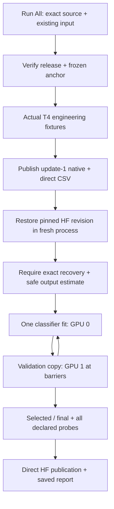

# TREAD-TWO / ATLAS — NB08 run guide

**Analysis follow-up, 30 October:** NB08 remains complete. Use the separate
[CPU NB09](../notebooks/phase3_NB09_TREAD_TWO_ATLAS_Completed_Review.ipynb)
to publish the completed evidence review; [settings and recovery](review/README.md).
The NB08 run/resume instructions below do not schedule a training rerun.

**Current result, 30 October 2026:** the measured run has finished and is
published. **Do not Run All to start another fit.** Open the retained report
or the existing session's final display cell instead. [Verified status and
remaining review](../phase3NB08CompletionStatus.md). The launch/resume steps
below remain instructions for recovering genuinely missing work, not a new task.

**Implementation v1 · 29 October 2026.** The Kaggle notebook is implemented.
Local engineering acceptance is separate from actual Kaggle/live-HF acceptance
and from the future measured classifier result. Both workstations stay unchanged.

**30 October repair:** use the current notebook and Run All. The original live
T4/HF recovery gate passed, then an erroneous local hourly HTTP cap blocked the
training launcher. The [repair record](../phase3NB08Repair.md) explains the
corrected five-minute HTTP windows, separate hourly commit guard and unchanged
24-file runtime/run identity. Compatible completed gates and existing progress
are reused. Keep current Kaggle working files if available; never clear leases.

## The notebook to upload

[phase3_NB08_TREAD_TWO_ATLAS_Resumable_Pilot.ipynb](../notebooks/phase3_NB08_TREAD_TWO_ATLAS_Resumable_Pilot.ipynb)

| Setting | Required value |
|---|---|
| Accelerator | **GPU T4 ×2** |
| Internet | **On** |
| Attached data | Expanded **shanmuk4622/tire-dataset-prepared-phase2**, directly from Kaggle |
| Secret | **HF_TOKEN**, enabled for the notebook, write access to Shanmuk4622/tyre-wear-study |
| Starting free space | At least **12 GiB**; the actual working mount and free capacity are checked |
| Execution | **Run All**, in order; do not skip the live recovery gate |

The notebook includes its exact isolated source and fixed reference bank. No
local source upload, ZIP upload, workstation copy, new photo collection or old
TREAD-ONE notebook rerun is required. The setup cell pins only the tested Hub
client, `huggingface_hub==0.36.2`, when needed; it does not replace Torch/CUDA.
Local development and checks continue to use `cv_conda`.

## Cell order and expected behavior

| Code cell | Action | Completion meaning |
|---:|---|---|
| 1 | Extract/verify source and native bank; check Hub dependency | Same bytes as the packaged inventory; no fitting |
| 2 | Define the stop-aware launcher | Secret is passed in memory to the publisher, removed from worker environments |
| 3 | Prepare data/anchor/contract | All prepared-release hashes checked; exact native r1 export downloaded from a pinned revision |
| 4 | Automatic engineering gate | Full batch eight; pause, abrupt termination, fresh process and actual pinned-HF restore; storage projection must pass |
| 5 | One measured fit | 60×49=2,940 optimizer updates, full validation, selected/final endpoint evaluation and diagnostics |
| 6 | Open saved results | CSV summaries, curves, interactive cases, publication receipt; no additional forward pass |

The short four-update fixtures in cell 4 are engineering checks. Their results
must not be reported as the measured study. The same model seed is used to
check equivalent trajectories; this is not a seed search.

GPU 0 owns the optimizer. GPU 1 holds a separate immutable evaluation copy.
They use barriers rather than overlapping validation and updates. This is
neither DDP nor two measured models; idle/device time must be interpreted
accordingly. The original dense model is always frozen and evaluated with
microbatch one, matching the application path and making its geometry
independent of training companions.

## What is trained and selected

| Component | Rule |
|---|---|
| Dense anchor | Original validation-selected TREAD-ONE seed 3 / epoch 20, verified SHA; frozen |
| New classifier | 81,274 trainable parameters; seed 1; FP32 throughout |
| Support/query | 18 fixed cases from 8 train photos; remaining 378 training images are query pool |
| Epoch | 392 draws **with replacement**, class/domain/source-group balanced; not one pass over 378 images |
| Objective | Three-class cross entropy; AdamW 0.001, weight decay 0.0001; cosine schedule, clip norm 1 |
| Appearance changes | Query atlas only; independent brightness/contrast/saturation factors [0.9,1.1], fully logged |
| Selection | Highest validation observed-class BA, then lowest NLL, then earliest epoch |
| Endpoint limits | Validation/test have low/high targets only; old test already inspected; no held-out mid or independent confirmation |

All 60 epoch checkpoints are retained. The selected checkpoint and final
checkpoint remain separate even when they happen to name the same epoch.
No test score chooses the model. [Exact frozen recipe](pilot/RECIPE.json).

## Stops and restarts

Normal progress commits locally after every completed optimizer update and
every evaluation unit. Native state and CSV byte cursors share one atomic
pointer. An incomplete unit is replayed; it cannot advance the durable cursor.

For a catchable Stop, the launcher signals its owned coordinator. The worker
finishes its current atomic unit, then the coordinator attempts an immediate
consistent HF flush. **Wait for its result.** Server rate limits/backoff can
delay publication. A forced kernel/process death cannot execute cleanup or
guarantee preservation of progress that never reached HF.

To resume after a fresh session, use the same notebook, input, T4×2 and secret,
then **Run All unchanged**. The current remote manifest is checked before
resume/skip. A compatible local state ahead of HF is preserved. A verified
remote extension can be restored; divergent histories are rejected rather
than silently merged. Completed runs are verified and skipped.

## HF and local evidence

| Location | Contents |
|---|---|
| `/kaggle/working/tread_two_atlas/run/` | Durable local CSV/native state, unit ledger and worker logs |
| `.../snapshots/` | Immutable derived publication staging; older verified staging may rotate |
| `.../LAST_REMOTE.json` | Last successful verified revision, progress and publication destination |
| HF `phase3/tread-two/atlas-v1/engineering/<contract>` | Engineering source/restore proof, distinct from measured fit |
| HF `phase3/tread-two/atlas-v1/fit/<contract>` | Measured CSV/native files selected by the current manifest |

Content-addressed CSV names remain directly browsable `.csv` files. The
manifest maps ordinary logical paths to exact immutable objects. Native
weights/maps are `.pt`/`.npy`; source/metadata are direct Python/JSON. No ZIP,
NPZ or database is published. [Evidence schema](PILOT_EVIDENCE_SCHEMA.md).

The working-output guard is **16 GB**, leaving margin within the user's 20 GB
budget. The measured local extrapolation is about **12.8 GB peak**, including
staging/native reserves; actual Kaggle cell-4 extrapolation is authoritative.
No 1 TB scratch allocation is assumed. Storage pressure stops safely rather
than disabling logging. Do not delete scientific CSV/native artifacts to
force continuation.

## Troubleshooting

| Message / symptom | Response |
|---|---|
| Wrong or ambiguous data release | Attach exactly one expanded prepared Phase 2 input; keep checksums enabled |
| Wrong GPU count/type | Select T4×2 before running the preparation cell |
| Missing/unauthorized secret | Enable Kaggle HF_TOKEN with dataset write scope; never paste its value into code/output |
| Another live writer | Stop the other session cleanly or allow the built-in bounded lease wait; never delete ownership |
| 429 / request-budget deferral | Keep local progress, respect the reported delay, rerun unchanged after it clears |
| Transport repair / quota wait | Current launcher waits for the proper bucket window/reset, preserving progress; safe diagnostics are in NB08_TRANSPORT_REPAIR/EVENTS.jsonl |
| Source/environment differs | Preserve the notebook and state; perform a compatibility review before any repair; do not reset the HF experiment |
| Worker failure | Inspect `run/console.log`, `NUMERICAL_EVENTS.jsonl` and `LIFECYCLE.jsonl`; last pointer-committed progress remains authoritative |
| Stop reports pending HF flush | Keep the session/files; LAST_REMOTE shows the recoverable remote boundary, not unsent local updates |

API and resolver requests have different service limits. The implementation
uses explicit authentication, a shared local HTTP budget, header-aware backoff
and one publisher. Traffic from other machines cannot be atomically counted
by this session; server headers remain authoritative. The historical 128/hour
concern is not treated as a universal service quota.
[Official HF rate-limit documentation](https://huggingface.co/docs/hub/en/rate-limits).

After completion, preserve the executed `.ipynb`. The next task is an
**independent pinned-revision scientific audit**, including failure cases and
all retained fields. Neither a completed engineering gate nor a publication
receipt establishes improved classification or physical wear measurement.
