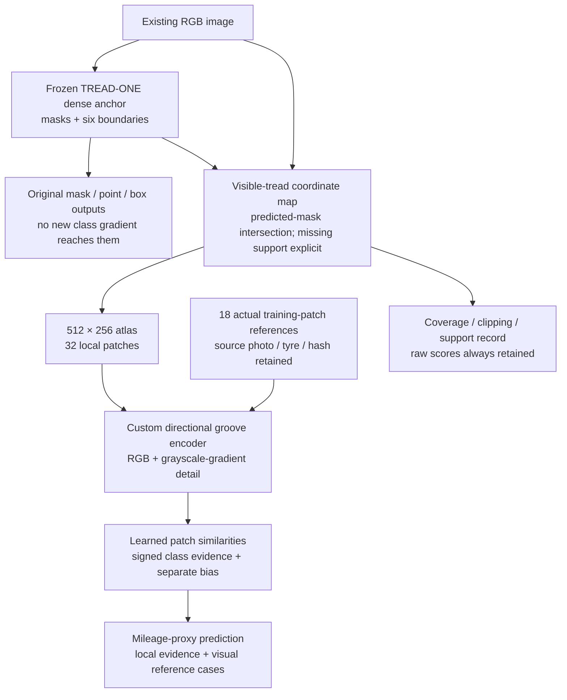
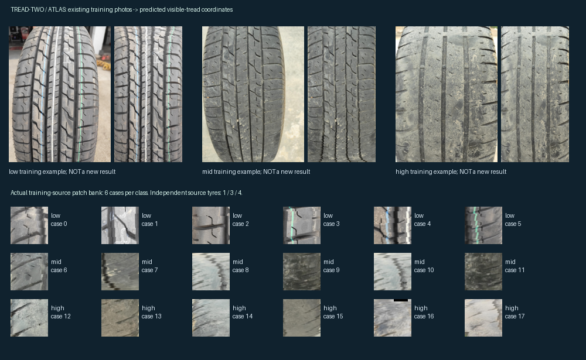

# TREAD-TWO / ATLAS

<!-- NB09_GATE_UPDATE_20261030 -->
**Latest, 30 October — [NB09 complete and HF-verified](../phase3NB09Completion.md).**
The next [training-only gate](../phase3TreadTwoAppearanceGate.md) is implemented
and locally complete: 386 images, seven probes, 1,918,052 CSV rows, native
state and an 18-photo UNTRAINED proposal. Next: **[NB10 on T4×2](../notebooks/phase3_NB10_TREAD_TWO_Train_Only_Appearance_And_Reference_Gate.ipynb)**
with existing expanded data; [settings/recovery](appearance_gate/README.md).
No fitting, held-out query, extra photo or installation occurred. Actual
dual-T4/HF gate publication remains pending user execution.

**Latest, 30 October 2026 — completed evidence review.**
[Findings](../phase3TreadTwoFindings.md): sampled training fit does not transfer
to the low tyre (low→mid); saved grayscale/dimming probes expose appearance
sensitivity. All retained endpoint/probe logits reconstruct correctly.
Thirty derived CSV tables / 246,157 rows, figures and a full interactive review
are delivered. Next: **[NB09 on Kaggle CPU](../notebooks/phase3_NB09_TREAD_TWO_ATLAS_Completed_Review.ipynb)**
for separate HF publication; [run guide](review/README.md). No new fit or UI change.

**Current status, 30 October 2026 — measured pilot completed.** HF holds all
60 epochs / 2,940 updates, selected/final evaluation, diagnostics and the final
report. The user confirmed no displayed error; the notebook finished normally.
**No training rerun is needed.** [Pinned verification and remaining review](../phase3NB08CompletionStatus.md).
Earlier pending/Run All statements below are historical implementation notes.

**30 October repair:** the live T4/HF gate passed, then the notebook's local
HTTP limiter timed out. The [repaired NB08](../notebooks/phase3_NB08_TREAD_TWO_ATLAS_Resumable_Pilot.ipynb)
corrects only transport handling. [Cause, checks and rerun instructions](../phase3NB08Repair.md).
Run All with the existing data/settings; compatible completed gates and saved
progress are reused. All 24 frozen model/runtime/assets remain unchanged.

**29 October 2026 — Kaggle pilot implemented and locally checked; measured fit pending.**
Existing data only. Workstation changes are deferred. This is a new model
direction, separate from the completed TREAD-ONE experiment and running app.

Start with **[NB08 Kaggle notebook](../notebooks/phase3_NB08_TREAD_TWO_ATLAS_Resumable_Pilot.ipynb)**
and the **[run guide](PILOT_RUN_GUIDE.md)**. Select T4×2, attach the expanded
prepared Phase 2 input, enable Internet/HF_TOKEN, then Run All. Actual live-HF
and two-T4 acceptance are automatic gates before the long run; they are not
locally claimed successes. The original untrained prototype remains preserved.

The idea is to make the classifier read a consistent **2D tread atlas**, then
explain its decision through similarities to **actual training-image patches**.
An unchanged TREAD-ONE branch keeps providing masks and boundaries. A new local
texture learner handles classification without changing those dense weights.

| State | Actual result |
|---|---|
| Architecture | Preserved CPU prototype plus isolated training/runtime implementation |
| Parameters | **1,453,433 total; 81,274 trainable** in the new classifier |
| Frozen anchor | Existing declared TREAD-ONE r1 seed 3 / epoch 20, 1,372,159 parameters |
| Atlas / patch layout | 512×256 visible-tread RGB; 8×4 patches of 64×64 pixels |
| Real reference bank | 18 training-source patches, six per class, from eight original training photos |
| Independent bank tyres | Low/mid/high = **1 / 3 / 4**, not 6 / 6 / 6 |
| Engineering checks | [15 pass](prototype_report/PROOF.json); frozen masks/points and additive accounting differences = 0 |
| Training | Prototype proof remains zero-update; measured Kaggle pilot separately completed 60 epochs / 2,940 updates |
| Kaggle delivery | Self-contained six-code-cell NB08, exact source/native bank; 21 transactional CSV families and 247 column definitions |
| Recovery acceptance | Local batch-eight pause/abrupt/restore equivalence and actual two-T4/pinned-HF gate passed |
| Workstation | Source/checkpoints unchanged; no UI integration or changes in this task |

## The proposed model



The intended explanation is: **which part of this image contributed, which
training patch it resembled, and what opposed the chosen class**. This is more
concrete than assigning physical names to unlabelled latent channels. Similarity
still does not establish physical wear, depth, safety or causal reasoning.



This picture uses **existing training photos** and the already trained frozen
dense branch. It illustrates geometry/provenance. The new classifier is not
trained, and its random-initialization scores are not shown as results.

Open the [interactive atlas and source-case explorer](ATLAS_EXPLORER.html)
to switch examples, inspect the 32-patch coordinate grid and view each real
reference's identity/support. It is a self-contained documentation artifact,
separate from both workstations. Its payload and JavaScript syntax are checked;
browser rendering has not been tested in this delivery.

## Why this follows our evidence

| TREAD-ONE observation | TREAD-TWO response |
|---|---|
| Strong dense outputs, weak transfer | Preserve the dense branch and learn a separate local classifier |
| Shared-gradient projection did not improve the selected endpoint | Remove shared trainable parameters between the new classifier and dense path |
| Oracle pooling barely helped | Learn a new representation on canonical local patches; this is not merely a replacement gate |
| Nominal training fit was already perfect | Avoid using training accuracy as proof of improvement; inspect subject/domain transfer and failure cases |
| Additive maps were exact but latent meanings unknown | Retain exact accounting and add actual source-image patch references |
| Only one low training tyre | Expose the true support count; multiple patches do not become independent subjects |

## Read next

- [Architecture and mathematics](DESIGN.md)
- [One-candidate experiment plan and leakage boundaries](EXPERIMENT_PLAN.md)
- [Training/evaluation evidence and recovery requirements](EVIDENCE_CONTRACT.md)
- [NB08 run guide](PILOT_RUN_GUIDE.md), [implemented modules/state flow](PILOT_IMPLEMENTATION.md)
- [actual evidence schema](PILOT_EVIDENCE_SCHEMA.md), [bank review](BANK_REVIEW.md), [validation record](PILOT_VALIDATION.md)
- [Local prototype source](model.py), [atlas construction](atlas.py), [engineering proof](prove_architecture.py)
- [Pilot handoff verification](pilot_validation/HANDOFF.json)
- [Original prototype receipt](DELIVERY.json)

The next execution milestone is **NB08 Run All on Kaggle**, beginning with the
actual dual-T4/live-HF engineering gate. The long run is implemented and gated;
no measured fit or workstation checkpoint promotion has occurred locally.
The original prototype can still be checked in cv_conda with:

```powershell
.\phase3\run_cv.cmd -B phase3\tread_two\prove_architecture.py
```

This reruns CPU architecture checks and derived illustrations only. It does
not fit the classifier or alter either workstation.

Original prototype verification checks every artifact hash/CSV count, bit-exact
native/CSV bank reconstruction, training-only provenance, prior model/study
isolation and local documentation links. It makes no further model forwards:

```powershell
.\phase3\run_cv.cmd -B phase3\analysis\validate_tread_two_delivery.py
```
