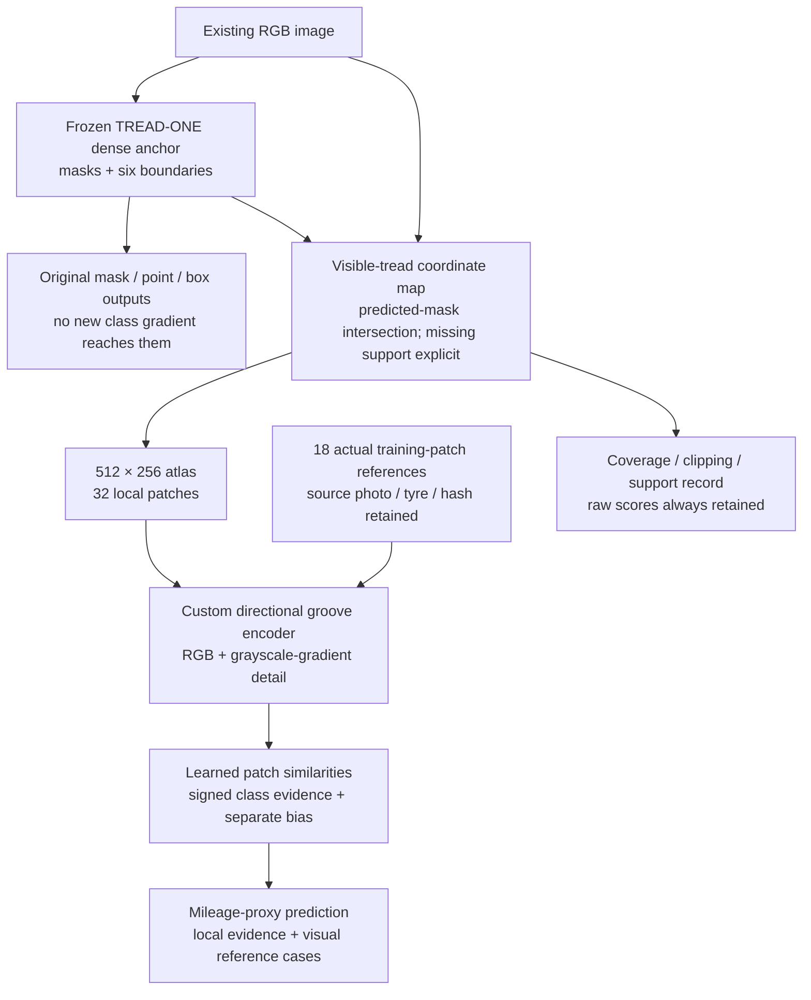

# TREAD-TWO / ATLAS

<!-- TRACE_BATCH_20261102 -->
## Current — NB21–NB24 TRACE batch delivered; run NB24 once

**2 November 2026:** all four self-contained TRACE notebooks are implemented.
**[NB24 Run All master](../notebooks/phase3_NB24_TREAD_TWO_TRACE_All_In_One_Batch.ipynb)**
automatically sequences fixed-target preparation, actual dual-T4/HF continuation
and storage gates, one seed / 60 epochs / 2,940 updates, then the saved-evidence
review and interactive passport. Individual NB21/NB22/NB23 files are supplied too.

Use a dedicated Kaggle **T4×2**, Internet ON, the existing expanded
`shanmuk4622/tire-dataset-prepared-phase2` input and **HF_TOKEN**. Start cold with
at least 19 GB free; actual capacity must also preserve the 2 GB reserve. Run one
master, not competing writers. [Full setup/recovery guide](../phase3TreadTwoTRACEBatch.md).

Local real-model lifecycle/restart/fault/review and fresh payload tests pass.
All 570 existing photos and 60 source schedules were exercised. The executable
schema has 48 CSV families / 671 fields with native predictions/tokens, all epoch
weights and complete-update recovery. [Acceptance and boundaries](../phase3TreadTwoTRACEValidation.md).

**Actual Kaggle/live HF and measured training remain pending user execution.**
The notebooks enforce those live gates automatically. No local token/HF write,
new photo or workstation change. Original GEO remains closed/unselected; no old
completed notebook needs a rerun. Preserve this new source/notebook/protocol
once execution starts.
<!-- END_TRACE_BATCH_20261102 -->

<!-- TRACE_DESIGN_20261102 -->
## Current — TRACE design and local prototype checked

**2 November 2026:** the user authorised work on the next design. **TREAD-TWO /
TRACE** now has four prototype modules, 71,022 new trainable parameters, fixed
spatial descriptors and explicit position-sensitive pooling. All 386 train photos
were audited: 197,632 target cells / 1,185,792 values retained. CPU leakage, loss,
gradient, state-restore and frozen-geometry equivalence checks pass.

[Design, findings and interactive examples](../phase3TreadTwoTRACEDesign.md) ·
[Detailed rollout](trace_design/DELIVERY_PLAN.md).

This is **local design/engineering**, not a measured model, live HF publication,
48 implemented telemetry writers or runnable Kaggle batch. Next build the full
data/transaction/evidence runtime and prove storage/dual-T4/HF continuation, then
deliver all justified notebooks with a sequential master. Existing photos only;
both workstations and every completed experiment remain preserved. NB20/GEO stays
closed and unselected; no old notebook rerun is needed.
<!-- END_TRACE_DESIGN_20261102 -->

<!-- NB20_VERIFIED_GEO_CLOSED_20261102 -->
## Current — NB20 HF-verified; GEO research cycle complete

**2 November 2026:** NB20 completed both NB18 review and NB19 passport stages.
All 19 payloads match; three cells complete without saved errors. Actual HF
revisions **610bdb22… / abfec8d6…** contain **121 logical files, 51 CSVs /
183,812 rows**. All 119 objects, released owners, 48 reference-comparable tables,
exact vector arrays and actual passport provenance check out. Earlier NB13–NB17
selecting manifests are unchanged. **No NB18/NB19/NB20 rerun needed.**
[Completion and numerical/evidence notes](../phase3NB20Completion.md).

The current GEO cycle is closed as **unselected, unpromoted research**. Geometry
passes 60/60 epochs; representation eligibility passes 0/60. The original
27,514,418 CSV rows and native/epoch evidence remain on HF.
[Compact research handoff](../phase3TreadTwoGEOResearchClosure.md).

**Recommended next direction:** separately design a texture revision with fixed
local targets and batch-compatible diversity, reusing saved geometry and existing
photos. [Design brief](../phase3TreadTwoGEONextResearch.md). This is proposed,
not implemented or trained. No new notebook/fit is required to finish this cycle.
Both workstation implementations remain deferred and preserved.
<!-- END_NB20_VERIFIED_GEO_CLOSED_20261102 -->

<!-- NB17_COMPLETE_POSTRUN_BATCH_20261102 -->
## Historical — NB17 verification and batch delivery before NB20 execution

**2 November 2026:** the attachment is completed NB17 (message says NB16).
HF revision `1113bf8a…`: **11,637 logical files / 3,080 direct CSVs /
27,514,418 rows / 8,457 native arrays / 10.31 GB**. One seed,
60 epochs and 2,940 updates; all selected bytes, schemas, native evidence and original masks
independently checked. Owner released; earlier four publication manifests unchanged.
**Do not rerun NB16/NB17 training.** [Completion and illustrated insights](../phase3NB17Completion.md).

The geometry floor passes 60/60; human point MAE improves 5.23% retrospectively.
Representation eligibility passes 0/60: final validation projector rank 1.038659,
pooled 96D rank 1.020990; masked gain 4.0337% is below 5%. **Selected unavailable;
final remains research-only, unpromoted.** No new classification/depth/safety claim.

**Next: [NB20 Run All master](../notebooks/phase3_NB20_TREAD_TWO_GEO_All_In_One_Postrun.ipynb)**.
It automatically runs/publishes NB18 full review then NB19 evidence passport.
All three notebooks are delivered now; individual stage files are optional.
CPU / None, Internet ON, existing expanded Kaggle input, HF_TOKEN, at least 13 GB free
on a fresh start. One shared verified cache, complete-stage recovery, publication
every 30 minutes and at major/stop boundaries. [Full batch/run guide](../phase3TreadTwoGEOPostrunBatch.md).
Local actual-data audit and offline source/handoff/restore checks pass; new
NB18/NB19 Kaggle/HF publication remains pending. Existing photos only, no extra
fit or workstation change. User preference: supply all justified next notebooks
together with an automatic sequential master; preserve scientific gates.
<!-- END_NB17_COMPLETE_POSTRUN_BATCH_20261102 -->


<!-- NB17_READY -->
**1November2026:** [NB16 completed](../phase3NB16Completion.md); [NB17 GEO pilot is ready](geo_pilot/README.md). Run NB17 next. Both workstations/old experiments remain preserved; no new photos.
<!-- END_NB17_READY -->

<!-- NB16_STATUS -->
**1 November 2026:** the new GEO model/preparation notebook is [implemented and locally checked](geometry_first/README.md). Run NB16 next; actual two-T4/HF gate and measured NB17 remain pending. Earlier ATLAS experiments stay closed/preserved.
<!-- END_NB16_STATUS -->

<!-- GEO_PLAN_20261101 -->
## Historical — geometry-first design before implementation

**1 November 2026:** the user requested the complete geometry-first development plan. [Master plan](../phase3TreadTwoGeometryPlan.md) and [technical package](geometry_first/plan/README.md) now define one new **TREAD-TWO / GEO** research candidate: frozen selected TREAD-ONE features, bounded supervised geometry refinements, an isolated masked-texture/self-supervised branch, and experimental annotation-error estimates. No mileage-classification loss in the first pilot.

The plan chooses one seed / 60 epochs / 2,940 updates, exact existing data/anchor, source-coverage scheduling, independent gradient clipping, original-role validation, checkpoint eligibility/selection, full raw-tensor retention and **40 CSV families / 443 declared fields**. New HF namespace, dual-T4 ownership, complete-update restore and 30-minute / major/stop publication are specified. Proposed 15 GB logical / 18 GB peak ceilings require actual fixture measurements within the 20 GB assumption; 1 TB scratch is optional.

**Status: design only; runtime, numerical/live resource gates and training notebooks are pending.** Next: implement isolated data/model/store modules and build planned **NB16 GEO engineering/contract gate**, then one NB17 measured pilot if its gates pass. No existing executed notebook is rerun or regenerated. No new photos, model forward/optimizer update, HF write or workstation change occurred during planning.

The completed ATLAS v1/LC/context series remains closed and unpromoted. This new geometry/representation objective is a separate requested direction; earlier statements about no extra notebook to close the unchanged classifier series remain historical and valid in that scope. Both workstations stay deferred.
<!-- END_GEO_PLAN_20261101 -->


<!-- NB15_CLOSED_20261101 -->
## Historical — NB15 verified; current ATLAS experiments closed as research

**1 November 2026:** executed NB15 is complete and HF-verified at `f4b44d3d…`: **38 direct files / 16 CSVs / 196,905 rows**, three figures and the interactive capability passport. All published bytes, table values, schemas and capability records pass independent checks; owner released. Earlier context fit/review manifests remain unchanged. **No NB13/NB13A/NB14/NB15 rerun is needed.** [Completion and proof](../phase3NB15Completion.md).

Scientific readiness remains false as expected: training conservative components low/mid/high = 1/1/4, and two conditional holdouts remove a fit class. All three completed candidate fits remain research-only/unpromoted; historical low recall is 0/62. This is a support/result finding, not an execution error or a claim that every alternative model must fail.

**Next consolidation step is implemented:** [interactive research evidence hub](research_release/Evidence_Hub.html), three model cards, original selected/final native pointers, nine pinned publications and seven metadata CSVs. [Research closure and technical handoff](../phase3TreadTwoResearchClosure.md). The index is local; its underlying scientific records are already on HF. No NB16 or fourth full classifier fit is needed to close these unchanged studies.

The broader application is not declared complete. Workstation changes remain deferred, both workstations and frozen experiments are preserved, and only existing photos are used. A later experiment needs a distinct supported objective/protocol. Earlier pending-run instructions below are dated history.
<!-- END_NB15_CLOSED_20261101 -->


<!-- NB14_COMPLETED_20261101 -->
## Historical — NB14 verified; NB15 existing-data readiness implemented

**1 November 2026:** executed NB14 is complete and HF-verified at `10c2f16d…`: **80 direct files / 52 CSVs / 585,825 rows**, five figures, 1,854 cases and 206 attention matrices. Every table matches independent local reconstruction exactly; all 1,502 original fit entries remain unchanged; owner released. **Do not rerun NB13/NB13A/NB14.** [Completion and findings](../phase3NB14Completion.md).

The classifier remains research-only: historical BA 50%, low recall 0/62 and worse context NLL. Implemented next: [NB15 readiness/evidence passport](../notebooks/phase3_NB15_TREAD_TWO_Existing_Data_Readiness_And_Evidence_Passport.ipynb). Local analysis passes; support readiness is false: known training tyres low/mid/high = 1/3/4 form conservative components 1/1/4, so two of six conditional holdouts remove an entire fit class. All 47,040 saved training views were already argmax-correct under the frozen LC prior; context mainly strengthens training confidence. [Detailed evidence and limits](../phase3TreadTwoReadiness.md).

**Next: CPU / None, Internet ON, HF_TOKEN,  no image dataset, 2 GiB free / about 4 GB RAM; Run All in NB15.** It retains 16 CSV tables / 196,905 rows, three figures and an interactive capability passport in a separate HF namespace. No fourth full fit, checkpoint reselection, new photos or workstation changes. [Run guide](readiness_gate/README.md). Actual NB15 Kaggle/HF publication remains pending. Earlier pending steps below are dated history.
<!-- END_NB14_COMPLETED_20261101 -->


<!-- NB13_COMPLETED_20261101 -->
## Historical — original context fit completed; use NB14 next

**1 November 2026:** NB13A restored HF update 2,486 and completed all 60 epochs / 2,940 updates. All 1,503 direct files / 58,176,066 raw CSV rows verified; owner released. Do not rerun the completed fit. [Completion and evidence](../phase3NB13Completion.md).

The context candidate remains unpromoted: low recall 0/62, historical BA 50%, confidence loss worse. Next is **NB14 CPU / Internet / HF_TOKEN / no image attachment**, Run All. [Review guide](context_review/README.md). Existing photos only; workstations and frozen training source unchanged. Earlier run/pending statements below are historical.
<!-- END_NB13_COMPLETED_20261101 -->


<!-- NB12_CONTEXT_UPDATE_20261030 -->
## Historical — NB12 verified; NB13 context pilot ready

**30 October 2026. NB12 is complete and independently HF-verified:** all 63 direct files, 40 CSVs / 380,595 rows, four figures and 1,442 review cases checked. All 1,350 original NB11 manifest entries are unchanged; ownership is released. No NB12 or earlier fit rerun is needed. [Completion and insights](../phase3NB12Completion.md).

Appearance stability improved, but selected/final LC endpoint BA remains 50% with low recall 0/62; selected NLL improved and ECE worsened. A train-only layout check confirms that the old shared-local/equal-band pooling ignores band/column reordering. This is a structural limitation, not proof of the cause of those errors.

**Next: [NB13 / ATLAS-CONTEXT r3](../notebooks/phase3_NB13_TREAD_TWO_ATLAS_CONTEXT_Resumable_Pilot.ipynb).** One new seed-1/60-epoch candidate freezes selected LC epoch 7 and learns a bounded position-aware correction. Initial logits match LC exactly. Local math/recovery/fresh-package/CSV accounting pass; actual T4×2/live-HF preflight, measured fit and accuracy remain pending. Use T4×2, Internet, existing expanded Kaggle input and HF_TOKEN,  then Run All. [Run guide](context_pilot/README.md).

Keep all 27 CSV families, native recovery/all epoch weights, separate base/context evidence and full selected/final attention. Per-update matrices are not retained; per-observation summaries are. Existing tyre photos only, no workstation changes or completed-source rewrites. Earlier dated pending instructions below are historical and superseded by this block.

[Architecture](../phase3TreadTwoContextArchitecture.md) · [Protocol](../phase3TreadTwoContextProtocol.md) · [Schema](../phase3TreadTwoContextEvidenceSchema.md) · [Engineering proof](../phase3TreadTwoContextValidation.md).
<!-- END_NB12_CONTEXT_UPDATE -->

<!-- NB09_GATE_UPDATE_20261030 -->
**Latest, 30 October — [NB09 complete and HF-verified](../phase3NB09Completion.md).**
The next [training-only gate](../phase3TreadTwoAppearanceGate.md) is implemented
and locally complete: 386 images, seven probes, 1,918,052 CSV rows, native
state and an 18-photo UNTRAINED proposal. Next: **[NB10 on T4×2](../notebooks/phase3_NB10_TREAD_TWO_Train_Only_Appearance_And_Reference_Gate.ipynb)**
with existing expanded data; [settings/recovery](appearance_gate/README.md).
No fitting, held-out query, extra photo or installation occurred. Actual
dual-T4/HF gate publication remains pending user execution.

**Latest, 30 October 2026 — completed evidence review.**
[Findings](../phase3TreadTwoFindings.md): sampled training fit does not transfer
to the low tyre (low→mid); saved grayscale/dimming probes expose appearance
sensitivity. All retained endpoint/probe logits reconstruct correctly.
Thirty derived CSV tables / 246,157 rows, figures and a full interactive review
are delivered. Next: **[NB09 on Kaggle CPU](../notebooks/phase3_NB09_TREAD_TWO_ATLAS_Completed_Review.ipynb)**
for separate HF publication; [run guide](review/README.md). No new fit or UI change.

**Current status, 30 October 2026 — measured pilot completed.** HF holds all
60 epochs / 2,940 updates, selected/final evaluation, diagnostics and the final
report. The user confirmed no displayed error; the notebook finished normally.
**No training rerun is needed.** [Pinned verification and remaining review](../phase3NB08CompletionStatus.md).
Earlier pending/Run All statements below are historical implementation notes.

**30 October repair:** the live T4/HF gate passed, then the notebook's local
HTTP limiter timed out. The [repaired NB08](../notebooks/phase3_NB08_TREAD_TWO_ATLAS_Resumable_Pilot.ipynb)
corrects only transport handling. [Cause, checks and rerun instructions](../phase3NB08Repair.md).
Run All with the existing data/settings; compatible completed gates and saved
progress are reused. All 24 frozen model/runtime/assets remain unchanged.

**29 October 2026 — Kaggle pilot implemented and locally checked; measured fit pending.**
Existing data only. Workstation changes are deferred. This is a new model
direction, separate from the completed TREAD-ONE experiment and running app.

Start with **[NB08 Kaggle notebook](../notebooks/phase3_NB08_TREAD_TWO_ATLAS_Resumable_Pilot.ipynb)**
and the **[run guide](PILOT_RUN_GUIDE.md)**. Select T4×2, attach the expanded
prepared Phase 2 input, enable Internet/HF_TOKEN,  then Run All. Actual live-HF
and two-T4 acceptance are automatic gates before the long run; they are not
locally claimed successes. The original untrained prototype remains preserved.

The idea is to make the classifier read a consistent **2D tread atlas**, then
explain its decision through similarities to **actual training-image patches**.
An unchanged TREAD-ONE branch keeps providing masks and boundaries. A new local
texture learner handles classification without changing those dense weights.

| State | Actual result |
|---|---|
| Architecture | Preserved CPU prototype plus isolated training/runtime implementation |
| Parameters | **1,453,433 total; 81,274 trainable** in the new classifier |
| Frozen anchor | Existing declared TREAD-ONE r1 seed 3 / epoch 20, 1,372,159 parameters |
| Atlas / patch layout | 512×256 visible-tread RGB; 8×4 patches of 64×64 pixels |
| Real reference bank | 18 training-source patches, six per class, from eight original training photos |
| Independent bank tyres | Low/mid/high = **1 / 3 / 4**, not 6 / 6 / 6 |
| Engineering checks | [15 pass](prototype_report/PROOF.json); frozen masks/points and additive accounting differences = 0 |
| Training | Prototype proof remains zero-update; measured Kaggle pilot separately completed 60 epochs / 2,940 updates |
| Kaggle delivery | Self-contained six-code-cell NB08, exact source/native bank; 21 transactional CSV families and 247 column definitions |
| Recovery acceptance | Local batch-eight pause/abrupt/restore equivalence and actual two-T4/pinned-HF gate passed |
| Workstation | Source/checkpoints unchanged; no UI integration or changes in this task |

## The proposed model



The intended explanation is: **which part of this image contributed, which
training patch it resembled, and what opposed the chosen class**. This is more
concrete than assigning physical names to unlabelled latent channels. Similarity
still does not establish physical wear, depth, safety or causal reasoning.


This picture uses **existing training photos** and the already trained frozen
dense branch. It illustrates geometry/provenance. The new classifier is not
trained, and its random-initialization scores are not shown as results.

Open the [interactive atlas and source-case explorer](ATLAS_EXPLORER.html)
to switch examples, inspect the 32-patch coordinate grid and view each real
reference's identity/support. It is a self-contained documentation artifact,
separate from both workstations. Its payload and JavaScript syntax are checked;
browser rendering has not been tested in this delivery.

## Why this follows our evidence

| TREAD-ONE observation | TREAD-TWO response |
|---|---|
| Strong dense outputs, weak transfer | Preserve the dense branch and learn a separate local classifier |
| Shared-gradient projection did not improve the selected endpoint | Remove shared trainable parameters between the new classifier and dense path |
| Oracle pooling barely helped | Learn a new representation on canonical local patches; this is not merely a replacement gate |
| Nominal training fit was already perfect | Avoid using training accuracy as proof of improvement; inspect subject/domain transfer and failure cases |
| Additive maps were exact but latent meanings unknown | Retain exact accounting and add actual source-image patch references |
| Only one low training tyre | Expose the true support count; multiple patches do not become independent subjects |

## Read next

- [Architecture and mathematics](DESIGN.md)
- [One-candidate experiment plan and leakage boundaries](EXPERIMENT_PLAN.md)
- [Training/evaluation evidence and recovery requirements](EVIDENCE_CONTRACT.md)
- [NB08 run guide](PILOT_RUN_GUIDE.md), [implemented modules/state flow](PILOT_IMPLEMENTATION.md)
- [actual evidence schema](PILOT_EVIDENCE_SCHEMA.md), [bank review](BANK_REVIEW.md), [validation record](PILOT_VALIDATION.md)
- [Local prototype source](model.py), [atlas construction](atlas.py), [engineering proof](prove_architecture.py)
- [Pilot handoff verification](pilot_validation/HANDOFF.json)
- [Original prototype receipt](DELIVERY.json)

The next execution milestone is **NB08 Run All on Kaggle**, beginning with the
actual dual-T4/live-HF engineering gate. The long run is implemented and gated;
no measured fit or workstation checkpoint promotion has occurred locally.
The original prototype can still be checked in cv_conda with:

```powershell
.\phase3\run_cv.cmd -B phase3\tread_two\prove_architecture.py
```

This reruns CPU architecture checks and derived illustrations only. It does
not fit the classifier or alter either workstation.

Original prototype verification checks every artifact hash/CSV count, bit-exact
native/CSV bank reconstruction, training-only provenance, prior model/study
isolation and local documentation links. It makes no further model forwards:

```powershell
.\phase3\run_cv.cmd -B phase3\analysis\validate_tread_two_delivery.py
```
