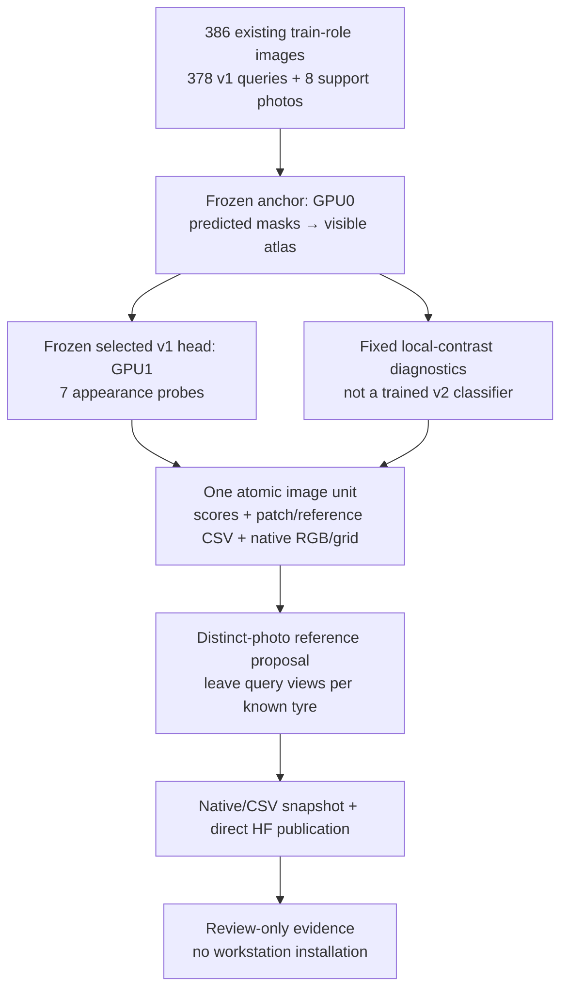

# ATLAS — training-only appearance and reference gate

**30 October 2026.** NB09 is complete and independently HF-verified. This
separate gate uses existing training data to examine the frozen selected v1
classifier, a deterministic local-contrast feature proposal and a reference
bank with greater view diversity. It performs **zero optimizer updates**.

## Run NB10 on Kaggle

[phase3_NB10_TREAD_TWO_Train_Only_Appearance_And_Reference_Gate.ipynb](../../notebooks/phase3_NB10_TREAD_TWO_Train_Only_Appearance_And_Reference_Gate.ipynb)

| Setting | Required value |
|---|---|
| Accelerator | **GPU T4 ×2** |
| Input | Exactly one expanded `shanmuk4622/tire-dataset-prepared-phase2`, attached directly from Kaggle |
| Internet / secret | Internet ON; Kaggle `HF_TOKEN` enabled for the run/publication cell |
| Space | At least **4 GiB free**; measured output/free-space guards remain active within 16 GB / user 20 GB output budget |
| Execution | **Run All**, in order; retain the executed notebook |
| Work location | `/kaggle/working/tread_two_nb10_appearance_gate/runtime/` |
| Publication | `Shanmuk4622/tyre-wear-study`, new `phase3/tread-two/atlas-v1/appearance-gate/<contract>` namespace |

The notebook includes the exact isolated sources and pinned original manifest.
It pins the tested Hub client only; it does not replace Torch/CUDA. Workers
receive no HF token. No project `.env` or alternative token file is read.
Source images stay read-only in Kaggle input; no additional tyre photos or
working-area dataset copy is needed. No 1 TB scratch assumption is made.

| Code cell | Actual work |
|---:|---|
| 1 | Verify/extract sources and check T4×2; define the stop-aware launcher |
| 2 | Verify data roles, exact anchor, selected epoch18 checkpoint, source/environment contract and free space |
| 3 | Restore compatible remote/local state; probe train images; propose references; publish consistent direct native/CSV evidence |
| 4 | Inspect the gate result, class/probe metrics, contact sheet and full interactive report |

GPU0 owns the frozen dense anchor; GPU1 owns the frozen patch head. The worker
canonicalizes each image once, then applies fixed appearance probes to the
predicted visible atlas. There is no DDP, second fit, optimizer or new seed
search. The local acceptance uses a single GTX1650; actual dual-T4/live-HF gate
execution is a separate user-run verification, not a locally claimed success.

## Scope and module ownership

| File | Responsibility |
|---|---|
| [RULES.json](RULES.json) | Frozen variants, normalization, eligibility, diversity and remaining-query policies |
| [UPSTREAM.json](UPSTREAM.json) | Independently verified NB09 publication and original fit provenance |
| [gate_worker.py](gate_worker.py) | Source/weight/role guards; all per-image calculations; native/CSV cursor commits; immutable model check |
| [gate_features.py](gate_features.py) | Masked local-contrast channels, descriptors, quality heuristics and deterministic train-only reference selection |
| [gate_controller.py](gate_controller.py) | Exact input preparation, one writer, remote restore, token-free worker, publication/Stop/error lifecycle |
| [gate_report.py](gate_report.py) | Saved-data summaries, original-pixel/feature contact sheet, full training-image explorer and dictionary |
| [SCHEMA.md](SCHEMA.md) | Per-family keys, meanings, units, counts and explicit unavailable values |
| [Notebook builder](../../analysis/build_nb10_appearance_gate.py) | Self-contained NB10 packaging; no executed NB08/NB09 regeneration |
| [Recovery/role checks](../../analysis/validate_appearance_gate.py) | Real frozen-model fresh-process seam, fake-HF restore, suffix rollback and proposal-role guards |

The original 24 v1 source/assets remain byte-identical. The selected classifier
is the original epoch18 native artifact pinned at `82e7e1c…`; the dense anchor
is the declared r1 seed3/epoch20 checkpoint. Actual gate source/environment,
weights, data checksum, overlay and all train image IDs form a new contract.
Source/environment mismatch is rejected rather than silently merged.

## What is measured

Seven variants are fixed before execution: identity, query brightness ×0.8/×1.2,
grayscale query+bank, query-only grayscale, query gamma exponent0.8/1.2. Support
geometry stays the original predicted atlas for each image. No validation/test
image is forwarded, and no held-out score selects thresholds or references.

The local-contrast proposal uses channel-mean luminance, masked **9×9** mean/std,
std floor **0.02**, standardized luminance clipped to **±3 /3**, Sobel x/y and
gradient magnitude. Pooled 8×8 descriptors support deterministic diversity.
Relative feature L2 is change/original norm. It is not classifier accuracy;
clipping, flat regions and the floor prevent universal exact equivariance.
Unclipped supported subsets and their denominators are reported explicitly.

Candidate references are drawn from original training photos only, six per
proxy class, with **one case per distinct photo**. Choose the least-represented
available tyre first, then fixed descriptor diversity/coverage/glare score.
Keep at least one original query photo per known tyre. Low texture is flagged,
not removed as presumed wear truth. Chroma/glare tags are heuristics, not new
human paint/wear annotations. Source pixels and all chosen indices are retained.

Candidate arrays are labeled **UNTRAINED_REFERENCE_PROPOSAL_DO_NOT_INSTALL**.
They are not a drop-in replacement for the bank against which v1 coefficients
were trained. More views do not change independent original train tyre support
from **1 low / 3 mid / 4 high**. Unresolved clip parents stay unresolved.

## Persistence, storage and recovery

| Boundary | Guarantee / limitation |
|---|---|
| Completed image | Raw probe, patch/reference and feature CSV chunks plus native RGB/valid/grid/dense/descriptor packet share one atomic pointer |
| Interrupted incomplete image | Replay that image; roll back only uncommitted suffixes, never committed science |
| Candidate assembly | Separate final unit; no partial candidate bank is called complete |
| Remote restore | Pinned manifest hashes, original contract and history prefix checked before installing a remote extension |
| Native recovery | Next image, model identity, protocol, artifact hashes and CSV byte/row cursors; no fictitious optimizer state |
| Normal publication | About every30 minutes plus major completion; only consistent paused worker boundaries are exported |
| Catchable Stop/error | Commit current image and attempt immediate HF flush, respecting actual server backoff |
| Forced kernel death | Only the last verified remote boundary is guaranteed; keep local files when available |
| Concurrent writers | Protected lease/CAS; never delete or steal an active owner |
| Completed rerun | Verified image units are skipped; no model fitting is repeated |

`csv/epoch_0000…` are reusable store partition names: **blocks of50 images**,
not training epochs. Native per-image `.pt` packets and candidate `.npy` arrays
remain direct files; no ZIP/NPZ/database upload is introduced. Only the latest
two local recovery states rotate; native science, CSVs and complete unit history
remain. Verified old derived publication staging may rotate after success.

The model runs eval/FP32 with all gradients disabled. Fixed transforms and
deterministic seed/settings make per-image replay independent of a stochastic
training trajectory. This finite inference gate therefore has no optimizer,
partial training epoch or learned v2 model to restore. Timing/allocator values
are retained but need not be identical across resumed processes. CUDA allocator
peaks are PyTorch tensor allocations, not total driver/context VRAM.

## Validation boundary and interpretation

[Gate acceptance receipt](../gate_validation/VALIDATION.json) records actual
two-image frozen-model uninterrupted/pause/native/fake-HF/fresh-process
equivalence, including all scientific CSV and native values. Synthetic controls
exercise empty support, unclipped appearance equivariance, distinct-photo
selection, role rejection and remaining-query coverage. These are engineering
checks, not v2 classifier results or actual live-HF/T4 completion.

The full local gate, its source/environment identity and actual result are
recorded separately in the [gate report](../../phase3TreadTwoAppearanceGate.md).
Original images, annotations, completed fit, executed NB08/NB09, both workstations
and selected prior models stay preserved. A future trained revision requires a
new explicit frozen recipe/namespace; this gate does not establish physical
wear, depth, alignment, safety, calibration or independent-tyre generalization.
