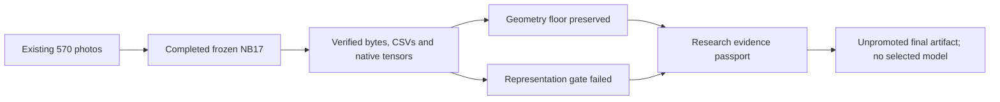

# TREAD-TWO / GEO — research evidence passport

The one-seed pilot completed **60 epochs / 2,940 updates**. All 60 validation
epochs preserve the geometry floor, and **zero** pass the representation gate.
The selected endpoint is unavailable. Keep the final epoch as a research artifact.

| Validation metric | G0 | Final epoch 60 |
|---|---:|---:|
| Mean tyre / tread Dice | 0.989865874 | 0.989862296 |
| Human point MAE / image width | 0.008085361 | 0.007662197 |
| Projector effective rank | 11.028566 | 1.038659 |
| Masked prediction gain vs train-only mean | — | 4.0337% |

The 96D pooled encoder also has validation rank **1.020990**.
Rank from all 570 images is not a substitute for the original validation rule.
Paired consistency and a larger training signal do not establish useful held-out
representation diversity. Probe sensitivity is descriptive, not a defect label.

The small cohorts were used during development. No new independent generalisation,
physical tread depth, safety, or GEO classification claim is supported. Training
has 386 photos but only six conservative components (low/mid/high = 1/1/4).
No new photos, optimiser update, image/model forward, checkpoint reselection,
workstation change or silent future fit is part of this handoff.

Full technical provenance and capability limits are in the accompanying direct
CSV tables. Native scientific files remain at pinned HF revision `1113bf8a9dd69687b23570fe985ed3a979a5f0e1`
under `phase3/tread-two/geo-r1/fit/7d1bc8554813ae16ba3d73d5d4af2d8c05c977e9282d1bf324ff9dbef6e89bdb`. Original manifest object paths identify the exact bytes.
