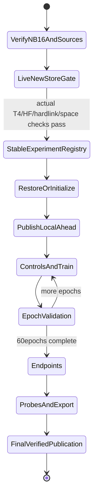

# NB17 — execution, publication and recovery

## Run settings

| Setting | Required value |
|---|---|
| File | [NB17 GEO resumable pilot](../../notebooks/phase3_NB17_TREAD_TWO_GEO_Resumable_Pilot.ipynb) |
| Kaggle accelerator | GPU T4 ×2 |
| Internet / Secret | ON /HF_TOKEN enabled for Shanmuk4622/tyre-wear-study |
| Data | Existing expanded shanmuk4622/tire-dataset-prepared-phase2 |
| Fresh output |≥19 GBfree; no assumed1TBscratch |
| Kernel | Fresh if NB16/another runtime has been imported |
| Start | Run All, all three code cells in order |

The verified NB16 environment was Python 3.13.15,Torch 2.11.0+cu128,
NumPy 2.1.3,Pillow 13.0.0,CUDA 12.8/cuDNN 91900,two Tesla T4s. A different numerical
environment fails clearly rather than starting a second fit or claiming
cross-release bit equivalence. Preserve any existing progress. The private
HF SDK0.36.2 uses --no-deps; global Torch/CUDA are not replaced.

## Automatic sequence

The disposable gate uses training-role controls only, two epochs/two batches,
and a separate pilot-gate namespace. It publishes optimizer update 1 within the
epoch, downloads that actual snapshot, continues in a fresh secret-free worker,
and compares final model/moments/RNG/cursor/scientific shards. The storage report
measures actual CSV widths, native sizes and the current filesystem. Matching
published certificates are reused; the measured initializer still verifies
snapshot creation before another optimizer step.

A stable geo-r1/EXPERIMENT.json binds the one measured source/environment/seed
intent using a parent-commit compare-and-swap. The fit namespace additionally has
one 45-minute leased writer. Source/environment changes do not silently create
a second candidate. Completed remote RESULT exits without optimization.

## Complete-update native and CSV restore

Native recovery holds model, all optimizer groups/moments/counters, disabled
scaler status, explicit LR cursor, Python/NumPy/CPU/CUDA RNGs, next phase/image/
draw, partial mean/validation/endpoint accumulators, best/history, CSV/native
prefix hashes, immutable catalogs and idempotent service acknowledgements.

On restart, compare the local/remote unit history at the shared cursor. Download
the newer remote state directly into working run paths, or publish verified
local-ahead state before optimization. Refuse a divergent chain. Verify every
closed artifact and active prefix, truncate only uncommitted append tails, then
continue the next complete update or evaluation image. A validation interruption
does not restart an epoch. A completed compatible run has no extra optimizer step.

Two native state files rotate. Active data is copied into immutable CSV/NPY
shards before the atomic selecting POINTER changes; older active generations
remain long enough for the previous state. At most8 training updates/64 source
observations enter a native shard; close early at phase/epoch boundaries. CSV
chunks close at 8 MiB or phase boundaries. Closed files are immutable/hardlinked
for staging; active prefixes are bounded copies. The measured path refuses a
full-copy staging fallback that could exceed20 GB. Engineering-only copy fixtures
remain separately labelled.

## HF cadence and stop behavior

One coordinator owns HF_TOKEN; numeric workers get no token and make no Hub
calls. Sources, input and anchor are verified before fitting. Publish initialization
before any measured update, initial-control completion, every 30 minutes, and
major/final completion. A catchable stop/error requests a complete worker unit,
then immediately attempts a consistent flush. A forced kernel/session kill
cannot execute cleanup or guarantee upload of unsent bytes.

Heartbeats identify worker phases and long transfer/verification waits every
30 seconds. Server Retry-After/RateLimit remains authoritative. Defaults stay
conservative until observed headers; then API/resolver limits use at most80%
of that observed quota with ceilings800/4,000 per 300 seconds. The independent
96commit-attempt/hour guard is unchanged. Cross-host traffic cannot be counted
by one local ledger; server remaining/reset still fences requests. NB16's
observed1,000/5,000 headers motivate this pre-fit transport adaptation.

Direct immutable objects are batched≤80, verified by blob/LFS hashes, then a
selecting manifest commits the snapshot. Lost successful responses reconcile
their marker. Final publication releases ownership. Old studies are never
rewritten. Fresh-session restore reads the full selected data with visible status;
it may take time for a large retained history.

| Problem | Action |
|---|---|
| Wrong input/GPU/secret | Correct settings, rerun unchanged |
| Source/env/experiment registry mismatch | Preserve notebook and files; do not bypass identities |
| Concurrent owner | Stop the other writer cleanly or wait for its displayed lease |
| HTTP429 / budget wait | Keep session open; do not reset request history |
| Space/hardlink gate fails | Preserve its report; measured fitting has not started |
| Catchable stop/error | Keep working output; inspect HF_PENDING/WORKER_ERROR and rerun unchanged |
| Forced death | Restore surviving files/latest verified HF state; unsent bytes are not guaranteed |
| Nonfinite update | Restore last complete state, retain error event, stop; no automatic numerical retry |
| No eligible selected model | Keep final/all evidence; do not choose a test winner |

After execution, save NB17 with outputs. Inspect it without regeneration, pin the
HF revision, independently audit CSV/native histories/selection, update project
documents and create NB18's retained-evidence review. Both workstations stay
deferred and no additional photos/seed/sweep is automatically requested.
