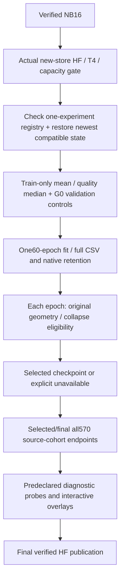

# TREAD-TWO / GEO — NB17 measured pilot

<!-- NB20_VERIFIED_GEO_CLOSED_20261102 -->
## Current — NB20 HF-verified; GEO research cycle complete

**2 November 2026:** NB20 completed both NB18 review and NB19 passport stages.
All 19 payloads match; three cells complete without saved errors. Actual HF
revisions **610bdb22… / abfec8d6…** contain **121 logical files, 51 CSVs /
183,812 rows**. All 119 objects, released owners, 48 reference-comparable tables,
exact vector arrays and actual passport provenance check out. Earlier NB13–NB17
selecting manifests are unchanged. **No NB18/NB19/NB20 rerun needed.**
[Completion and numerical/evidence notes](../../phase3NB20Completion.md).

The current GEO cycle is closed as **unselected, unpromoted research**. Geometry
passes 60/60 epochs; representation eligibility passes 0/60. The original
27,514,418 CSV rows and native/epoch evidence remain on HF.
[Compact research handoff](../../phase3TreadTwoGEOResearchClosure.md).

**Recommended next direction:** separately design a texture revision with fixed
local targets and batch-compatible diversity, reusing saved geometry and existing
photos. [Design brief](../../phase3TreadTwoGEONextResearch.md). This is proposed,
not implemented or trained. No new notebook/fit is required to finish this cycle.
Both workstation implementations remain deferred and preserved.
<!-- END_NB20_VERIFIED_GEO_CLOSED_20261102 -->

<!-- NB17_COMPLETE_POSTRUN_BATCH_20261102 -->
## Historical — NB17 verification and batch delivery before NB20 execution

**2 November 2026:** the attachment is completed NB17 (message says NB16).
HF revision `1113bf8a…`: **11,637 logical files / 3,080 direct CSVs /
27,514,418 rows / 8,457 native arrays / 10.31 GB**. One seed,
60 epochs and 2,940 updates; all selected bytes, schemas, native evidence and original masks
independently checked. Owner released; earlier four publication manifests unchanged.
**Do not rerun NB16/NB17 training.** [Completion and illustrated insights](../../phase3NB17Completion.md).

The geometry floor passes 60/60; human point MAE improves 5.23% retrospectively.
Representation eligibility passes 0/60: final validation projector rank 1.038659,
pooled 96D rank 1.020990; masked gain 4.0337% is below 5%. **Selected unavailable;
final remains research-only, unpromoted.** No new classification/depth/safety claim.

**Next: [NB20 Run All master](../../notebooks/phase3_NB20_TREAD_TWO_GEO_All_In_One_Postrun.ipynb)**.
It automatically runs/publishes NB18 full review then NB19 evidence passport.
All three notebooks are delivered now; individual stage files are optional.
CPU / None, Internet ON, existing expanded Kaggle input, HF_TOKEN, at least 13 GB free
on a fresh start. One shared verified cache, complete-stage recovery, publication
every 30 minutes and at major/stop boundaries. [Full batch/run guide](../../phase3TreadTwoGEOPostrunBatch.md).
Local actual-data audit and offline source/handoff/restore checks pass; new
NB18/NB19 Kaggle/HF publication remains pending. Existing photos only, no extra
fit or workstation change. User preference: supply all justified next notebooks
together with an automatic sequential master; preserve scientific gates.
<!-- END_NB17_COMPLETE_POSTRUN_BATCH_20261102 -->

**1 November 2026. Ready to run; measured training has not been executed here.**
[NB16 passed and is independently verified](../../phase3NB16Completion.md).
Run [NB17](../../notebooks/phase3_NB17_TREAD_TWO_GEO_Resumable_Pilot.ipynb) next:
**T4×2, Internet ON, the existing expanded Kaggle input, HF_TOKEN,  Run All**.
Start a fresh run with at least **19 GB free**. Compatible restarts reuse local
or verified HF progress automatically. No NB16 rerun or new photography.

| Item | Status |
|---|---|
| Source/runtime |28 frozen files plus FILES.json; 29 embedded notebook files |
| Notebook |Three code cells; under 1 MB; unexecuted |
| Model |355,879 trainable /1,728,038 total parameters |
| Measured fit |One seed /60 epochs /49 updates per epoch /2,940 updates |
| Logging |40 executable CSV families /468 fields, plus direct native tensors and recovery |
| Local tests |Full disposable lifecycle, fresh-process recovery, independent losses, rotation crashes, typed transport/replay and selected-export provenance |
| Actual NB17 live gate |Automatically runs in Kaggle before measured fitting; remains pending |

[Protocol](../../phase3TreadTwoGEOProtocol.md) · [Operations](OPERATIONS.md) ·
[Actual schema/retention](EVIDENCE_SCHEMA.md) · [Validation](VALIDATION.md).
The original approved [design](../geometry_first/plan/README.md) remains a dated
snapshot; its443 draft fields are refined to468 executable fields before fit.

No new classification head, mileage loss, depth/safety claim or workstation
change. Representation similarity, masked residuals and error estimates remain
research diagnostics. NB18 follows completed NB17 evidence; no extra fit starts
automatically if this hypothesis fails.
