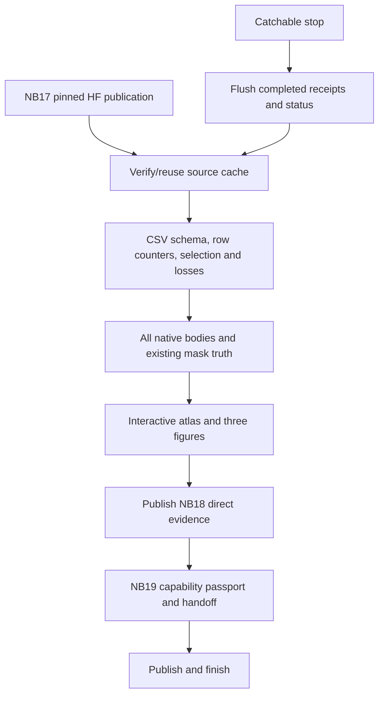

# GEO postrun batch — NB18, NB19 and NB20

<!-- NB20_VERIFIED_GEO_CLOSED_20261102 -->
## Current — NB20 HF-verified; GEO research cycle complete

**2 November 2026:** NB20 completed both NB18 review and NB19 passport stages.
All 19 payloads match; three cells complete without saved errors. Actual HF
revisions **610bdb22… / abfec8d6…** contain **121 logical files, 51 CSVs /
183,812 rows**. All 119 objects, released owners, 48 reference-comparable tables,
exact vector arrays and actual passport provenance check out. Earlier NB13–NB17
selecting manifests are unchanged. **No NB18/NB19/NB20 rerun needed.**
[Completion and numerical/evidence notes](../../phase3NB20Completion.md).

The current GEO cycle is closed as **unselected, unpromoted research**. Geometry
passes 60/60 epochs; representation eligibility passes 0/60. The original
27,514,418 CSV rows and native/epoch evidence remain on HF.
[Compact research handoff](../../phase3TreadTwoGEOResearchClosure.md).

**Recommended next direction:** separately design a texture revision with fixed
local targets and batch-compatible diversity, reusing saved geometry and existing
photos. [Design brief](../../phase3TreadTwoGEONextResearch.md). This is proposed,
not implemented or trained. No new notebook/fit is required to finish this cycle.
Both workstation implementations remain deferred and preserved.
<!-- END_NB20_VERIFIED_GEO_CLOSED_20261102 -->

**Run NB20 once with Run All.** It executes the complete NB18 saved-evidence
audit, publishes it, then produces/publishes the NB19 research passport. All
three notebooks are delivered together; the stage notebooks remain available
for separate use. No further fit or workstation change is launched.

| Notebook | Purpose | Execution |
|---|---|---|
| [NB18](../../notebooks/phase3_NB18_TREAD_TWO_GEO_Completed_Review.ipynb) | Full saved-data and native evidence audit | Review only |
| [NB19](../../notebooks/phase3_NB19_TREAD_TWO_GEO_Evidence_Passport_And_Research_Handoff.ipynb) | Capability passport and research handoff | Automatically satisfies NB18 first |
| [NB20](../../notebooks/phase3_NB20_TREAD_TWO_GEO_All_In_One_Postrun.ipynb) | Recommended master | NB18 → publish → NB19 → publish |

## Kaggle settings

| Setting | Required value |
|---|---|
| Accelerator | None / CPU |
| Internet | ON |
| Existing input | Expanded `shanmuk4622/tire-dataset-prepared-phase2` |
| Secret | `HF_TOKEN`, enabled for write access to `Shanmuk4622/tyre-wear-study` |
| Working space | Fresh start at least 13 GB free; 10.31 GB pinned input shared once |
| RAM | About 8 GB recommended; bounded CSV chunks and native shards |
| Run order | Fresh kernel, keep compatible files, Run All in NB20 |

The source release is pinned in [FIT_INPUT.json](FIT_INPUT.json). Exact existing
PNG masks are required to check raw geometry and final pixel counts. This uses
the read-only Kaggle attachment; images are not downloaded from HF or copied
into the working output.

## Recovery and publication

The parent reads only Kaggle Secret `HF_TOKEN`. The numeric worker receives no
token and performs no HF calls, image/model forwards or optimizer updates.
Private HF SDK 0.36.2 is installed without replacing Torch/CUDA/NumPy. The four
vendored persistence/transport files retain their original hashes in
[VENDORED.json](VENDORED.json).

Publish completed boundaries and every 30 minutes; attempt an immediate flush on
a catchable stop/error while respecting server backoff. One owner and a local
lock prevent competing writers. Immutable staged objects and a final selecting
manifest handle ambiguous commits. The separate commit guard is 96/hour;
API/resolver budgets observe server quota/reset headers. Cross-host traffic
cannot be counted atomically by a single session.

The output stages have source-bound receipts with exact artifact hashes. Reruns
skip completed stages and verified downloads. An unfinished CPU stage replays
from its previous completed stage; this does not retrain the model. Verified
completed HF reviews/passports restore and skip. Forced kernel death cannot
publish unsent bytes. Do not delete a compatible cache or manually remove an
owner to bypass a failed gate.

## Outputs and scientific interpretation

The original 40-family training evidence remains at its pinned revision. The
batch adds direct CSV inventories, schema/count audits, complete-update loss
reconstruction, raw native and dense geometry audits, validation spectra for
64D/96D spaces, role/component cohorts, exposure/gradient summaries, error
controls/calibration, probes and source-excluded retrieval. PNG/HTML provide
durable visuals; NPY stores compact derived vectors. No ZIP/NPZ envelope.

NB17 completed 60 epochs, but **zero checkpoints passed the original rank gate**.
That is an accepted scientific rejection, not a technical exception. No selected
model is invented. The final epoch is an unselected research artifact. No physical
depth/safety or GEO classification claim is supported; the small, previously
inspected cohorts are not a new blind evaluation. Existing photos only.

See the [complete batch guide](../../phase3TreadTwoGEOPostrunBatch.md) and
[NB17 completion report](../../phase3NB17Completion.md).
