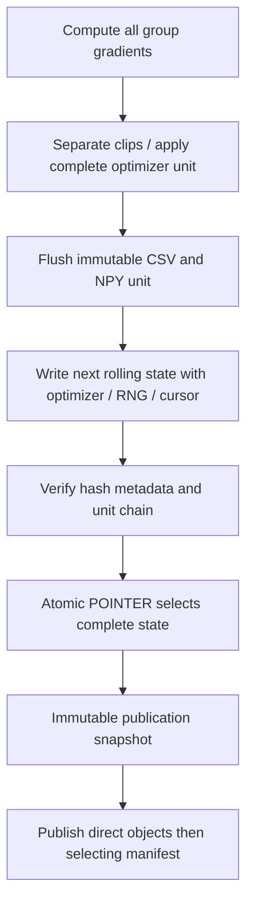

# NB16 data retention — actual engineering scope

The user prioritizes detailed training evidence and directly browsable CSV.
NB16 retains disposable engineering observations and recovery, with no ZIP/NPZ
or database envelope. The future measured contract remains **40 CSV families /
443 fields** in [SCHEMAS.json](plan/SCHEMAS.json). It is not silently reduced to
the smaller engineering fixture.

## Actual engineering unit tables

| CSV family | Unit rows / meaning |
|---|---|
| `samples` | Eight source IDs, historical train roles, components and point provenance |
| `objectives` | All geometry numerator/count terms, VIC batch terms, masked Huber sum/count, texture eligibility/ramp and quality sum/count |
| `gradients` | Three preclip group norms, clip limit and completed group counters |
| `parameter_gradients` | Every trainable tensor: preclip norm/max/mean/zero fraction, availability, count and finite flag |
| `geometry_points` | Six predictions/source plus available human/weak targets and weights |
| `region_metrics` | Both masks' exact full-grid TP/FP/FN and Dice |
| `quality_errors` | Three raw error predictions, detached targets and availability; point target human-only |
| `vectors` | Every96D global and64D projected coordinate for both views |
| `tile_support` | Both views/all32tiles: valid coverage, geometric mass, selected mask and eligibility |
| `masked_tiles` | Exact packed native slot→source tile mapping |
| `view_plans` | Actual brightness/contrast/gamma, masked count, eligibility and valid loss mass |

Additional direct files include all570 source-role/component records, the full
60-epoch23,520-draw schedule, actual device peak memory in `RESOURCES.csv`, and
safe HF transport-event CSV. The engineering schema is emitted as
`ENGINEERING_SCHEMA.json`. The private SDK's safe JSONL diagnostic events are
also exported into directly browsable CSV; no credential/header values beyond
safe rate-limit metadata are logged.

Each unit saves uncompressed NPY mask logits, atlas row parameters/validity, both
views' pre/post-context tokens, and up-to8 masked predictions, targets and valid
loss weights. Unused packed slots are identified by `masked_tiles`, not counted
as real observations. Actual forward-support masks/grids can be reconstructed
from source SHA/preprocessing and retained logits/row parameters. Points and
embeddings are additionally preserved in roundtrippable direct CSV.

## Complete state and transaction boundaries

Native PT contains trainable state, all Adam moments/group counters, Python,
NumPy, CPU/CUDA RNGs, explicit cosine cursor convention, FP32/no-scaler status,
contract and complete unit list. Two state files rotate; the pointer changes
only after evidence/state durability. An interrupted uncommitted unit is replayed
after restoring the previous complete state. Pending stale files are excluded
from selected publication snapshots, never mistaken for measured evidence.

The coordinator retains a dedicated unit1 snapshot for the actual HF continuation
test **and** the latest committed engineering progress. Thirty-minute/major/stop
flushes select immutable snapshots. It does not repeatedly publish only an old
unit1 while hiding later committed work.

## Measurement versus full-fit budget

The finite report measures actual vector CSV widths, native observation bodies,
rolling-state bytes and a dense-row export probe. It extrapolates to the approved
29,520 source/59,040 view upper bounds, with explicitly provisional allowances.
`complete_40_family_measurement=false` and
`measured_fit_storage_gate_passed=false` remain honest until measured emitters,
8-update shard lifecycle and staging-copy peaks are integrated. The design's
15GB logical/18GB peak/2GB reserve within20GB remains the future acceptance rule.
No existing training evidence is removed to make a projection pass.
