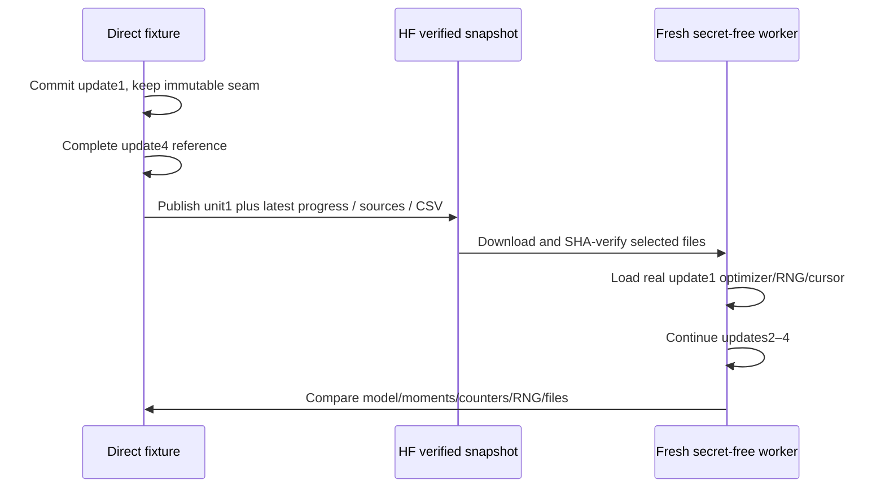

# NB16 validation and recovery proof

**Local proof is CPU/offline. Actual dual-T4/HF proof is pending user execution.**
See the [delivery receipt](validation/DELIVERY.json) and
[local mathematical receipt](validation/LOCAL_ENGINEERING.json).

| Check | Local result / precise scope |
|---|---|
| Data/point/component identity | Every dataset checksum;386/81/103 roles;70human/152weak/164none train point kinds; six conservative groups2/3/5/60/67/249 |
| Warm start | Exact refined/anchor mask logits and points with zero adapters |
| Atlas | Original canonicalizer RGB/support exact; row-parameter reconstructed grid exact |
| Gradient isolation | Geometry-only, texture-only and quality-only backward reach only their own trainable group; anchor has no gradient |
| Hidden tile leakage | Changed hidden RGB gives identical visible LC and masked-context predictions; token replacement also tested |
| Loss arithmetic | Independent loop covariance and FP64 NumPy masked-Huber numerator/count reconstruct the texture loss |
| Missing/ignored targets | Zero supervision counts produce finite reductions; point order remains valid; quality point targets are human-only |
| Dense evidence | Coarse foreground/valid subpixel counts reconstruct original-grid TP/FP/FN exactly |
| Texture skip | No texture AdamW parameter, decay or moment update when support is unavailable |
| Resume | Actual batch8 model, four updates direct versus native restore after update1; parameters, moments, counters, RNG and scientific files exact |
| Separate process | Byte-verified offline snapshot copy, new worker continuation1→4 matches direct model/moments/counters/scientific observations |
| Transaction crashes | Failure after evidence, after state-before-pointer, and after pointer: restore exactly the prior or newly durable unit |
| Float serialization |10,000 FP32 values roundtrip through9-digit CSV without a bit change |
| Notebook | All27 embedded files match readable source; code parses; Jupyter notebook schema validates; no outputs/execution counters shipped |
| Preservation | All24/30/32 frozen candidate files,47+18 workstation entries,27 paired-runtime entries,103 original Markdown records and completed notebook hashes preserved |

The gallery has32 actual predicted-mask cases and an update filter. Numerical
receipts are engineering evidence; no classification, physical wear, depth,
safety or generalisation result is inferred from these disposable updates.

## What NB16 must establish in Kaggle



Only a live run through Publisher.download and actual twoT4s establishes the
live gate. Offline copies are explicitly marked in local receipts. Scientific
file comparison excludes timing/environment differences; same-environment RNG
and deterministic math are bound to the protocol. Cross-release/CPU-versus-GPU
bit equality is not promised; [PyTorch reproducibility guidance](https://docs.pytorch.org/docs/2.11/notes/randomness.html)
motivates the matched-environment checks.

## HF operation

The new namespace is `phase3/tread-two/geo-r1/engineering/<contract>` in
`Shanmuk4622/tyre-wear-study`. The coordinator is the sole owner/token holder;
workers make no Hub calls. The unchanged copied transport stages immutable
direct files in batches≤80, verifies tree blob/LFS hashes and selects a final
manifest. Owner compare-and-swap fencing and a45-minute lease prevent competing
writers. Completed runs release ownership.

Normal flush cadence is30minutes plus major stages and catchable stop/error.
The shared local request ledger imposes96 commit attempts/hour and obeys server
Retry-After/RateLimit policies. Cross-host account traffic cannot be atomically
counted by one session; server headers remain authoritative. HF documents
[separate API/resolver/page buckets](https://huggingface.co/docs/hub/en/rate-limits),
so the historical128/hour concern is not treated as a universal quota.

Catchable stop waits for a complete worker unit then attempts publication;
forced death cannot upload unsent bytes. NB16 fresh-session disposable reruns
must not be confused with the future NB17 automatic measured-state restore.

## Reproduce locally

Use the existing environment without package replacement:

```powershell
.\phase3\run_cv.cmd -B phase3\analysis\build_nb16_geo.py
.\phase3\run_cv.cmd -B phase3\analysis\validate_nb16_delivery.py
```

The builder refuses to overwrite a notebook with execution outputs. Do not run
it against the user's subsequently executed NB16. Fixture/cache/native files are
ignored by Git; readable sources, compact receipts and the current notebook are
kept visible. No local token discovery or HF write is performed by validation.
