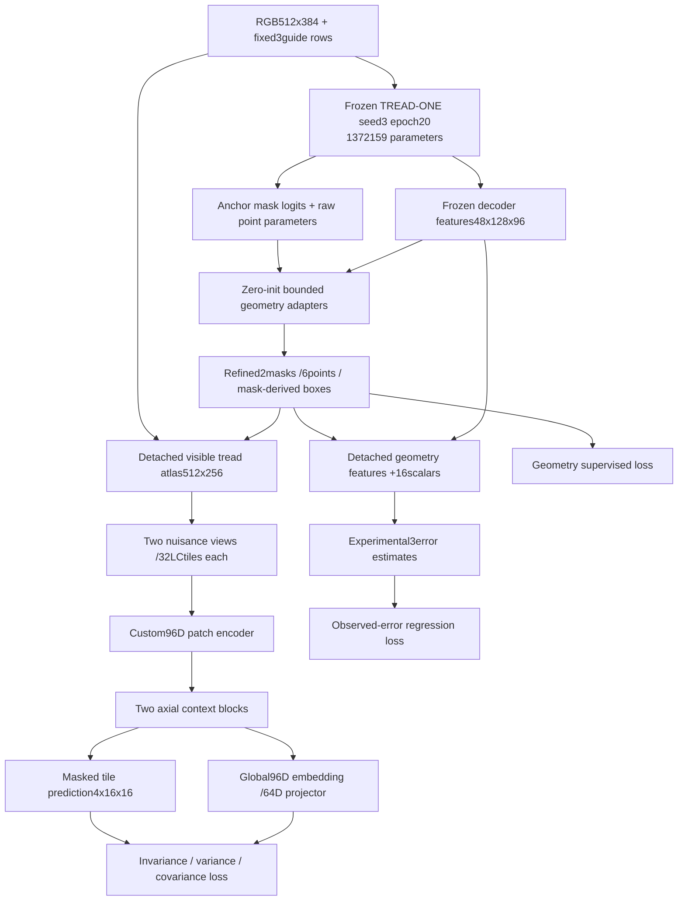

# GEO architecture and mathematical contract

**Design only.** Names below are planned modules, not implemented files. Configuration values are in [PLAN.json](PLAN.json).

## One packaged model, separated learning paths



The frozen anchor's entire state stays bit-identical, in eval mode. New geometry adapters, texture modules and the error head use disjoint trainable parameters. Atlas construction detaches masks, row coordinates and RGB. Error-head inputs and targets are detached. Texture/error losses therefore have zero gradient to geometry adapters and the anchor. Geometry gradients cannot reach texture parameters. Clip each parameter group separately; a single global clip would couple updates despite disjoint branches, as the earlier shared-gradient study demonstrated.

## Geometry initialization and refinement

Anchor: exact project-selected TREAD-ONE r1, seed 3/epoch 20, SHA `a5b872ed2e4cbfb3b9782b0df563e2606631744cd0274fee2da42a832f985f65`. Source SHA `d16cd4eef75779044dd95900c0531fee474704cf88f523326ee069115347ba09`. This is not the failed projected r2 condition or a newly test-selected checkpoint. The existing full model file is loaded strictly; its old class head is frozen and unused by GEO losses/selection.

| Module | Chosen specification |
|---|---|
| Input / normalization |512 high ×384 wide RGB; original ImageNet mean/std and overlay guide definitions |
| Frozen features |48 channels ×128×96, before old segmentation head |
| Mask residual |3×3 Conv 48→24, GN8, SiLU, 1×1 Conv 24→2; final weights/bias zero |
| Refined mask logits |`anchor_logits +1.0*tanh(mask_residual)`; independent overlapping tyre/tread sigmoid channels |
| Point residual |Existing 256D guide-row features → Linear 256→64 → SiLU → Linear 64→2; final zero; shared across 3 guides |
| Refined point raw parameters |`anchor_raw +0.25*tanh(point_residual)`; use original raw parameters directly, never inverse-sigmoid approximations |
| Point coordinates |`left=.99*sigmoid(a)`; `right=left+(1-left)*sigmoid(b)`; 6 normalized x coordinates |
| Localization |Bounding boxes enclosing masks at 0.5; empty masks yield unavailable boxes |

At zero initialization, refined mask logits/points/boxes must match the anchor under the identical device/math path. The new forward adapter must expose old frozen features/raw point parameters without changing their computation or source checkpoint keys. Exact guide fractions remain 384/1535,768/1535,1151/1535. Bounded residuals constrain change, not correctness. Weak points retain weight 0.25, human points 1, absent point targets 0. Raw masks and explicit ignore regions remain intact.

Training mask targets use fixed 4×4 mean aggregation with any-ignore blocks excluded; soft Dice smoothing is 1.0 and BCE uses logits. Reporting repeats native 128×96 predictions by 4 to the 512×384 input grid and applies the original per-pixel ignore rule. Dense CSV stores quarter-grid probability/prediction plus the number of valid native subpixels and foreground subpixels in each 4×4 block. These integer counts reproduce full-grid TP/FP/FN exactly; fractional coarse targets are not mislabeled as binary human truth. Store every predicted/target box as explicit left/top/right/bottom half-open integer coordinates in the 512×384 report frame, with availability flags. Ground-truth boxes remain derived from the original valid target mask, not from a coarse averaged surrogate.

## Atlas and support

Use predicted tyre∩tread support and the existing visible-row algorithm: input 512×384 → atlas 512×256 → eight bands × four 64×64 tiles. Rows need at least 16 source pixels. Keep row-valid/clipped flags, left/right/source-y parameters and actual pooling mass. Bilinear RGB and nearest support sampling use the existing `align_corners=True` convention. No source truth mask/point gates ordinary inference. Ignore annotations can exclude training loss pixels after projection; they do not provide the forward support.

Guide predictions are an independent consistency check, not an automatically trusted replacement warp. Log point-versus-mask-row gaps, with the existing 0.05 width engineering flag; it is not a calibrated rejection probability. Invalid geometry remains an observable outcome, not a silently repaired atlas. Fully unsupported samples keep geometry outputs and skip texture loss with a reason.

The sampling boundary is `no_grad`: input/grid and result are detached. This avoids asking CUDA to differentiate `grid_sample`; [PyTorch2.11 documents a backward nondeterminism caveat](https://docs.pytorch.org/docs/2.11/generated/torch.nn.functional.grid_sample.html). New texture gradients begin at its encoder. That boundary also prevents the network learning a convenient distorted warp to reduce its texture objective.

## Texture representation and prediction

| Module | Chosen specification |
|---|---|
| Tile inputs |4 channels: patch-local 9×9 normalized luminance, Sobel x/y/magnitude; std floor 0.02, clip±3 then divide 3 |
| Patch encoder |Four 3×3 stride 2 convolution/GN8/SiLU stages, channels 4→24→32→64→96; 4×4 output mean-pools to 96 |
| Layout metadata |Linear projection of row/column normalized coordinates, coverage and pooling mass:4→96 |
| Context |Two residual axial blocks over 8×4×96; depthwise 3×3,5×1,1×3 spatial paths summed; GN8; 1×1 96→192→96 with SiLU; learned residual scale initially 0.1 |
| Global embedding |Geometric-support-weighted mean of 96D full-view contextual tokens; raw and L2-normalized forms exposed |
| Projector |Linear 96→128, SiLU, Linear 128→64; unnormalized outputs for variance/covariance loss; no BatchNorm/dropout |
| Prediction decoder |Linear 96→128, SiLU, Linear 128→1024; reshape 4×16×16 per masked tile |
| Masking |One supported tile per band where at least 2 eligible tiles exist; ≤8 masked tiles/view; at least 2 visible valid tiles overall |
| Target |Detached 4×16×16 local-contrast target, from fixed 4×4 mean aggregation of the corresponding 64×64 input tile |

Two photometric views share geometry and coordinates. Compute local contrast within each tile, so hidden tile pixels cannot leak through a cross-tile normalization kernel. The masked pass replaces selected encoder tokens with a learned mask token before context; hidden tile features are absent from that path. Full and masked context passes share weights and may reuse the patch-encoder outputs. There is no direct visible-to-target skip. Full-view embeddings feed the invariance loss; masked outputs feed prediction loss.

A source image is SSL-eligible only with at least 4 supported tiles of coverage≥.25 spanning at least 2 bands, at least 2 visible supported tiles and at least 1 masked tile with nonzero target-loss weight in each view. Otherwise retain its geometry outputs and explicit texture skip. Batch-level variance/covariance still require 4 eligible distinct images and 2 components. These checks prevent empty masked reductions being misreported as perfect predictions.

First run uses no Transformer, EMA teacher, negative-image bank or new external backbone. The custom axial branch is small and appropriate to 32 tiles. Parameter targets: trainable≤1M, total≤3M; exact counts and tensor shapes are mandatory implementation measurements before freeze, not claimed measurements today.

## Experimental error estimation

Quality head 64→32→3 with SiLU and three sigmoid outputs predicts annotation-agreement errors, not probabilities of physical safety. Input 64 =48 pooled frozen features +16 detached scalars: two mask areas, two mask entropies, two empty flags, two clipped fractions, three guide/mask gaps, three guide-gap availability flags, atlas coverage and valid-band fraction. Undefined gaps use a zero sentinel plus their associated availability flags; empty boxes are never given fabricated aspect ratios.

Targets: `(1-Dice_tyre,1-Dice_tread,human_point_MAE_width)`, all detached, with explicit target availability. Point-error targets use only the 70 human-labelled training images; weak point annotations do not become human calibration truth. Compare MAE/RMSE and fixed-bin predicted/observed error with a training-only constant-median predictor. If the head is uninformative, export its raw values as experimental/unvalidated; never market them as calibrated uncertainty.

## Objective and gradient rules

```text
L_geo = mean_region(masked_BCE +soft_Dice)
        +2*weighted_point_SmoothL1(beta=.02)
        +.1*containment +.1*eligible_guide_row_agreement
        +.1*anchor_drift

L_quality = masked_SmoothL1(predicted_error,detached_observed_error,beta=.02)

L_texture =25*invariance +25*(variance_A+variance_B)
           +(covariance_A+covariance_B) +.5*masked_prediction_Huber(beta=.1)

L_total = L_geo +.25*L_quality +min(1,epoch/5)*L_texture
```

Geometry drift is mean squared mask-probability change plus mean squared point-coordinate change against the same-view anchor on applicable pixels/points. Point reduction divides weighted loss sums by available weight, not by the full batch. Missing targets give zero contribution and zero denominators, logged as unavailable. Soft containment/row terms retain original eligibility rules; contradictory/ignored annotation cells do not enter reference supervision.

The [VICReg paper](https://arxiv.org/abs/2105.04906) motivates matching views while preserving variance and reducing covariance. Here invariance is mean squared difference of 64D projections. Each variance term is mean `relu(1-sqrt(sample_variance+1e-4))`; sample variance uses N−1 across eligible distinct images in the current batch. Each covariance term sums squared off-diagonal covariance entries and divides by 64. These 25/25/1 starting coefficients follow the source method, but this small tyre-cohort adaptation is unvalidated. Patches/paired views are never counted as independent tyres.

Variance/covariance terms are batch-level and appear once in batch_objectives, not duplicated as independently summable pair losses. Masked Huber divides the summed weighted element losses by the summed valid weights across all masked tiles/views and four channels; retain both sums. Any 4×4 target block touching a projected ignore pixel is excluded from that target loss. Compute variance/covariance only with≥4 eligible distinct images from≥2 conservative components. Otherwise set every texture gradient to None, skip that optimizer group, record the reason and still commit the geometry/error update. Log global and per-group update counters. Full FP32 training, no AMP/dropout, separate clip 1.0 per group; frozen anchor gradient count must always be 0.

## Explainability and classification boundary

Outputs explain geometry, support, observed masked-prediction residuals and reference similarity. A reconstruction residual is not a crack/damage label. Retrieval must show exact source references, coordinates, similarities and source/component exclusions; it does not yield a calibrated wear class. No mileage CE, ordinal loss or trained class head participates in the first pilot. A later classification readout would require its own declared protocol and cannot fix missing independent tyre support by itself.
