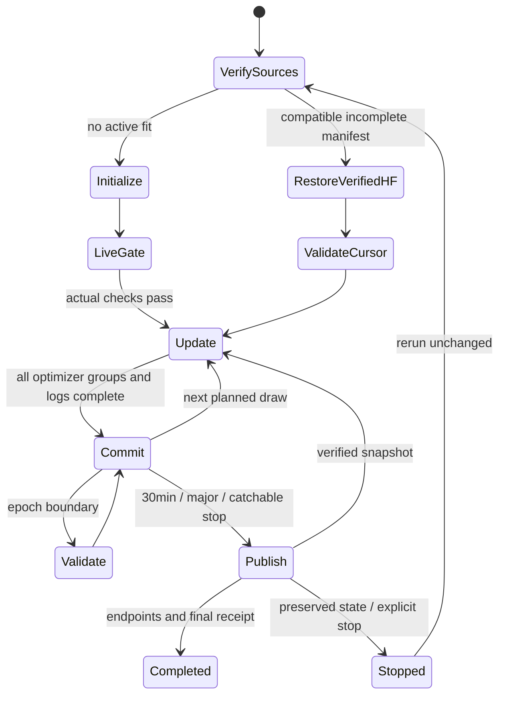

# Kaggle operation, recovery and HF transport

**Planned behavior, not a runnable notebook yet.** Preserve local `cv_conda`; use `phase3/run_cv.cmd` for development. Do not replace CUDA Torch or the existing workstation dependencies.

## Two T4s, one measured model

| Device / component | Actual intended ownership |
|---|---|
|GPU1 |Frozen TREAD-ONE feature/anchor inference with geometry microbatch 1; checkpoint-matched validation/evaluation at barriers |
|GPU0 |Trainable geometry adapters, texture encoder/context/decoder/projector and error head; batch 8 texture losses |
|CPU coordinator |Seeded epoch plan, source verification, serialization, CSV/native writes, one HF writer and clear status |

The frozen 48×128×96 features, anchor logits/raw points and minimal metadata move explicitly fromGPU1 toGPU0. They are detached. GPU1's anchor is immutable; it never performs optimization. At validation barriers, copy the exact completed trainable state to the evaluation modules onGPU1 and record its SHA/update; optimizer training pauses until the declared evaluation unit is committed. This is one candidate using two GPUs, not two seeds or DDP. Initial synchronous ownership is favored; pipeline overlap may be added only before freeze with a matched seam test. Never claim both GPUs continuously train.

## Planned notebooks and settings

| Notebook | Purpose | User settings |
|---|---|---|
|NB16 GEO preparation/contract gate |Source/input checks, disposable train-only optimizer/recovery seam, actual devices/math/memory/storage/HF gate; no measured candidate fit |T4×2, Internet ON, existing expanded Kaggle input, HF_TOKEN |
|NB17 GEO resumable pilot |One measured seed/60 epochs under the passing frozen contract |Same exact settings/source/environment; Run All; automatic compatible resume |
|NB18 completed review/export |Independent retained-data audit, figures and model-card/capability export after NB17 completion |CPU or GPU only if an explicitly declared extra saved-state verification requires it; no automatic retraining |

These names/numbers are planned reservations. No files with these notebook names are delivered today. The measured notebook must embed exact sources/config/schema, not rely on the repository being cloned or previous session variables. Dataset auto-discovery must find exactly one expanded input with the pinned checksum. It must not download an image archive from HF when the Kaggle input is attached.

NB17 cell order:1 bootstrap/private tested HF SDK/source extraction; 2 dataset/anchor/source/environment/space checks and verified recovery; 3 actual live gate if no compatible saved gate exists; 4 single training/validation loop; 5 selected/final evaluation and final publication; 6 report/interactive links/receipt. Every major completed cell publishes its relevant direct evidence. Run All is the normal instruction; do not ask the user to paste helper code or retain an invisible Python variable across fresh sessions.

## Complete-update persistence

A unit includes all geometry/texture/error steps, scheduling, CSV rows/native offsets and the next cursor. Save an atomic pointer only after all associated files flush and hash. If interruption occurs inside the unit, restore the preceding native state, truncate only uncommitted append tails and replay the same seeded unit. Never keep a partially applied geometry update with an unrecorded texture update. All three group moment/step counters must be restored, including skipped texture updates.

Fresh session: verify manifest, source/runtime/environment/data/anchor hashes and owner lease; download required immutable files to unique partial paths; verify SHA/size; install one internally consistent state; compare native/CSV/chunk prefixes; resume the next complete update. Reuse local/saved Kaggle files only when their verified ledger extends the same history. Publish ahead local committed progress before doing further fitting. Completed compatible run → display receipt and exit without another optimizer step.

Strict replay binds actual numeric environment/devices. A runtime change is not silently ignored. [PyTorch2.11 reproducibility](https://docs.pytorch.org/docs/2.11/notes/randomness.html) motivates exact same-environment state tests; CPU/T4 equality is not promised. Original workstations and historical sources are outside all mutation paths.

## HF writes and quotas

Account/repo: `Shanmuk4622/tyre-wear-study`. Token: authorized Kaggle Secret `HF_TOKEN` only. Private tested HF SDK directory, publishing subprocess only; no global package downgrade. Worker tensors/training code do not receive the token. Namespace: `phase3/tread-two/geo-r1/{engineering,fit,review}/<contract>`, distinct from every ATLAS/TREAD-ONE namespace.

Reuse the tested immutable-object/CAS owner transport as a separately copied, hash-pinned module; do not edit completed copies. One owner, explicit heartbeat/expiry, at most 80 scientific objects/batch, final selecting manifest after object checks. Existing verified object receipts skip redundant work; lost successful commit responses reconcile their marker instead of creating duplicate writes. Do not erase a live lease or fork another fit to bypass recovery.

Normal push interval 1,800 seconds; additionally after each major stage and immediately attempted at a catchable stop/error once the current complete unit is sealed. Server backoff may delay transfer. The existing conservative 96 commit-attempt/hour guard is below the user's128/hour concern; actual API/resolver/action policy headers govern waiting. The [HF documentation](https://huggingface.co/docs/hub/en/rate-limits) distinguishes request buckets and granular actions. Do not assume 128/hour is a universal resolver limit or reset the budget to evade a wait.

Catch SIGINT/SIGTERM/KeyboardInterrupt: request a safe boundary, flush native/CSV state, attempt verified publication, write an explicit pending receipt if transfer fails, and exit clearly. Forced kernel death/network loss cannot execute an upload; recover from surviving local output or the latest verified HF snapshot. Preserve all source files and the failure transcript. This is strong resumability with stated boundaries, not an impossible guarantee that every crash uploads unsent bytes.

## Status and troubleshooting built into delivery

Print update/epoch/next draw and current phase at least every 30 seconds while waiting. Distinguish feature inference, texture backward, native writes, prefix verification, quota wait, upload and validation. Enable periodic stack diagnostics for long blocking paths without printing tokens/headers containing credentials. No silent 2 GB object stream: bounded verified reads with Retry-After/RateLimit handling.

| Trigger | Required behavior |
|---|---|
|Wrong source/input/anchor/environment |Fail before measured update; show expected identity and safe observed metadata |
|Missing local directory |Restore full compatible HF state; no old POINTER-only requirement |
|Disk projection exceeds limit |Fail preflight; revise format/schema before freeze; never silently shrink measured retention |
|In-run free reserve breached |Commit safe state, attempt publication, stop explicitly; keep evidence |
|Unsupported deterministic CUDA op |Fail fixture; repair/test new source before freeze; do not switch determinism off silently |
|NaN/Inf |Do not commit invalid update; retain diagnostic event/native last-good cursor; explicit bounded retry policy frozen before fit |
|Invalid atlas / too few SSL images |Log sample/batch skip, keep geometry loss, preserve group counters; monitor coverage gate |
|HF429/backoff |Visible waiting with retained state/owner heartbeat; no fake training failure or reset of quotas |
|No eligible checkpoint |Keep final/all epoch states and rejection reasons; no test-selected replacement |

Actual new throughput, GPU memory, transfer overhead, native chunk peak and upload duration remain measurements for NB16. Never give the user an untested hour estimate as a promise.
