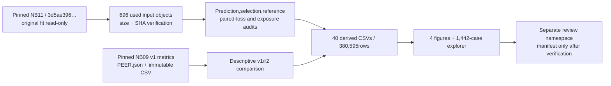

# Completed ATLAS-LC review — code and CPU run guide

> Completed-study guide: NB11 and NB12 are HF-verified. No rerun is needed. See [NB12 findings](../../phase3NB12Completion.md) and the new [NB13 guide](../context_pilot/README.md). Earlier run instructions below describe the preserved completed delivery.

This is a separate post-hoc analysis of completed NB11. It makes **zero model
forward passes and zero optimizer updates**. It never changes an original fit,
selects another test-scoring checkpoint or installs a workstation model.

## Run NB12

| Setting | Value |
|---|---|
| Notebook | [NB12](../../notebooks/phase3_NB12_TREAD_TWO_ATLAS_LC_Completed_Review.ipynb) |
| Accelerator | None / CPU |
| Input | No tyre dataset attachment; pinned saved HF evidence |
| Internet | ON |
| Secret | Kaggle HF_TOKEN for write access to Shanmuk4622/tyre-wear-study |
| Space | At least2GiB free; used scientific subset about295MB; no5.28GB model download |
| Order | Setup → saved-science audit/report → direct-file publication → inspect |

Run All. Preserve the executed notebook and publication receipt. Completed
source objects are reused by size/SHA; corrupt/incomplete downloads are replaced
atomically. Derived CSVs are atomic per table. An interrupted finite analysis
regenerates derived tables from verified inputs on rerun; there is no optimizer
state and no need to repeat NB11. Keep source/cache/report files after an error.

During publication, a catchable Stop allows the complete validated review flush
to finish, subject to server backoff. Forced kernel death cannot publish unsent
work. Completed matching manifests are verified and skipped. Active ownership is
never stolen. Publication uses the corrected frozen r2 transport: server quota
headers, bounded object batches, CAS lease, immutable verification, lost-success
reconciliation and direct CSV/JSON/source/PNG/HTML. No ZIP,NPZ or database.

This finite review publishes at the major completed-analysis cell. Its recovery
does not claim NB11's within-epoch optimizer resume or periodic training snapshots.
The latter were already exercised in the actual dual-T4/live-HF training preflight.

## Ownership and provenance

| Source | Responsibility |
|---|---|
| `review_lc.py` | Pinned public cache,53,342prediction/role/metric checks,validation selection,endpoint reference reconstruction,dense/calibration analysis and table dictionary |
| `paired_review.py` |23,520paired losses,752,640patch distances,960,156SHA permissions,47,040seeded factors,draw-vs-view exposure,resources and pinned v1 comparison |
| `render_lc_review.py` | Saved-data plots,all1,442endpoint/probe records,paging/filter/search,class-specific signed patches and actual reference sources |
| `publish_lc_review.py` | Immutable review contract,validated file staging,direct-file publication,owner release and duplicate-publication skip |
| `assets/PEER.json`, `assets/v1_cohort_metrics.csv` | Exact previously verified v1 publication identity and descriptive metrics; no invented gamma/control rows |
| NB11 frozen publication modules | Tested native transport/publication only; no worker/coordinator training function is invoked |

The code is adapted from the preserved v1 saved-evidence review, with separate
sources and scope. The actual r2 endpoint happens to retain the same low→mid
confusion; this is checked directly from predictions, not inferred from BA.
The full local object/raw-row audit and this used-subset scientific audit have
separate receipts. NB12 embeds the former as provenance; it does not redownload
or claim to repeat that full5.28GB audit on CPU.

See [completion/findings](../../phase3NB11Completion.md),
[derived CSV inventory](../lc_analysis_report/CSV_INDEX.md),
[methods](../lc_analysis_report/METHODS.md) and
[validation](../lc_review_validation/VALIDATION.json).

## Interpretation

Selected epoch7 has validation BA56.25%; historical endpoint BA remains50%,
low recall0/62,high recall41/41. Probability NLL/Brier improve over v1 while
selected raw-score ECE worsens. All six endpoint probes have zero prediction
flips. Stability is useful engineering evidence; grayscale invariance is built
into LC, and stable wrong predictions do not establish wear recognition.

Both online views remain correlated observations of one draw. Source-SHA
exclusion prevents identical-photo support, not similarity between photos of
the same physical tyre. Known training low/mid/high tyre support remains1/3/4;
there is no held-out mid target or newly acquired physical wear/depth/safety truth.
Both workstations remain unchanged. Review publication is pending actual NB12.
