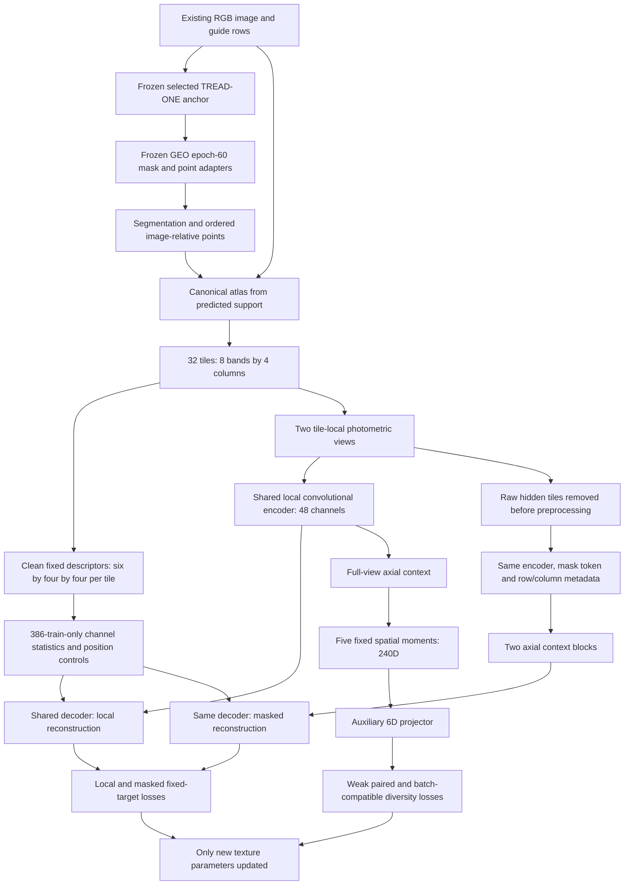

# TRACE design — learn observable tread structure without moving targets

**Design/prototype, 2 November 2026.** [Actual checks](FINDINGS.md) distinguish
implementation evidence from proposed study outcomes. The design reuses only the
existing 570 photos and historical roles. No transformer, pretrained external
backbone, teacher network, cross-batch queue or extra classifier is introduced.

## Why this particular revision

| Observed result | Design response | What remains a hypothesis |
|---|---|---|
| GEO geometry passes 60/60 floors | Freeze the saved geometry and spend updates on texture | The inherited geometry is an unselected research input, not a new validated product |
| GEO local encoder, pooled vector and projector all have low diversity | Supervise local features against image-derived fixed spatial descriptors | Descriptor reconstruction may still learn nuisances or generalise poorly |
| Final masked gain is 4.03%, below the original 5% requirement | Preserve train-only constant controls and add a visible-neighbour control | A new loss can still lose to these simple controls |
| Eight images with a 64D batch covariance | Use a 6D auxiliary projector; omit variance/covariance terms below seven eligible rows | Feasible covariance does not ensure useful features |
| NB12 exposed order invariance; train-target averaging also removes variation | Retain 32 local tokens, spatial target maps and five explicit row/column moments | Spatial sensitivity is not proof of physical-wear sensitivity |
| Learned error heads lose to train-median controls | Omit a new learned confidence head; retain diagnostic residuals and support flags | Residuals do not establish confidence or safety |
| Held-out cohorts have only two conservative components | Audit original-role and within-component spectra separately | These cohorts cannot provide new independent validation |

## Computational graph

There is no gradient through geometry, atlas construction, target calculation,
normalisation or annotation exclusions. Annotation ignore masks affect loss
support only. They never enter network input channels or geometry inference.

## Shapes and parameter ownership

| Component | Shape / definition | Parameters | Ownership |
|---|---|---:|---|
| Original selected anchor | Input RGB 512×384; selected seed 3 / epoch 20 | 1,372,159 | Frozen; original source/weights pinned |
| GEO geometry adapters | 48→24→2 mask residual; 256→64→2 ordered-point residual | 27,068 | Frozen from **unselected final** epoch 60 |
| Local encoder | Four stride-2 convolutions, channels 4→16→24→32→48, GroupNorm, SiLU | Included below | New; one shared instance per view/path |
| Local tokens | 32×48 per image | — | Retain before context |
| Context | Two axial depthwise row/column blocks, residual mixing | Included below | New; full and masked paths share weights |
| Decoder | 48→96→96; reshape 6×4×4 | Included below | Shared local/masked target semantics |
| Spatial moments | Weighted sums with bases 1, y, x, yx, y²−1/3 | 0 | 5×48 = **240D**, explicitly order-sensitive |
| Projector | 240→48→6 | Included below | Auxiliary objective; never sufficient alone for acceptance |
| **TRACE texture branch** | [Model](runtime/model.py) | **71,022** | **Only proposed trainable parameters** |
| **Frozen geometry + TRACE** | Model bundle before study evidence/export metadata | **1,470,249** | 1,399,227 frozen +71,022 trainable |

GroupNorm operates separately for each flattened tile. No BatchNorm or global
image statistic lets hidden RGB change visible inputs. A full-view pass supplies
local targets/features; the masked path separately removes hidden raw pixels
before contrast processing. Do not reuse the full-path features in the masked
path, even if that appears to save compute.

The geometry wrapper imports no old texture or quality tensors. SHA checks bind
the original anchor source and the actual GEO export. Frozen state remains in
evaluation mode even if a future enclosing bundle calls `.train()`.

## Geometry provenance is part of the model

GEO's final export is pinned at HF revision
`1113bf8a9dd69687b23570fe985ed3a979a5f0e1`, SHA
`8358e0595d46caee1160818ad975042f2031e14f7d0fa6f2ac105b9312325450`.
It was not selected by the original joint rule. TRACE extracts just its two
geometry adapters alongside the original frozen anchor. The new wrapper matches
the original CPU logits/masks/points exactly for two training images. That proof
does not certify identical GPU reduction order or new prospective performance.

The design audit reconstructs every training atlas from the already saved final
row coordinates and logits, with source SHA checks; it performs zero geometry
forwards. The separate implementation-equivalence fixture performs four forwards
on two train images. Both are engineering evidence, not another measured fit.

## What the application could eventually show

| Output | Meaning | Required display boundary |
|---|---|---|
| Segmentation and points | Inherited frozen image-space geometry | Preserve its original provenance and research status |
| Groove-direction / curvature maps | Fixed observed descriptors and learned reconstructions | Image descriptors; not millimetres of tread or physical alignment |
| Masked residual atlas | Where contextual reconstruction disagrees with visible-image targets | Diagnostic discrepancy, not a damage detector or calibrated confidence |
| Spatial feature contribution | Which bands/columns contribute to representation moments | Representation evidence, not a causal class explanation |
| Source-excluded retrieval | Existing training cases with similar representations | Context only; exclude identical image SHA; no label-conditioned fitting |

Mileage classification remains a separate historical capability with known low
recall. TRACE introduces no new mileage loss, physical-depth label, safety
threshold or claim of improved classification. Both desktop workstations remain
unchanged. A later application integration requires a successful model and its
own review; it is not bundled into this design stage.

## Research lineage

Fixed handcrafted masked targets have prior art in
[MaskFeat](https://arxiv.org/abs/2112.09133). The auxiliary variance/covariance idea
comes from [VICReg](https://arxiv.org/abs/2105.04906). TRACE uses custom descriptors,
small convolutions and the project's canonical tyre atlas; it is not a
reproduction of either paper and their benchmark results do not transfer here.
The main motivation is our saved-data diagnosis, not a claim of a new universal
learning method.
