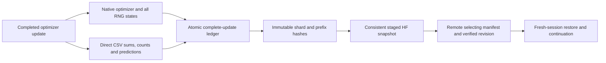

# Evidence retention — planned fields and actual local records

<!-- NB24_COMPLETION -->
## Actual execution update — 2 November 2026

NB24 completed the original one-seed fit and review. Original selected=None and
all source/contract identities are preserved. [Completion](../../phase3NB24Completion.md)
and [illustrated findings](../../phase3TreadTwoTRACEFindings.md) supersede pending
execution statements below. No rerun or new fit is required for this cycle.
<!-- END_NB24_COMPLETION -->

<!-- TRACE_BATCH_SUCCESSOR -->
## Executable successor delivered

**2 November 2026:** this file retains the original design-stage record. The
separate [TRACE notebook batch](../../phase3TreadTwoTRACEBatch.md) is now implemented
with NB21–NB24,671 executable fields and local acceptance. Use NB24 for automatic
preparation→gates→pilot→review. Actual Kaggle/HF and measured results remain
pending; the original prototype/code/check receipts remain unchanged.
<!-- END_TRACE_BATCH_SUCCESSOR -->

**Standing priority:** retain more useful evidence from the existing data and
publish tables directly as CSV on Hugging Face. Do not hide them in ZIP, NPZ,
SQLite or checkpoint-only history. More rows/views are not additional tyres.

## Delivered at this design stage

| Record | Actual scope | Location |
|---|---|---|
| Full target cells | 197,632 rows; six raw channel values and count per cell | Local `validation/actual_train/target_cells.csv`, excluded from Git |
| Exact native targets / weights | 1,185,792 FP32 values plus full weights | Local `validation/actual_train/*.npy`, excluded from Git |
| Source registry | 386 train image SHAs, roles, components, source sample IDs, coverage and seeds | [CSV](../trace_report/target_registry.csv) |
| Normalisation | Six train-only mean/std/count records | [CSV](../trace_report/normalization.csv) |
| Control losses | 1,158 image×control records, common coverage, sums/counts and mean losses | [CSV](../trace_report/control_losses.csv) |
| Original saved inputs | 273 source objects individually size/SHA checked | [CSV](../trace_report/saved_inputs_verified.csv) |
| Descriptor-space diagnosis | 12 version/space/centering combinations | [CSV](../trace_report/target_spaces.csv) |
| Synthetic fixture updates | Current run: 12 actual disposable updates, all five loss terms, gradient norms and availability | [CSV](validation/FIXTURE_UPDATES.csv) |
| Checks and provenance | Numeric, geometry, original source identity and local handoff | [Validation](validation/) |
| Visuals | Four existing train images and six observed descriptor maps | [Explorer](../trace_report/TRACE_Design_Explorer.html) / [figure](../trace_report/figures/TRACE_Fixed_Targets.png) |

These **new design records are local, not yet published to HF**. This stage does
not access local tokens, alternative credential files or remote write APIs. The
future Kaggle preparation publication must carry the full constructions, not
only their compact local summaries. Earlier GEO evidence is already HF-verified.

## Draft measured-run schema

[SCHEMAS.json](SCHEMAS.json) declares **48 planned CSV families** with grains,
frequency and typed fields. It is a specification, not a claim that 48 runtime
writers or measured tables already exist. Every planned family must be matched
to an exercised writer before the fit notebook is delivered. JSON can hold
configuration/manifests alongside CSV; native PT/NPY hold exact recovery/tensors.

| Area | Required detail |
|---|---|
| Data/geometry | All original SHA/roles/components, selected-vs-unselected provenance, row coordinates, support and ignore-policy hashes |
| Target construction | Full clean maps once for all declared roles, counts, normalisation inputs/counts, position controls, formulas/source hashes and failures |
| Every view | Source/update/epoch, view and mask seeds, appearance factors, hidden tile IDs, support, losses/counts, embeddings, target/native pointers |
| Every update | All objective terms and coefficients, pre/post clipping norms, finite checks, source order, padding, eligible counts, optimizer and transactional state hash |
| Every epoch | Full weights, source exposure, local/masked/control scores, geometry sentinels, all spectra and selection rejection reasons |
| Per component/role | Cohort counts, within/between decomposition, native encoder/context/moment/projector diversity and missingness |
| Endpoints/probes | Selected/final distinction, full local/context tokens, spatial reconstructions, control comparisons, retrieval permissions and probe plans |
| Resources | Actual staging bytes, free space, host RSS, torch allocated/reserved **and reset peak** counters on each GPU, durations and sampling scope |
| Transport | Attempts/status/delay/bytes/last verified revision; final upload receipt and explicit unsent-event boundary |
| Failures | Nonfinite events, invalid support, exceptions, stop handling, retry budget, repair/source revision and unavailable records |

## Storage calculation before implementation

Use the fixed small target maps once. Saving both views' complete input contrast
tensors at every update would cost about **98.65 GB for training alone**, before
CSV/native outputs, so this is explicitly outside the 20 GB plan. Exact source
photos, frozen geometry, photometric/mask seeds and preprocessing hashes allow
reconstruction; the construction is retained once and hash-bound.

| Native body, training views only | Count | Raw FP32 bytes |
|---|---:|---:|
| Local predictions | 47,040×32×6×4×4 | 578,027,520 |
| Masked predictions | Same | 578,027,520 |
| Local tokens | 47,040×32×48 | 289,013,760 |
| Full-context tokens | Same | 289,013,760 |
| Masked-context tokens | Same | 289,013,760 |
| Spatial-moment vectors | 47,040×240 | 45,158,400 |

Validation/baseline/endpoints/probes, CSV text, duplicate native recovery slots,
the geometry input, all epoch weights, indexes and staging must be added. The
actual writer fixture must measure total row widths and every family; do not
extrapolate only the compact native body. Draft ceilings remain **15 GB logical /
18 GB projected peak**, with at least **2 GB free reserve** in the assumed 20 GB
area. Fail before long fitting if full retention does not fit; do not silently
sample/drop promised families. [BUDGET.json](BUDGET.json) records the draft math.

For FP32 predictions, nine significant digits can round-trip finite binary32;
the eventual CSV writer must prove exact native↔CSV reconstruction. Keep FP64
statistics with sufficient precision separately. Do not apply display rounding
to machine evidence.

## Native/CSV recovery and verification

Native arrays use direct uncompressed NPY shards with indexed dtype/shape/IDs;
PT stores optimizer/recovery state and native weights directly. Keep all epoch
weights and two rolling complete-state slots, with ledger and committed byte
prefixes. Historical full optimizer snapshots are not all permanently retained;
record that distinction instead of claiming every historical step is fully
reconstructable from an overwritten rolling slot.

Retain all computed model predictions/loss sufficient statistics at their
declared grain. True within-step GPU peaks require explicit peak resets and
reads; sampled counters alone must never be labelled true peaks. Final transport
events occurring after the selecting commit need a bounded audit receipt in a
follow-up administrative publication, with no recursive promise to store an
event about its own final upload forever.

Current prototypes do not implement this transaction/publication system. CPU
RNG/optimizer fixture equivalence does not prove truncation safety, remote
continuation, hard-kill recovery or GPU reproducibility. These remain hard
engineering deliverables before a measured run.
