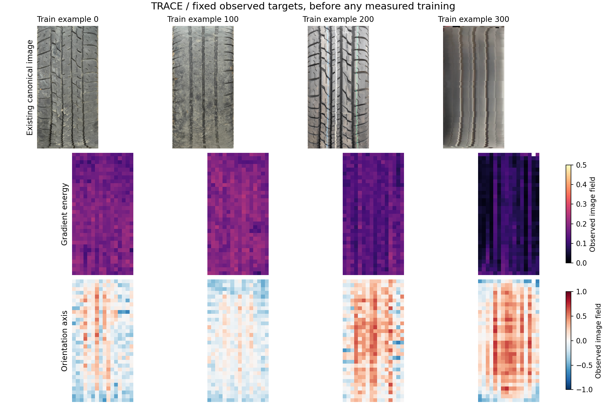

# TRACE design findings — local engineering, not trained performance

<!-- NB24_COMPLETION -->
## Actual execution update — 2 November 2026

NB24 completed the original one-seed fit and review. Original selected=None and
all source/contract identities are preserved. [Completion](../../phase3NB24Completion.md)
and [illustrated findings](../../phase3TreadTwoTRACEFindings.md) supersede pending
execution statements below. No rerun or new fit is required for this cycle.
<!-- END_NB24_COMPLETION -->

<!-- TRACE_BATCH_SUCCESSOR -->
## Executable successor delivered

**2 November 2026:** this file retains the original design-stage record. The
separate [TRACE notebook batch](../../phase3TreadTwoTRACEBatch.md) is now implemented
with NB21–NB24,671 executable fields and local acceptance. Use NB24 for automatic
preparation→gates→pilot→review. Actual Kaggle/HF and measured results remain
pending; the original prototype/code/check receipts remain unchanged.
<!-- END_TRACE_BATCH_SUCCESSOR -->

**2 November 2026.** The next design has four implemented prototype modules and
an actual all-training-photo target audit. The new measured fit, Kaggle notebook
batch, full telemetry writers and live dual-T4/HF gates are not yet implemented
or run. [Delivery plan](DELIVERY_PLAN.md) · [status](STATUS.json).

## Actual evidence

| Check | Result | Proof |
|---|---|---|
| Existing train scope | 386 unique images / 6 conservative components; no held-out photo reads | [Target audit](validation/ACTUAL_TARGETS.json) |
| Target construction | 197,632 cells / 1,185,792 values; 197,201 supported cells | Full CSV/NPY maps retained locally; hashes in audit |
| Source integrity | All 386 image SHAs and 386 ignore masks checked; 273 saved geometry/table objects size/SHA checked | [Input inventory](../trace_report/saved_inputs_verified.csv) |
| Numerical target reduction | NumPy FP64 cell reduction vs FP32 implementation maximum absolute difference **3.56e-07** | [Numeric proof](validation/NUMERICAL.json) |
| Loss arithmetic | Per-image sufficient-statistic reconstruction difference **2.44e-08** | Same proof |
| Leakage | Hidden-pixel perturbation leaves masked predictions bit-exact; ignore masks never enter student features | Same proof |
| Rank feasibility | 8×6 identity sample covariance witness; fewer than7 eligible rows disables diversity | Same proof |
| Spatial information | Explicit moment pooling responds to row and column reversal | Same proof |
| Gradients | Every new parameter has connected finite gradient | 71,022 new parameters |
| CPU native continuation | Exact model/optimizer/RNG/cursor/history at synthetic update 3→6 | 12 actual disposable updates in current fixture; [CSV](validation/FIXTURE_UPDATES.csv) |
| Frozen geometry | Original CPU logits/masks/points bit-exact for 2 train images; parent train cannot unfreeze; all state unchanged | [Geometry proof](validation/GEOMETRY.json), 4 image forwards in this fixture |
| New study / HF publication | No measured candidate, new photos, remote write, local token lookup or workstation change | Scope remains design/engineering |

CPU continuation is not a test of the future transactional store, dual-CUDA RNG,
remote state restoration or GPU numerical determinism. It validates these
prototype modules and a native optimizer/state round trip only.

## The failed first descriptor draft is preserved

The initial v0 used contrast, absolute gradients, squared gradients and their
cross-product. Its six image-average target coordinates have rank **1.329425**,
with **93.4932%** of variation in the leading direction. The revised v2 adds
stabilised orientation, relative curvature and occupancy, with rank **1.458123**
and **91.6687%** leading variance. This is still low; it is not a collapse fix or
a model improvement. Original v0 code, maps, audit and numerical receipt remain
locally in `validation/actual_train_v0/`; the compact [space comparison](../trace_report/target_spaces.csv)
keeps its findings visible in Git.

| Current v2 target space | Effective rank | Leading share | Meaning |
|---|---:|---:|---|
| Six whole-image means | 1.458123 | 91.6687% | Strong common intensity/energy variation remains |
| Mean spatial cells,96D | 2.046700 | 86.3167% | Spatial averaging still discards much variation |
| Full common spatial cells,2,568D | 15.656767 | 48.0424% | Keep local maps and position-sensitive representation |
| Full common spatial,within-component centred | 19.853732 | 46.8627% | Descriptive redistribution after centering, not new subjects |

Only cells observed in **all 386** train images enter the full-spatial comparison;
missingness is not treated as visual variation. Different dimensions/centering
answer different questions. No held-out feature transform is fitted. The v2
choice adds interpretable image structure; it does not improve every rank metric
over v0 (v0 full-spatial rank was 16.463679).

The architecture therefore supervises full tile/cell maps, keeps the native
local tokens and adds fixed row/column moments. No whitening makes targets look
artificially diverse. Encoder, context and projector all need separate future
checks; a well-spread final projector alone cannot establish useful learning.

## Controls are already strong on training images

One fixed mask plan/image; same common hidden cells for all three controls.
Numbers below are **train-only descriptive image means**, not leave-one-out
control validation, a trained-model result or checkpoint eligibility.

| Control | Images | Image-mean standardised Huber | Minimum common coverage |
|---|---:|---:|---:|
| channel_mean | 386 | 0.745211 | 100.000000% |
| position_mean | 386 | 0.676516 | 100.000000% |
| visible_band_mean | 386 | 0.616960 | 100.000000% |

The visible-band control shows why beating only a constant mean would be weak
evidence. The future candidate must beat all three controls on identical
validation cells and retain coverage/missingness.

## Engineering issues caught and corrected

| Issue in the new prototype/audit | Correction | Verification |
|---|---|---|
| First gradient-energy fields strongly correlated | Keep history; add orientation/curvature/occupancy; preserve full spatial maps | All 386 train images, both target versions, no held-out fitting |
| Global averages discard local arrangement | Fixed five-basis spatial moments and axial full context | Row/column reversal fixture |
| Valid batch can shrink below seven rows | Explicitly unavailable variance/covariance terms, logged eligibility | Six-row disabled/seven-row enabled tests |
| FP32 pooling differed from independent FP64 cell sums by a few1e−7 | Bound this FP32-vs-FP64 comparison at1e−6 and report actual error | Max3.565e−7; no data/value replacement |
| Per-image geometry adapters changed batch reduction arithmetic | Preserve original anchor-microbatch then concatenated-adapter execution | Exact original CPU output comparison passes |
| Old local dataset helper default points outside this root | Pass the existing dataset path explicitly in the new fixture | No completed helper/source changed |

## Visual evidence and next work

[Open the interactive six-channel explorer](../trace_report/TRACE_Design_Explorer.html).
Four examples use fixed training-source positions 0/100/200/300. They are observed
descriptor maps, not neural predictions or selected best examples.

Next implement the data/target cache, deterministic scheduler, transaction store
and 48 planned CSV families, then the actual storage/dual-T4/HF gates and complete
automatic notebook batch. The current user does not need to rerun an older
notebook. All new design evidence is local; direct HF publication belongs to
the future Kaggle preparation stage using only its HF_TOKEN Secret.
