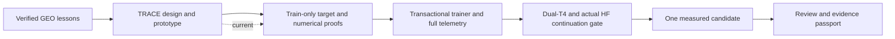

# TREAD-TWO / TRACE — design and numerical prototype

<!-- NB24_COMPLETION -->
## Actual execution update — 2 November 2026

NB24 completed the original one-seed fit and review. Original selected=None and
all source/contract identities are preserved. [Completion](../../phase3NB24Completion.md)
and [illustrated findings](../../phase3TreadTwoTRACEFindings.md) supersede pending
execution statements below. No rerun or new fit is required for this cycle.
<!-- END_NB24_COMPLETION -->

<!-- TRACE_BATCH_SUCCESSOR -->
## Executable successor delivered

**2 November 2026:** this file retains the original design-stage record. The
separate [TRACE notebook batch](../../phase3TreadTwoTRACEBatch.md) is now implemented
with NB21–NB24,671 executable fields and local acceptance. Use NB24 for automatic
preparation→gates→pilot→review. Actual Kaggle/HF and measured results remain
pending; the original prototype/code/check receipts remain unchanged.
<!-- END_TRACE_BATCH_SUCCESSOR -->

**2 November 2026. Status: implemented design prototype, locally checked; no
measured candidate or Kaggle training delivery yet.** The user authorised this
next design after NB20. TRACE means **Texture Reconstruction with Anchored
Canonical Evidence**. It is a separate texture research revision, not a renamed
or promoted GEO checkpoint.

| Read | Purpose |
|---|---|
| [Design](DESIGN.md) | Observations, architecture, parameter ownership and outputs |
| [Target mathematics](TARGETS.md) | Exact six fields, masking boundaries, normalisation and controls |
| [Experiment draft](EXPERIMENT.md) | One candidate, roles, eligibility and interpretation |
| [Evidence plan](EVIDENCE.md) | Planned CSV/native retention, reconstruction and explicit gaps |
| [Operations](OPERATIONS.md) | Kaggle resources, publication, recovery and troubleshooting contract |
| [Delivery plan](DELIVERY_PLAN.md) | Dependencies and proposed automatic notebook batch |
| [Local findings](FINDINGS.md) | Actual train-only audit and synthetic checks; no accuracy claim |
| [Implementation status](STATUS.json) | Machine-readable delivered/pending distinction |
| [Interactive explorer](../trace_report/TRACE_Design_Explorer.html) | Four existing training images and all six fixed target maps |

The four modules in [runtime](runtime/) implement fixed descriptors, the new
texture branch, loss arithmetic and an explicitly frozen geometry wrapper. They
are prototype components, not a transactional training service. Source identities
and baseline preservation are recorded in [delivery proof](validation/DELIVERY.json).

No new photos, held-out target fitting, workstation changes or remote writes took
place. Large local target constructions remain local until the future Kaggle
preparation stage publishes them directly. Do not run an old completed notebook
to test TRACE. All justified future notebooks will be delivered together with a
sequential Run All master; planned notebook filenames are not runnable deliveries.
