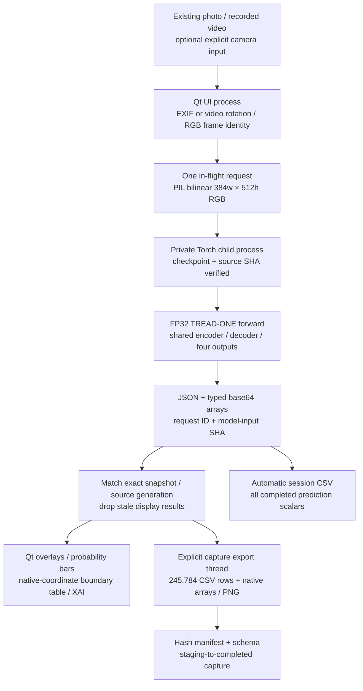

# Phase 3 workstation — implementation and isolation

## Unified window

`workspace.py` hosts the existing TREAD-ONE page and lazily mounts the
original multi-model station as a second native Qt page. `legacy_bench.py`
resolves the original flat imports in a separate namespace so its `engine`,
`theme` and `bootstrap` identities cannot replace Phase 3's modules. Qt
stays owned by Phase 3. Original model loaders and checkpoints are read in
place. The bench's writable root and video-export child are private to
`workstation/data/model_bench/`.

Both tabs expose the same calibrated alignment dialog. TREAD-ONE supplies its
native RGB and, for supporting image geometry, its thresholded tyre/tread masks.
The dialog reads oriented images without importing the legacy model engine.
The UI selects the original workstation's NumPy/OpenCV dependencies before
either tab imports them, keeping alignment and later Model bench startup
compatible in the Windows process.

Frame handoff transfers RGB and source time. Each tab keeps its own model
preprocessing, prediction state, and evidence format. The historical
TREAD-ONE processing contract below still applies to its tab.

**29 October 2026.** A separate inference application under `phase3/workstation/`.
No training/runtime source, original workstation source, selected-model registry
or earlier executed notebook is replaced.

## Process and data flow

| Source | Responsibility |
|---|---|
| `app.py` | Window, source/media controls, exact-snapshot display, UI readouts, capture restore and shutdown |
| `theme.py`, `widgets.py` | Independent dark/teal identity, per-process fonts/icon, zoom/pan/wipe canvas and class bars |
| `bootstrap.py`, `paths.py` | Private Qt/plugin/cache paths; local state; no original-app bootstrap import |
| `media.py` | Owned OpenCV source, tagged rotation, play/pause/seek and derived frame timestamps |
| `bridge.py` | Qt supervision of one owned worker; bounded requests; capture export off the GUI thread |
| `worker.py` | Strict one-request/one-result JSON protocol; no UI, HF, dataset labels or optimizer |
| `engine.py` | Checkpoint/source verification, strict state loading, faithful preprocessing and model decoding |
| `imaging.py` | RGB preparation, safe typed array transport, native coordinate display and seven render modes |
| `records.py`, `schema.py` | Durable direct CSV, full native capture, field/grid definitions, hashes and restore checks |
| `models/tread_one_r1.py` | Exact copied frozen model source; no architectural changes |
| `models/MODEL.json`, `models/weights.pt` | Declared selected model identity and 5,525,189-byte state dictionary |

TREAD-ONE inference stays in its child process. The worker inherits the
activated cv_conda interpreter and loads only the pinned TREAD-ONE checkpoint.
Windows starts the child without another console window. The embedded model
bench loads Torch lazily in the Qt process and retains the original inference
thread and independent export process. Device switching in TREAD-ONE restarts
only its owned worker.

## Model identity

| Field | Fixed value |
|---|---|
| Architecture | TREAD-ONE r1, 1,372,159 trainable parameters in the completed study |
| Selection | Original declared joint-validation winner, seed 3 / epoch 20 |
| Weights SHA-256 | `a5b872ed2e4cbfb3b9782b0df563e2606631744cd0274fee2da42a832f985f65` |
| HF source revision | `a0296f18e02b12d28f7e51377783d68538032209` |
| Training protocol | `371c40c0c6aaedaf5c5970f7721a284b042494db7bb330065f6cbde8fc3a0b8c` |
| Load | Hash verification before `torch.load(..., weights_only=True)`; strict state-dictionary match |
| Precision | FP32, no autocast, CUDA matmul/cuDNN TF32 disabled |
| CPU threads | At most four Torch intra-op threads |
| Network | No inference-time download, token lookup or publication |

The preparation step copied existing verified local files and existing Qt
bindings. It did not install packages or change cv_conda. The private Qt copy
is approximately 185.8 MiB. Native fonts are registered from the existing OS
font files for this process only; they are not installed or redistributed.
A separate Windows taskbar application ID/icon distinguishes this window.

## Preprocessing and coordinates

1. Photos are decoded as RGB with EXIF orientation applied; the source file
   SHA and orientation action are recorded. Existing study examples have their
   recorded byte hashes checked before use.
2. Video rotation metadata is applied once. The frame itself has an RGB SHA;
   full video-file bytes are not hashed during live playback, and that gap is
   explicit in metadata.
3. A direct PIL bilinear resize produces width 384 × height 512. No automatic
   crop, truth-mask gate, background removal or new augmentation is introduced.
4. RGB uint8 becomes FP32 CHW / 255, then mean `[.485,.456,.406]`, standard
   deviation `[.229,.224,.225]`. Fixed guide fractions are
   `[384/1535,768/1535,1151/1535]`.
5. The model returns 128×96 masks/logits, evidence, concepts and normalized
   tread gate; six x-coordinate fractions; three guide fractions; class scores.

Mask probabilities are thresholded at **≥0.5**, repeated four times on both
axes exactly as in frozen reporting, then nearest-resized for native display.
Boxes are enclosing mask boxes, not a separate detector. They use zero-based
native x/y and exclusive right/bottom bounds. Empty masks produce missing boxes.
Point x and guide y fractions map using `x*(width-1)` and `y*(height-1)`.
The displayed canvas is bounded to 1,100 pixels on its long side; full oriented
source pixels and native coordinates are retained in captures.

Arbitrary image aspect ratios are directly resized by the declared model
recipe. The interface preserves native aspect ratio for viewing and maps
predictions back. It does not claim a new aspect-ratio validation study.

## Evidence accounting

For each class c, the signed quarter-grid contribution E has
`logit[c] = bias[c] + sum(E[c,:,:])`. The worker rejects a reconstruction
residual over 1e-5. The display reports positive mass, negative mass and bias
separately. Heat colours use per-view maximum-absolute normalization; colour
brightness is not a calibrated probability or cross-class absolute scale.
Texture channels are learned latent features, not named damage concepts.

No model is rerun when toggling a mask, comparing a wipe, switching evidence
class or viewing a texture channel. Those operations render the retained arrays.
The encoder/transformer have wide receptive fields; exact evidence-layer
accounting does not establish independent causal input pixels.

## Frame identity and storage boundaries

The UI holds the native RGB snapshot and metadata for each request. The worker
returns its request ID and model-input RGB SHA. Only a matching request/input
can be displayed. If another source is opened meanwhile, the old completed
prediction is logged but its overlay is discarded. The feed preview and
analysed snapshot have separate roles/timestamps; results are never painted
over a later unanalysed frame.

There is at most one in-flight inference; live requests are attempted every
700 ms and skip busy intervals. Full arrays are not automatically accumulated
for every decoded frame. Capture export has a separate thread, an explicit
`.partial` stage and a checksummed completed folder. The UI waits for an active
save on close. The session CSV is flushed/fsynced after each accepted completed
prediction group. Forced process death cannot save unsent/in-memory work.

Restore checks file confinement, total declared size, all SHA-256 values, RGB
frame identity, native no-pickle arrays and checkpoint identity. Restoring a
capture does not call the model. Earlier prediction notes/arrays remain intact.

The independent UI has no original multi-model comparison/calibrated-target
alignment engine. Those remain available in the original workstation. This
application exposes the actual TREAD-ONE heads and image-space geometry.
