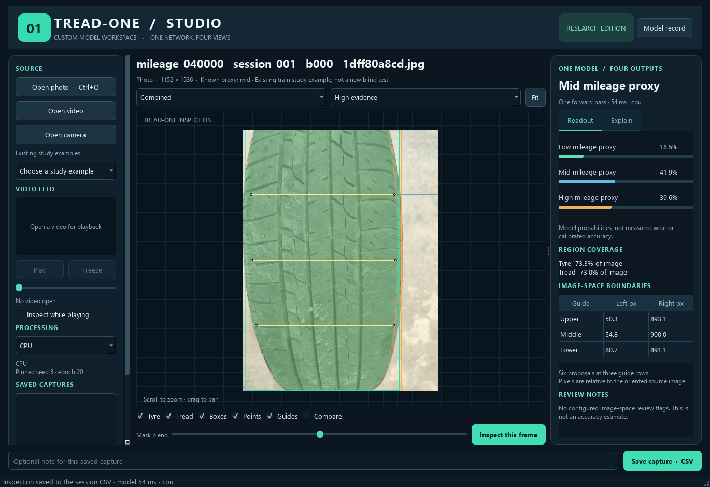

# TREAD-ONE Studio — separate desktop workstation

**29 October 2026. Existing data only.** This is the custom TREAD-ONE model's
own native Windows window. It has its own model, Qt bindings, cache, sessions
and evidence captures. The original `prototype/` workstation remains unchanged.

## Open the app

Double-click **[Launch TREAD-ONE Studio.cmd](Launch%20TREAD-ONE%20Studio.cmd)**.
It activates `cv_conda`, opens this application and loads a labelled existing
training example. The example is demonstration input, not a new blind test.
No Kaggle notebook, HF secret, download or retraining is needed.

For terminal use from the project root:

```powershell
.\phase3\run_cv.cmd -B phase3\workstation\app.py --example
```

Choose CPU explicitly if needed:

```powershell
.\phase3\run_cv.cmd -B phase3\workstation\app.py --device cpu --example
```

The first model load may take a few seconds. The device status changes from
loading to the actual CPU/GPU name. The original workstation can remain open;
closing this window stops only this app's reader and inference child process.



## Inspect an existing image

1. Use **Open photo**, drag an image into the window, or choose an **Existing
   study example**. The example selector includes the first available original
   photo for each nonempty historical split/class combination.
2. Select **Inspect this frame**. Classification, overlapping masks, boundary
   points and signed evidence come from one forward pass through one model.
3. Switch between Combined, Masks, Boundaries, Signed evidence, Tread attention,
   Texture channel and Original. Changing a view does not run the model again.
4. Use layer toggles, mask blend, zoom/pan and **Compare** to inspect the result.
   **Fit** resets the viewport. Choose an evidence class or one of 12 texture
   channels for those views. The **Explain** tab shows the separate bias and
   signed spatial contributions.
5. Add an optional note and select **Save capture + CSV** for the full portable
   result. Double-click a saved capture to restore it without inference.

The user has ruled out further tyre-photo collection. Existing examples,
photos and recorded videos remain usable. The camera button is optional live
inspection and opens a device only on an explicit click; camera hardware was
not tested and is not a new training-data acquisition plan.

## Inspect an existing video

**Open video** decodes the first frame. **Play/Pause** affects the small feed
preview; **Freeze** selects the current decoded frame for inspection. Seek
with the slider, freeze, then inspect. **Inspect while playing** requests a
snapshot at most once every 700 ms, with at most one inference in flight.

The main inspection canvas always shows the exact analysed snapshot. It never
draws old masks over a different live frame. Its caption identifies the analysed
frame time; the small feed preview may be ahead. Rotation metadata is applied
once. Untagged landscape inputs are not silently rotated/cropped. Recorded
timestamps are frame index divided by reported FPS, explicitly labelled as such.

## What gets saved

| Location | Contents |
|---|---|
| `data/sessions/<session>/` | Automatic prediction, class, point, region, latent-mass and event CSVs; session identity JSON |
| `data/captures/<capture>/` | Explicit full capture: **10 direct CSV tables / 245,784 rows**, ten native NPY arrays, five PNGs, schema/metadata/hash manifest |
| `.cache/` | This app's inference-worker/UI error logs |
| `models/` | Private pinned checkpoint, exact model implementation and model record |
| `.vendor/` | Private copy of the already installed Qt bindings; no environment upgrade |

Live inference saves compact scalar records automatically. Full quarter-grid
arrays/CSV are retained when **Save capture + CSV** is selected. This avoids
silently accumulating hundreds of thousands of rows for every video frame.
Captures finish in a staging directory before being marked complete. A failed
save retains a `.partial` folder and displays an error; it is not listed as a
completed capture. Shutdown waits for an active capture export.

Desktop records are **local**. Training/audit results remain on HF. This app
does not read credentials or upload source media automatically. CSV/native
files can be retained for a separately authorized direct-file publication.
No new ZIP, NPZ, database or hidden checkpoint-only metric bundle is created.

## Model and interpretation

The installed model is the **declared r1 validation winner: seed 3, epoch 20**,
with 1,372,159 parameters. It uses RGB PIL bilinear direct resize to 384×512,
ImageNet normalization and the frozen default guide rows. Desktop inference
uses FP32 with TF32 disabled. Its outputs are faithfully preserved; the UI
does not swap in the NB05 projected candidate or choose another test checkpoint.

The model record shows the current evidence: 50% selected balanced accuracy,
98.419% mean Dice and 1.196% image-width human-point error on the small existing
low/high holdout. Every selected r1 model missed the low test tyre. These are
historical study results, not fresh accuracy estimates for an opened image.
The interface labels classes as **mileage proxies** and probabilities as model
scores. Boundaries are image-space proposals. It does not report predicted
physical wear/depth, safety or camber/toe.

## Troubleshooting

| Symptom | Action |
|---|---|
| Existing Conda hook emits OpenCL/temp warnings | The documented wrapper is used; a ready model status confirms successful startup. Do not reinstall the working environment |
| GPU unavailable/model cannot initialize | Choose CPU from the device selector; inspect `.cache/inference-worker.log` |
| A checkpoint checksum differs | Preserve files and restore the pinned package using the recorded preparation process; do not load an arbitrary checkpoint |
| No study examples in a copied app folder | Open an existing photo/video; the example list is optional and depends on the existing local dataset |
| Video codec unsupported | Preserve the original; use a supported existing recording/codec or inspect already extracted frames |
| Capture checksum fails on restore | Preserve the damaged capture; the app refuses mixed/corrupt evidence rather than silently reading it |
| No accuracy/Dice/error for a photo | Expected: workstation inference does not use reference masks/points; those CSV fields stay blank |

[Technical architecture](ARCHITECTURE.md) · [Evidence definitions](EVIDENCE_SCHEMA.md) ·
[Project integration and validation](../phase3TreadOneWorkstation.md).
